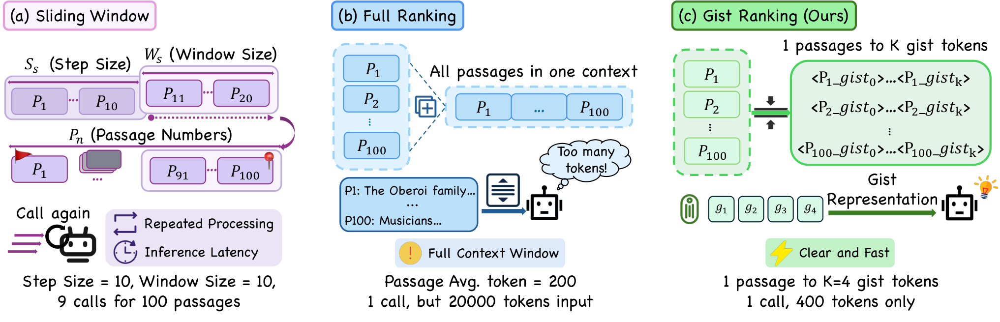
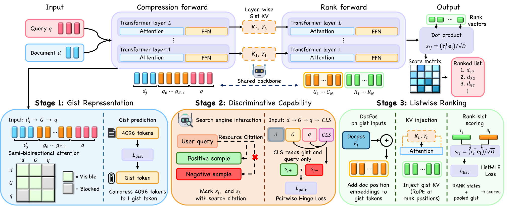
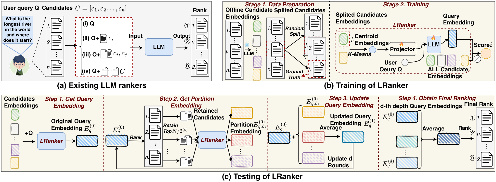

## 总览
今天这两篇放在一起看挺有意思，都是在给「LLM 当排序器太贵」这件事找出路，但一个走压缩、一个走解耦，方向几乎相反。[GistRank](#note-1) 的思路更讨巧：先把每篇候选压成几个 gist token，再用三段训练把「压缩」和「判别」分开练，消融里去掉 pairwise 那一段直接掉两个多分，说明这俩能力确实不能混为一谈；它的问题是那个 14 倍加速其实靠 batched 压缩加非自回归打分堆出来的，FLOPs 反而更高，1.6 秒的 P50 对线上搜索依然偏慢，更适合塞进近线或异步重排。[LRanker](#note-2) 则干脆把 LLM 排序拉回双塔，候选侧离线缓存、prompt 长度和模型前向次数不随候选数涨，扩到千万级衰减曲线比 Tiger 平得多，这个工程价值是实的；但那个名字唬人的 test-time scaling 本质就是 query 向量的多视图集成，而且百万级任务绝对 MRR 还在 1% 以下，也没跟真正的召回粗排精排级联做端到端对比。两篇的共同短板一样明显：全是离线 benchmark，没有线上 A/B，也没有显著性检验，读的时候把结论打七折比较稳妥。如果时间有限，优先精读 [GistRank](#note-1) 的训练设计和消融部分，再看 [LRanker](#note-2) 的解耦分析和规模化衰减曲线，这两块是今天最值得抄作业的地方。
## 论文列表

### 1. GistRank: Gist-Compressed Listwise Ranking with Large Language Models
- 论文链接：[AlphaXiv](https://alphaxiv.org/abs/2610.39610v1)
- 更新时间：2026-10-29 08:43 UTC
- 机构：未披露机构
- 工业优先级：中

**每条压成4个token，排序反而快14倍**

各位算法同学们，一个100条候选的排序请求，全文本塞进prompt就是两万token，而把每条passage压成4个gist token后只剩400token，端到端快了14倍——之前大家都觉得软压缩必然掉点，这篇的结论是：掉点不是压缩本身的锅，是训练目标没跟排序对齐。

📄 GistRank: Gist-Compressed Listwise Ranking with Large Language Models

🔧 先修注意力：vanilla gist用严格因果编码，gist token对原文的吸收不充分，改成半双向注意力后，gist能更完整地看到整段passage，为后面的判别打底。

🧩 三阶段训练把“压缩”和“排序”缝起来：第一阶段只让模型靠gist预测后续token，学忠实表示；第二阶段原文隐藏、只留gist，用真实搜索交互数据做pairwise训练，逼出区分相近候选的能力；第三阶段才切到listwise目标，学直接输出排列。

⚙️ 推理时把gist位置的KV cache直接当压缩状态喂给rank阶段，不再重编码原文，候选内容长度从Σ|x(pj)|降到N×K。

📊 TREC DL19/20加五个BEIR子集，平均nDCG@10做到59.17，距最强全上下文基线只差0.89。

📈 端到端P50延迟DL19是1625ms、DL20是1634ms，相对one-shot全文本基线分别是14.05倍和13.93倍加速，这个数包含了压缩、KV组装和排序全流程。

✅ K固定为4，100条候选的passage部分从两万token压到400；分阶段测量显示rank forward只占约7%的模型时间，大头仍在候选压缩。

总结一下：做LLM reranker或RAG重排、延迟被卡住的团队可以跟，它比sliding window省掉了重叠块重复编码。但要盯两个指标：压缩阶段的耗时现在是真瓶颈，以及top几位的精细区分能力——平均只差0.89，可前几名排错在业务上更疼。坑在于第一阶段是重建式训练，换领域时gist的忠实度得重新验一遍；另外和蒸馏小模型比，要算上压缩这次前向的总账，别只看rank阶段。

### 2. LRanker: Scaling LLM Ranking to Millions of Candidates with Test-Time Scaling
- 论文链接：[AlphaXiv](https://alphaxiv.org/abs/2605.27810v2)
- 更新时间：2026-10-27 01:19 UTC
- 机构：未披露机构
- 工业优先级：中

**680万候选，LLM排序prompt不涨**

各位算法同学们，680万个候选丢进去，prompt长度居然不随候选数量增长——这篇LRanker的做法是把LLM排序从“把所有候选文本塞进上下文”改成“聚类摘要当软提示＋缓存向量内积”，试图证明全库直排不必依赖先召回、再硬性截断。

📄 LRanker: Scaling LLM Ranking to Millions of Candidates with Test-Time Scaling

🔧 候选信息不再进上下文：离线候选embedding先做K-means，质心经可学习projector投影成soft prompt喂给LLM，排序时只拿query embedding和缓存好的候选向量做内积，固定质心数K下prompt长度和LLM前向次数与候选规模解耦。

🧩 “测试时扩展”用在query表示上：不是加长推理链，也不是堆模型参数，而是按候选分区反复做切分、剪枝、聚合，得到多个partition-conditioned query embedding，最后把这些embedding的打分ensemble起来。

⚙️ 训练阶段随机采样候选子集来构造分区，让query表示对分区规模更鲁棒；架构上把“能排百万级”和“排得更准”两件事拆开，前者靠聚合编码＋缓存打分，后者靠测试时多轮计算。

📊 RBench-Large上相对最强基线的MRR提升：Rec-Movie 27.5%、Rec-Toy 3.9%、MS MARCO 0.9%、ESCI 8.9%。

📈 RBench-Small上Rec-Music提升26.7%，Routing-Balance提升6.1%。

✅ 680万候选的Rec-Clothing任务比Tiger高27.0%；消融显示候选聚合和test-time ensemble各有独立贡献。

总结：这套东西对候选池上百万、又想用LLM语义做全库直排的召回/粗排场景比较对口。两个坑要留意：一是本文报的是相对提升，MS MARCO只涨0.9%，说明纯文本检索类任务的收益并不普遍；二是论文没做端到端的retrieve-then-rerank级联对比，落地时建议同时盯MRR和额外推理轮次的延迟开销，先在自己候选规模上复现Rec-Clothing那一档，再决定测试时扩展开几轮。

