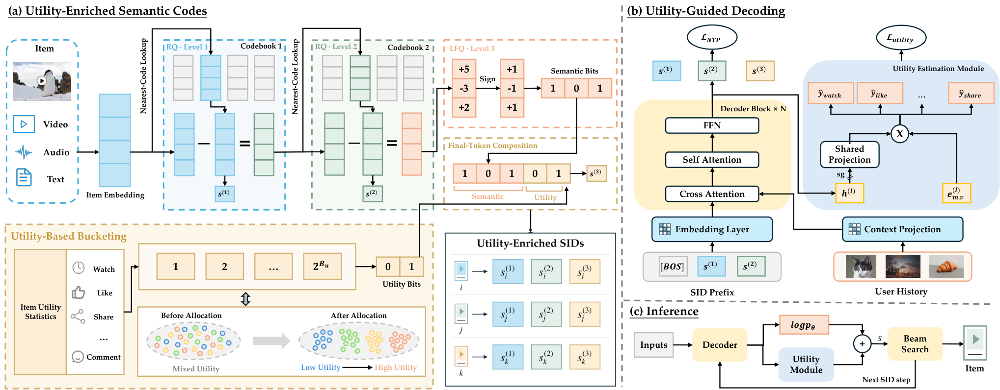
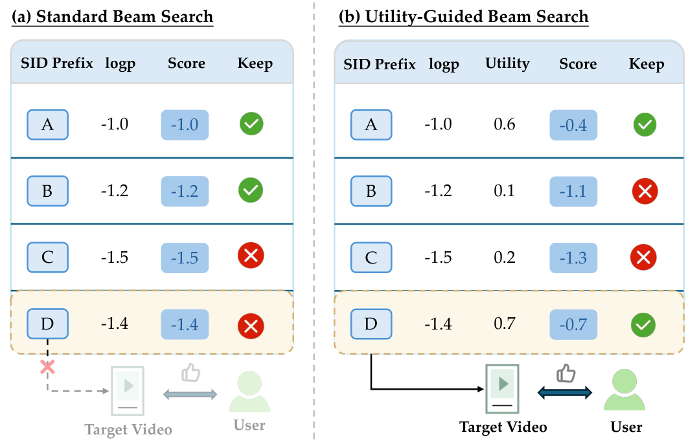
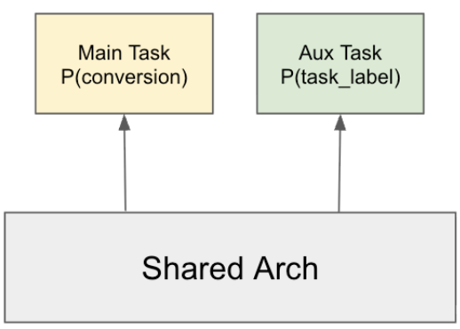
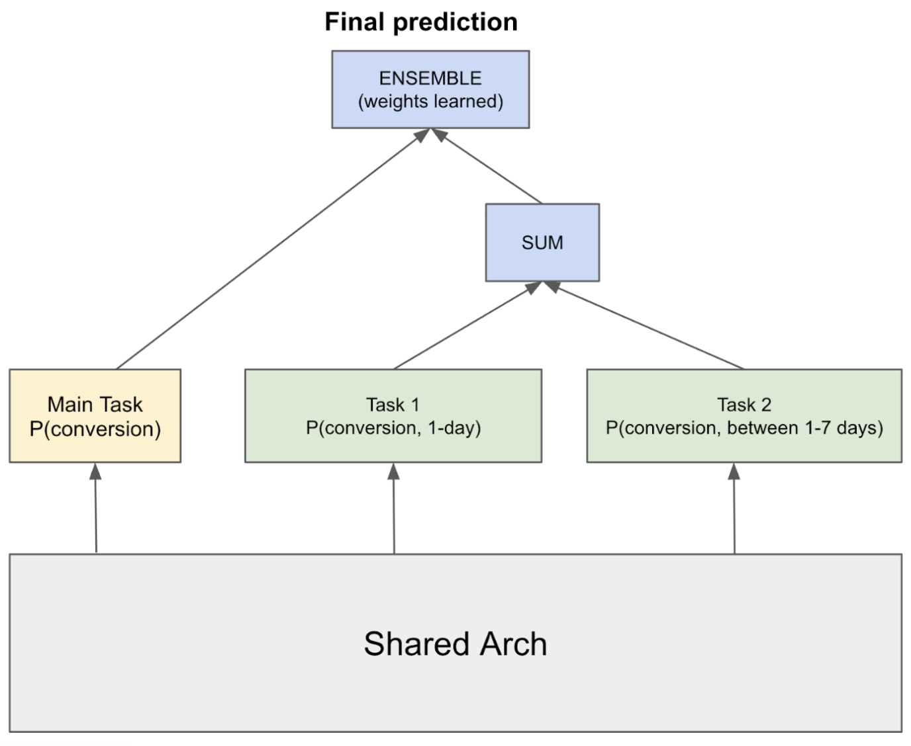
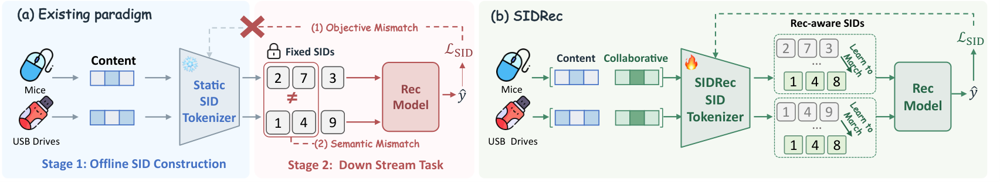

## 总览
今天这四篇整体偏工程落地，学术惊喜不多但干活的人会喜欢，主线很清楚：一条是生成式推荐的 ID 与解码怎么把效用信号塞进去，一条是工业界怎么用辅助监督和系统评测把老问题抠出边际收益。最值得细读的是快手那篇 [Utility](#note-1)-[Aware](#note-1) Generative Recommendation，它没换骨架，而是只在最后一层量化腾出几个 bit 装效用、再把效用分接进 beam 打分，改动小、约束清楚，还有线上 A/B 和 QPS 数据兜底，属于能直接抄思路的那种。第二梯队是 Meta 的辅助监督小结和蚂蚁那篇数值特征 embedding 横评，前者把 pCVR 稀疏正样本的几种补监督手段拆开单独量增益，结论小而实，但要记住那是单项增益不是可叠加的总账，线上也坦白归因不清；后者价值不在谁第一，而在告诉你换个数值尺度就有四成格子冠军换人、准确率和延迟还不同向，以后报预处理得跟 encoder 一起报。第四篇 [SIDRec](#note-4) 只看到标题和机构，端到端做语义 ID 表征与建模，跟第一篇正好同题对打，值得拿来对照读。今天优先看快手那篇和 [SIDRec](#note-4)，剩下两篇当工具箱翻翻就行。
## 论文列表

### 1. Utility-Aware Generative Recommendation: Utility-Enriched Semantic Codes and Utility-Guided Decoding
- 论文链接：[AlphaXiv](https://alphaxiv.org/abs/2611.02981v1)
- 更新时间：2026-11-02 11:48 UTC
- 机构：Kuaishou Technology
- 工业优先级：强

**生成概率高≠用户爱看？快手这套改了**

各位算法同学们，生成式推荐有个不太起眼的坑：beam search 剪枝看的是生成似然，但似然高的 item 不一定观看时长高，高收益的路径在中间解码步就被剪掉了，后面的重排再怎么救也救不回来。快手这篇 UAGR 就是冲着这个错位去的。

📄 Utility-Aware Generative Recommendation: Utility-Enriched Semantic Codes and Utility-Guided Decoding

🔧 UE-SID：最后一层 SID token 不纯讲语义了，用 LFQ 查表加把 item 级效用离散成 bit 写进去，SID 长度和词表大小都不涨；效用更新只动最后一层码本，不用重训语义量化器，也不用重跑 tokenization。

🧩 UGD：从解码中间态的 hidden state 预测完播、点赞、分享等多个后曝光目标，加权成一个可配置的效用分，和 logp 一起参与 beam 打分，让高效用前缀别在中间被剪掉。

⚙️ stop-gradient 隔离：效用模块的梯度不回传主干，生成能力不受干扰，线上调效用权重也不用动在线模型的训练。

📊 已在快手全量部署，线上 A/B 视频观看时长提升 0.206%。

📈 离线实验加真实流量 A/B 都验过有效性和可部署性，不是只在小数据集上跑通。

✅ 效用模块是插件式的，SID 长度、词表规模、序列解码成本都没增加。

我的判断：0.206% 放在快手这个量级是实打实的收益，但别把它当成能替代重排的万能方案——它解决的是“候选根本没进集合”的问题，不是“进了集合怎么排”。真要跟进的话盯两件事：效用 bit 的更新频率跟不跟得上信号漂移，以及 beam 里效用权重在多大范围内调参不掉点。多目标样本口径和冷启动 item 的效用估计是主要落地坑。

### 2. Improving Ads Ranking Models with Auxiliary Supervision: Techniques and Insights
- 论文链接：[AlphaXiv](https://alphaxiv.org/abs/2611.01280v1)
- 更新时间：2026-10-31 21:27 UTC
- 机构：未披露机构
- 工业优先级：中
- 备注：5 pages. Accepted to the IEEE ICDM International Workshop on AI for Personalization (WAIP 2026)

**CVR 太稀疏？给辅助标签挑挑精度**

各位算法同学们：辅助任务的标签不是越多越好，精度不够反而拖后腿——这篇里 F-Beta 的 β 一旦 ≥1（也就是开始偏袒覆盖率），离线 NE 就稳定变差，最优解落在 β=0.02，辅助标签精度做到 91%。做 CVR 的人应该会想看一眼它怎么定义"什么信号值得当辅助任务"。

📄 Improving Ads Ranking Models with Auxiliary Supervision: Techniques and Insights（ICDM WAIP 2026）

🔧 线性化标签：把 dwell time 这类连续/有序信号按 n 分位数切成 2 到 4 个桶，做成多分类任务，比二值标签粒度更细；也可以把"转化 / 停留>10s / HTML 加载完成"按预测力排成有序列表，取第一个命中的作为真类。分桶阈值不用统一，电商广告可以给大桶、线索类广告给小桶。

🧩 Split architecture：把 7 天窗口的 pCVR 拆成 0–1 天和 1–7 天两个互斥且完备的子任务，子任务预测之和在数学上就等于整体的 0–7 天 pCVR，再和主任务做 ensemble。另外缺失标签（比如没在浏览器打开的点击没有 dwell time）要用 gating 只在该信号可用的样本上训，别粗暴当负样本。

⚙️ LaCo 标签组合：多个辅助标签各自开任务会互相打架，于是用 F-Beta（相对主转化标签算 precision/recall）去搜 AND、OR、NOT OR、NOT AND、XOR 的组合，合成一个降噪的派生标签。每个模型 n≤10 个信号，穷举完全跑得动。

📊 基线 pCVR 的 NE = 0.54，越低越好，线性化标签、split architecture、LaCo 三者在离线 NE 上都比基线有改善。

📈 调 β 扫了 0.001 到 10，最优 β=0.02，对应辅助标签高精度（91%）、中等召回；思路是先保精度到 90% 左右，再在这个约束里尽量抬召回。

✅ 训练侧还试了 DivideMix 和 Tri-Training 这类抗噪训练法，其中 Tri-Training 在 pCVR 上继续带来 NE 改善。

总结感想：如果你的 CVR 模型正卡在标签稀疏、想加辅助任务但一加就掉点，这篇的排查顺序值得照抄——先看辅助标签相对主标签的 precision/recall，再决定要不要组合降噪。落地要盯的是 NE 和精度-覆盖率曲线，别只盯 AUC；坑在于 β 和分桶阈值都随数据分布变，得自己重扫，另外这套是在 Meta 体量上验证的，小数据量下辅助任务可能先学噪声。

### 3. Numerical Embeddings for CTR Prediction: A Taxonomy, Unified Benchmark, and Open-Source FuxiCTR Extension
- 论文链接：[AlphaXiv](https://alphaxiv.org/abs/2611.01090v1)
- 更新时间：2026-10-31 16:24 UTC
- 机构：Ant Group，Independent Researcher，Alibaba Inc.，Henan Polytechnic University
- 工业优先级：中
- 备注：5 pages

**CTR数值编码18种，谁真能打？🔍**

各位算法同学们，CTR 里数值特征怎么嵌入，几乎每篇方法论文都说自己涨点，但把 18 种编码器塞进同一个接口、跑满 2430 次对比，这事之前真没人系统做过，这篇把它补上了。

📄 Numerical Embeddings for CTR Prediction: A Taxonomy, Unified Benchmark, and Open-Source FuxiCTR Extension

🔧 分类维度换了：不看模型名，看“数值坐标怎么构造”，18 个配置归成六族——点投影、离散化、固定基、分段基、自适应坐标、分布或上下文自适应，比的是喂进 backbone 的数值表示本身
🧩 统一到 FuxiCTR 一个接口，所有编码器输出 16 维，共用 train-only z-score、同一套分阶段调参预算、同一批 seed，主榜 2430 次跑完再跑一遍只改输入尺度的原生尺度榜
⚙️ 统计量只在训练集拟合，配置冻结后才上测试，测试指标不参与选型，per-seed 结果和冻结配置全部开源，可以直接复现别人后续的编码器

📊 主榜 DEER 平均排名最好，3.41，27 个 dataset–backbone 格子里拿 14 个第一、19 个进前三；PLE-B 平均 5.30；Friedman 检验 χ²=157.04，p≈1e-24，说明方法间确实不是随机波动
📈 但它不是通杀：DEER 在 Criteo 的 9 个 backbone 赢 8 个，在 AutoML-E 的 9 个里只赢 1 个，六个方法各至少在某个格子里排第一，连最朴素的 Field 都赢过三个格子
✅ 把输入换成原生尺度、不重新调参，27 个格子里 11 个冠军换人，排行榜对预处理相当敏感
⚙️ 家族标签几乎不预示性能：同为分段基，PLE-B 平均 5.30，PLE-ReLU 掉到 12.48；自适应坐标里 NaryDis-Lite 13.44，DEER 3.41；配对延迟测量也显示精度和推理成本不必同向

选型时这篇能当基线清单用：先拿 DEER、PLE-B、Quantile 各跑一遍，但一定在自己的 backbone 和真实输入尺度上复测，别把 z-score 榜的结论直接搬到线上；看均值排名的同时盯 per-seed 方差和配对延迟，否则容易选出一个只在某个格子里强的编码器。坑也明确：只有三个数据集、维度固定 16、调参是限定预算的离散筛选，它给的是“哪个配置在什么组合下强”，不是“哪个家族更好”。

### 4. SIDRec: End-to-End Semantic ID Representation and Modeling for Recommendation
- 论文链接：[AlphaXiv](https://alphaxiv.org/abs/2611.01136v1)
- 更新时间：2026-10-31 17:27 UTC
- 机构：The Hong Kong Polytechnic University，University of Electronic Science and Technology of China，Southwest Jiaotong University，Kuaishou Technology
- 工业优先级：未标注

**语义ID一建好就冻住？这篇改成端到端🔧**

各位算法同学们，把 item 压成语义 ID，AUC 却追不平独立哈希 ID。这篇给的答案很直接：真正的问题出在内容语义和协同偏好、SID 构建和推荐目标这两处彼此不匹配，量化器本身够不够好并非关键。

📄 SIDRec: End-to-End Semantic ID Representation and Modeling for Recommendation

🔧 自更新融合：协同 embedding 表先由训练好的排序模型初始化，训练中继续更新，与预训练内容表示显式融合，而不是只在 loss 上做对齐，避免量化环节把融合后的信息丢掉。

🧩 MMoE 式联合优化：共享专家加各任务独立 gate，推荐梯度可以直接穿过多位量化，让码本边界跟着点击目标动。

⚙️ 把两阶段改成端到端：SID 不再是离线固化、下游只能学着用的静态 ID，构建过程本身会被排序目标反向修改。

📊 三个公开基准上 AUC 与 GAUC 全部领先所有对比方法，相对最强 baseline 最高提升 5.15%。

📈 消融：融合和端到端两项一起去掉，AUC 相对掉 7.19%、GAUC 掉 7.11%，说明两块是互补，不是重复叠 buff。

✅ 除公开基准外，摘要提到工业数据集也做了验证，这个方向在真实场景里不是纸面结论。

总结：如果你们线上还在用 content-only 的 SID，并且效果被 HID 打平，这篇的融合加端到端思路可以借鉴。要盯的坑有两个：协同表初始化依赖一个已训好的排序模型，冷启动和模型换代时这套自更新未必稳；端到端意味着 tokenizer 参与每一步训练，训练成本得先算清楚。对比时对准 DIG、DAS 这类对齐路线，看清涨的到底是 AUC 还是 GAUC。

