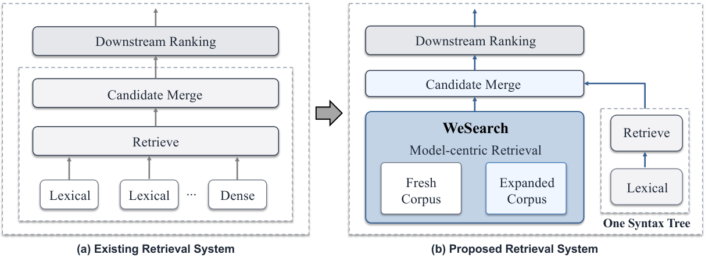
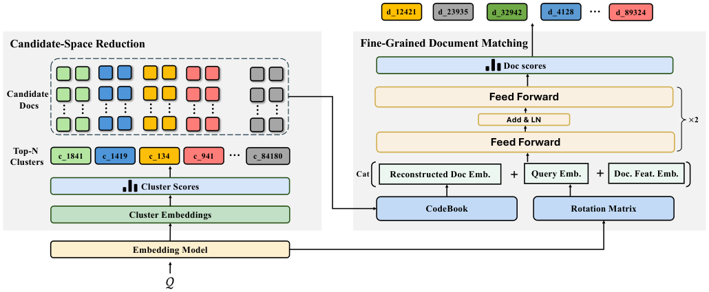
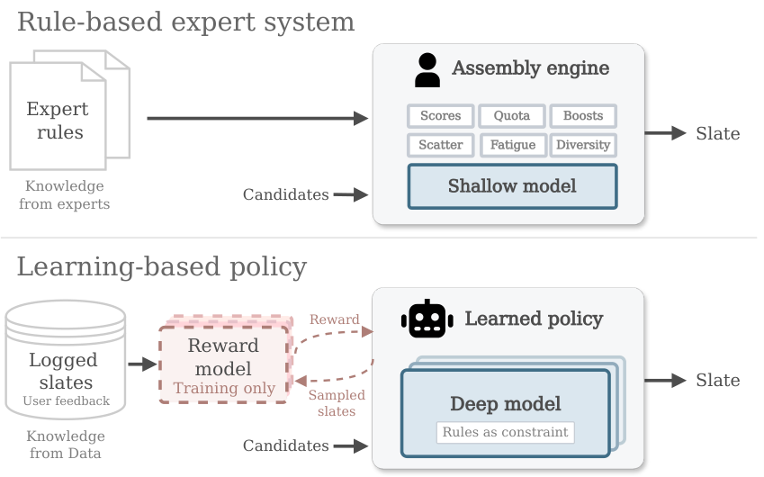
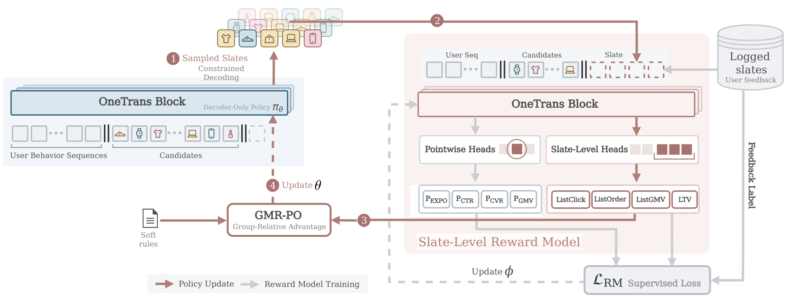

## 总览
今天这批论文质量不错，真正把“在线效果和工程细节”讲清楚的只有两篇，但恰恰是这两篇最值得花时间。一条主线是“别让生成式检索/生成的语义 ID 绑架召回”，微信那篇把 cluster 从文档 ID 降级成候选池裁剪器，把剪枝和细粒度相关性解耦，再加上模型与索引原子切换、41% 成本下降和一个月的线上 A/B，是今天工程可信度最高的一篇；另一条主线是“用一条自回归 Transformer 把重排和混排一次生成掉”，[OneTrans](#note-2)-GSR 的 reward model、共享 prefill KV cache 和 decode 时取最高 log-prob 直接上线都是实打实的活，GMV 和延迟双赢也很少见。有意思的是两篇其实是同一种思路：不迷信端到端生成，而是把生成放到该放的位置，再用检索或约束兜底，规则并没有消失，只是挪到了解码和 reward 里。要提醒的是，这两篇都吃自家场景的行为信号和标注体系，超参和规则细节也没完全摊开，换个业务别指望照搬就能复现那几个点。今天优先看 [WeSearch](#note-1) 和 [OneTrans](#note-2)-GSR，尤其是前者里“候选池大小怎么定”和后者里“规则冲突率”这两处，是真正决定能不能落地的地方。
## 论文列表

### 1. WeSearch: A Unified Model-Centric Retrieval Framework for WeChat Search
- 论文链接：[AlphaXiv](https://alphaxiv.org/abs/2611.00530v1)
- 更新时间：2026-10-31 01:35 UTC
- 机构：未披露机构
- 工业优先级：强

**微信搜索换掉语义ID检索，成本降41%**

各位算法同学们，先甩一个反常识的结论：给每篇文档绑定一条固定的层级 Semantic ID、再逐层解码，这套在内容型搜索里是个坑。一篇同时讲签证、机票、酒店攻略的图文，硬塞进一条语义路径，前缀错一步，后面全废。WeSearch 干脆不这么干了。

📄 WeSearch: A Unified Model-Centric Retrieval Framework for WeChat Search

🔧 聚类只当“候选空间裁剪器”，不再当文档的固定标签：先用向量召回 query 相关簇，再取簇内所有原子文档做细粒度相关性排序，多主题文档不用被迫走单一路径，也躲开了前缀解码错误一票否决的问题。

🧩 检索链路收敛成一条模型主导的语义路径，外加一棵词法语法树。原来多路 dense/lexical 拼接带来的重复计算、通信开销和优化目标割裂，被一次性收掉了。

⚙️ 工程配套才是能上线的关键：OPQ 紧凑文档表示 + 非对称距离计算（ADC）加速打分，新文档滚动挂载进已有簇空间、不用重建全量索引，模型刷新从月级压到周级，必要时天级。

📊 一个月全流量 A/B：CTR +0.68%，人均图文点击 +2.27%，搜索结果页平均停留时长 +0.71%。

📈 质量涨的同时资源在降：检索资源成本 -41%，图文检索延迟 -19ms。

✅ 从数亿到数十亿文档的三组语料配置上，一周 A/B 均显著优于对应线上基线，目前已承接微信搜索 100% 生产流量。

🔍 离线对照还给出一个明确结论：层级 Semantic ID 检索在异质内容上不如这套方案，OPQ 表示稳定优于低维稠密压缩表示。

总结：如果你在做十亿级内容检索、又被 Semantic ID 的前缀错误和多路召回内耗折磨，这篇更该看的是系统设计而不是模型结构。要盯的指标是簇粒度带来的候选池规模和覆盖率——簇太粗省不下算力，太细又把好文档筛掉，这个粒度得按自己的语料重调。坑在于滚动训练和增量挂载对数据管道要求不低，不是换个 loss 就能复现的。

### 2. OneTrans-GSR: A Generative Slate Ranking Paradigm Unifying Reranking and Mix-Ranking with One Autoregressive Transformer
- 论文链接：[AlphaXiv](https://alphaxiv.org/abs/2611.04720v1)
- 更新时间：2026-11-03 11:42 UTC
- 机构：未披露机构
- 工业优先级：强
- 备注：26 pages, 6 figures, 11 tables

**重排混排塞进一个解码器🧩**

各位算法同学们，推荐系统最“玄学”的一环其实一直在靠人肉规则撑着：重排加混排那层，配额、打散、去重、商业加权，全是手调融合权重，模型再强也进不去这个组合空间。这篇把重排和混排直接改写成同一个自回归生成问题，而且在字节电商全流量上线了。

📄 OneTrans-GSR: A Generative Slate Ranking Paradigm Unifying Reranking and Mix-Ranking with One Autoregressive Transformer

🔧 把整屏 slate 当成一条序列生成：单个 decoder-only 策略从本次请求的候选池里直接解码出曝光位，商品卡、短视频、直播、广告卡混在一条序列里，线上只服务这一个模型，原来的装配引擎和下游重排都不在服务链路上
🧩 奖励模型打的是“整屏分”而不是把 item 分数相加：一个位置的收益取决于它的位置、邻居和内容类型组合，所以不能拆成独立监督；这个 reward model 只在训练用，容量受离线资源限制而不是线上延迟限制，可以做得比任何能上线的模型都大
⚙️ GMR-PO 处理多目标：把多个目标的 reward 聚合成标量，再把标量 reward 和业务偏好的 reward 分别标准化后合成 advantage；软偏好在训练里学，硬业务约束放到解码阶段强制，不靠下游重排来修

📊 线上 A/B：GMV/u 提升 2.63%，广告主价值提升 2.06%，复购率提升 2.03%
📈 端到端重排+混排延迟反而降了 13%，因为不用再多模型串行打分
✅ 离线随 reward model、decoder 和 rollout 算力增加，slate 质量单调变好，这条 scaling 曲线是它和规则系统最本质的区别

我的判断：这套更适合业务线多、混排规则包袱重的场景，比如电商首页这种多类型内容抢位。要盯两点，一是 reward model 的离线目标和线上长期收益是否真的对齐，二是解码期硬约束会不会把可行空间压得太小、把探索掐死。另外别忽略它对比的是 Generator–Evaluator 基线，涨幅是单位数百分比，如果团队还停在 pointwise 打分、reward 建模没打牢，先补数据和评估，直接上 RL 大概率跑不出这个数。

