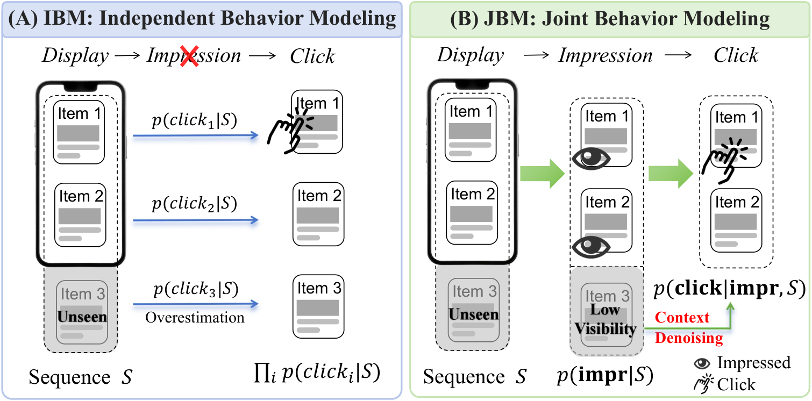
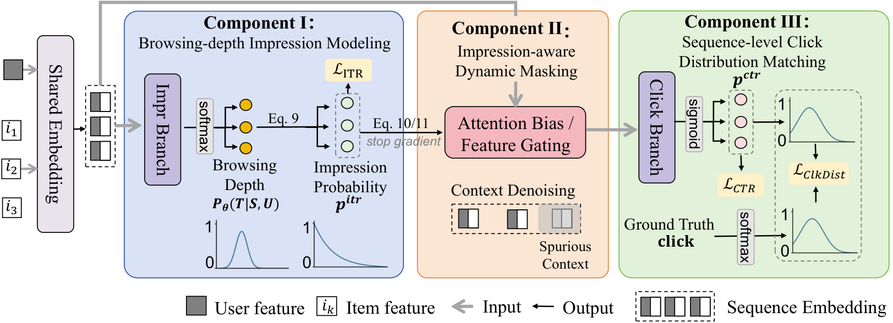
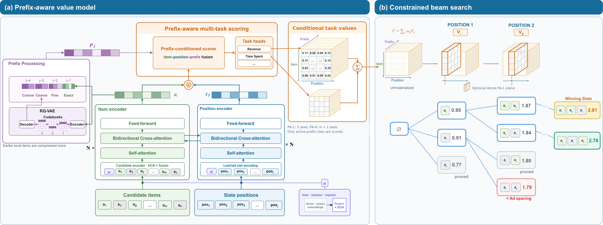

## 总览
今天这三篇看下来，整体感觉很实在：都在解决真实系统里的具体工程问题，没有为了发论文而硬造概念。三条主线其实很清楚：重排/整页排序里如何把“上下文”用对（曝光衰减、前缀依赖、注意力竞争这三件事本质是一回事），生成式召回在实时供给约束下如何不产生幻觉，以及工业落地时那些真正卡人的工程细节。最值得细读的是淘宝那篇 JBM/ICE，它是三篇里唯一有完整线上 A/B 结果的，而且 plug-and-play 到六个骨干都能用，曝光建模的思路可以直接迁移；但要注意它 oracle mask 和实预测 mask 差出近 9 个 GAUC 点，说明真正的红利还没吃到。第二篇的 one-pass 拆解很聪明，离线也稳，但要清楚它省的只是候选编码这一块，前缀更新还是串行的，工业侧 CPU 一个降一个升，别只看对自己有利的那个数。第三篇最有价值的是那段掩码归一化和按父节点 gather 的细节，实验证据比较零散，几个开发阶段混着比，当经验帖看更合适。今天优先看淘宝那篇和 Meta 那篇，第三篇建议只精读约束处理那两节。
## 论文列表

### 1. Beyond Independent Predictions: Learning the Browsing Journey for Sequence-Level Re-ranking
- 论文链接：[AlphaXiv](https://alphaxiv.org/abs/2611.07591v1)
- 更新时间：2026-11-05 07:41 UTC
- 机构：Taobao & Tmall Group of Alibaba，Xi’an Jiaotong University
- 工业优先级：强

**重排评估别只算独立CTR了🔧**

各位算法同学们，先问一句：你们的重排评估器是不是把序列每个位置的CTR单独算出来再加和？坑就在这——用户压根没滑到第15个位置，你却按“全都看到了”给尾部商品记了一笔收益，于是离线指标好看、线上没动静。CIKM'26这篇就是来堵这个漏的。

📄 Beyond Independent Predictions: Learning the Browsing Journey for Sequence-Level Re-ranking

🔧 把“展示→曝光→点击”拆成链式建模，先预测一条浏览深度分布，估出每个位置真实的曝光概率，补上展示到曝光之间的落差，而不是默认20个位置曝光率都是1。

🧩 拿到曝光概率后做动态掩码：建模点击时，把没被曝光的商品从上下文里压掉，避免它们被当成“有效邻居”污染表示，这也是尾部虚高的来源之一。

⚙️ 加了一个点击分布匹配目标，捕捉序列内的竞争关系：用户点了某个商品并且满意后，后面同类商品的边际效用会掉，这种“互相遮蔽”独立建模学不到。

📊 在多种评估器backbone上做离线实验，都能挂上去用，属于即插即用，换架构不用改框架。

📈 淘宝App 14天线上A/B：点击+0.70%，商业收入+3.67%，之后走了全流量部署。

✅ 论文另外把ITR、CTR、ITCTR分开定义，端到端从展示到点击的转化用ITCTR衡量，比只看CTR更能暴露偏差。

总结感想：做重排G–E框架、且评估器还停留在逐物品打分的人可以直接拿来试，改动集中在评估器侧，不碰generator。上手前先确认两件事：曝光标签本身噪声大不大，浏览深度分布的位置假设跟你们实际列表长度是否对得上；另外别只盯CTR，把ITR和尾部位置的校准一起看，否则很容易又回到虚高的老路。

### 2. Towards Efficient Whole Page Ranking with One-Pass Inference
- 论文链接：[AlphaXiv](https://alphaxiv.org/abs/2611.05542v1)
- 更新时间：2026-11-03 19:33 UTC
- 机构：Meta Platforms, Inc.
- 工业优先级：强
- 备注：12 pages, 2 figures, 5 tables

**整页排序一次编码，NAR 也记住顺序了**

各位算法同学们：NAR 排序模型有个老毛病——同一个广告排在第 2 位还是第 5 位，打分是一样的，因为它压根不知道前面已经放了什么。这篇来自 Meta 的工作想做的就是：在保留 NAR 一次性编码效率的前提下，把“已选前缀”塞进打分里。

📄 Towards Efficient Whole Page Ranking with One-Pass Inference

🔧 一次编码、多轮复用：候选集和槽位的表示每个请求只算一遍，beam search 过程中只对“当前存活前缀 + 候选”的轻量条件打分做更新，而不是每扩展一个候选就把整个候选池重新编码一次。论文特意说明，one-pass 指的是共享编码，不是一步生成整页。

🧩 三种上下文拆开建模：全局自注意力建模候选之间的互作用，且不给输入候选加位置 embedding，避免把召回顺序误当成展示顺序；局部前缀建模从直接前驱到完整有序历史；item–slot 交叉注意力负责表示“放在哪个坑位”。

⚙️ 长历史不硬存：历史状态用 RQ-VAE 的共享码本加每 item 的码元元组压缩，解码时只物化存活的 B×C 行分数，绕开“前驱组合爆炸”的稠密打分表。

📊 KuaiRand-1K 上 CPU 解码快 4.07×，RL4RS 上快 3.54×，生成质量接近自回归 CGA 这个高算力参照。

📈 大规模社交视频平台的随机实验：realization 指标 +0.104%，watch time +0.058%。

✅ 同一套服务下排序侧 CPU 消耗降 9.73%——质量略升、算力反降，这在重排场景里算比较少见的组合。

要不要跟，看你的现状：如果你正在跑 NAR 分配、又被 AR 的延迟卡住，这套前缀条件化是条相对低风险的路；如果你本来就是 listwise 小模型，收益可能没那么明显。要盯两个点：前缀长度这个旋钮（越长越接近 AR，但存储和打分成本也涨，论文专门做了长度权衡），以及 RQ-VAE 压缩带来的表示损失会不会在长历史下放大。对比基线别只挑 NAR，得同时对上 CGA 的质量和 NGA 的效率才算公平。坑在于线上增益是千分位量级，离线分差能不能对上线上、以及“one-pass”别被误读成恒定算力，做延迟预估时容易算错。

### 3. Generative Retrieval under Real-Time Supply Constraints in Local Commerce
- 论文链接：[AlphaXiv](https://alphaxiv.org/abs/2611.06323v2)
- 更新时间：2026-11-05 06:16 UTC
- 机构：未披露机构
- 工业优先级：中
- 备注：11 pages, 3 figures, 6 tables, 2 algorithms. The first five authors contributed equally. Revised supply-stage discussion and filtering table; anonymized experimental locations; improved appendix layout

**🛒生成式检索别把beam浪费在无效商家**

各位算法同学们，先甩个反常识结论：在本地生活场景里，生成式检索给出的商家 ID 在 catalog 里完全合法，也照样可能是一家此刻送不到你手上的店。这篇把“供给幻觉”单独拎出来分析，还给了工程侧的解法。

📄 Generative Retrieval under Real-Time Supply Constraints in Local Commerce

🔧 把可服务的 SID 编译成请求级 CSR 前缀索引，CPU 解析排序编译与模型 prefill 并行，索引上传后所有 beam 共用一份
🧩 非法扩展直接剪枝，合法候选仍用原模型 log prob 比较，约束状态跟着选中 beam 的父节点走，避免 beam 复制后状态错位
⚙️ 概念上拆开三件事：catalog 有效性、请求级可服务性、新鲜度；后置过滤省不掉已经花掉的 beam 名额和推理算力

📊 同 beam 对比的日更约束场景，299 个候选里被过滤掉的商家从 170 个降到 29 个
📈 C++ 排序约 3ms，CSR 构建约 1ms，编译这步确实不便宜
✅ 跨机器、3 万条供给条目对比，服务侧延迟只增加 0.6ms，但客户端实测还暴露出额外请求开销

总结：这是一篇偏工程落地的报告，作者自己也写明尚未证明“同等检索质量下省了算力”。要盯的指标是 GPU 时间除以有效输出数，再加零结果率，基线该选后置过滤而不是全局 catalog 树。坑在上游：供给集合漏了或老化了，mask 再准也救不回来，而且三 token 短序列本来就没几步可摊薄传输和编译成本。
