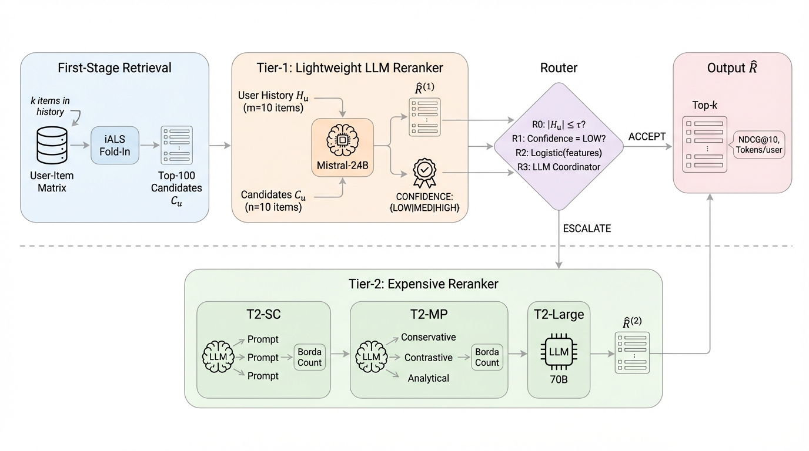

## 总览
今天这两篇不是来卷指标的，都是已经上线或接近上线的工业界实战记录，共同点是都在认真算成本账：生成式召回能不能扛住延迟、LLM 重排的钱花得值不值。主线有两条，一条是 [Shopify](#note-1) 那套用语义 ID 加 next-token prediction 把搜索和推荐塞进同一个生成框架，多 token 预测配轻量 ranker 重排能把质量和延迟同时按住，这条线信息密度很高，工程细节和踩坑都写得很实在，是今天最值得细读的一篇；另一条是级联式 LLM 重排的成本调度，坦白讲结论偏保守，线上只省了约 10% 且质量持平，但它那些硬教训——租户负载不均才是做级联的真正动机、模型静默退化成小作文得靠逐请求解析率才看得出来、缓存和阈值配置化是 A/B 可信的前提——比模型本身有用。我尤其认同它离线那组反直觉结果：给冷用户加算力救不回稀疏历史，推理时扩展替代不了缺失的偏好证据，这个判断对很多想靠 scaling 解决冷启动的团队是盆冷水。两家都没回避坏消息，[Shopify](#note-1) 直言统一 student 还在实验阶段、codebook 一加大延迟就炸，这种自曝其短的写法比刷榜论文可信得多。今天优先看 [Shopify](#note-1) 那篇，级联重排那篇可以快读，重点看它的工程教训和冷启动结论。
## 论文列表

### 1. Generative Search and Recommendation at Shopify
- 论文链接：[AlphaXiv](https://alphaxiv.org/abs/2611.08804v1)
- 更新时间：2026-11-05 23:56 UTC
- 机构：未披露机构
- 工业优先级：强

**搜索推荐合成一个模型，Shopify跑通了**

各位算法同学们，双塔召回先把用户历史压缩成一个固定向量，再用内积打分；Shopify 在十亿级商品目录上直接换掉了这套做法，让 LLM 生成语义ID，而且线上 A/B 有数据。它更值得看的地方在于：把搜索和推荐放进同一个生成模型之后，还能接进生产环境、满足延迟要求，而不只是“生成式检索”这个概念本身。

📄 Generative Search and Recommendation at Shopify

🔧 统一成生成语义ID：每个产品的内容 embedding 用 RQ-KMeans 量化成 3 个离散 token，码本为 8192-8192-8192。搜索 query 和推荐历史都变成“给定上下文生成目标 SID”，上下文全程留在 prompt 里，不再被压成一个向量。

🧩 训练方案更值得关注：先用目录和行为数据联合预训练得到共享表征，再用 RL 提升人工判定的搜索相关性，最后从任务专家蒸馏到统一 student；推荐变好了，而搜索没有统计上可检测的损失。

⚙️ 服务侧用多 token 预测加一个轻量 ranker，召回比自回归基线更好、延迟更低；这对做线上系统的人比模型结构更有参考价值。

📊 分词器对比：RQ-KMeans 的 OneDCG@10 是 0.3945，RQ-VAE 是 0.3518；但 RQ-KMeans 的 SID 唯一率只有 30.4%，RQ-VAE 是 69.1%。这说明唯一率不是选择 tokenizer 的硬指标，按搜索意图聚类才更关键。

📈 码本大小：32768-8192-8192 分数更高，但 100 QPS 下 p95 延迟到 50ms，最后选 8192-8192-8192 留延迟余量。

✅ 作为独立检索器，质量与 Shopify 现有多模型搜索栈相当，且满足生产延迟；接入搜索和推荐栈后，离线评估和线上 A/B 都显著提升。

我的判断：做生成式检索、统一召回，或者想把搜索和推荐合并的同学可以细看。要盯的指标是 OneDCG@10、搜索购买 Recall@10、推荐 Recall@50 和 p95 延迟，对照的是双塔召回和多模型搜索栈。风险点在于它依赖已有的高质量产品 embedding 和 LLM judge 评估协议；换业务后，需要重新验证 SID 碰撞率和 tokenizer 取舍。如果延迟预算紧，多 token 预测加 ranker 这套组合要先做压测再上线。

### 2. CascadeRec: Deployed Adaptive LLM Compute Allocation for Multi-Tenant Content Recommendation
- 论文链接：[AlphaXiv](https://alphaxiv.org/abs/2611.08566v1)
- 更新时间：2026-11-05 17:30 UTC
- 机构：未披露机构
- 工业优先级：中
- 备注：IAAI-27 (Oral)

**给冷用户上大模型重排，反而掉30%📉**

各位算法同学们，把最贵的模型全量铺到重排链路上，指标不一定涨——论文里稀疏历史用户的NDCG@10最多掉了30%，把冷用户升级到更贵的推理只会让损失更大。这篇是少见的“线上跑了一个多月”的工业落地文，讲的是怎么用两级级联把LLM算力按请求分配。

📄 CascadeRec: Deployed Adaptive LLM Compute Allocation for Multi-Tenant Content Recommendation

🔧 两级级联加一个路由器：轻量Tier-1对全量请求做重排，同时吐一个粗粒度置信度（LOW/MEDIUM/HIGH），路由器判断“这单加算力大概率有用”才升级到Tier-2，其余直接用Tier-1结果
🧩 Tier-2给了三条可换的路：自一致性采样N=3、多角色多路推理、直接上更大模型，正好对应“多采样、多推理、换强模型”三个推理时扩展轴，升级后的多份排序用Borda聚合
⚙️ 把serving层的脏活写进正文：容忍式解析排行输出，解析失败就回退到上一级排序，用户侧永远不暴露LLM报错；硬超时加流式卡顿检测兜住尾延迟；Tier-1输出按(用户, 模型, seed)缓存，A/B对照臂看到完全一致的Tier-1结果，线上线下对比才干净

📊 线上A/B超过一个月，对比“全量走贵档”，推理成本降约10%，延迟影响很小，至今没观察到质量回退；作者只报parity，不吹增益
📉 离线在MovieLens-1M和Amazon-Electronics上做历史稀疏度控制：全量LLM重排让稀疏历史用户NDCG@10最多掉30%（配对bootstrap显著），唯一显著增益出现在MovieLens历史最长的分段，+27%
📈 在Amazon上给受损用户加自一致性或多路推理，损失反而变大——prompt里偏好证据本来就少，多出来的算力没东西可用
✅ 离线同配置下升级率60%时，Tier-2的token比全量升级少40-50%；解析失败率在0.1%到10%之间，随模型和目录变化

这篇适合做B端、低QPS高客单、租户流量高度倾斜的团队看：它真正的动机是少数重租户吃掉大部分GPU预算，级联既是省钱也是保别人的延迟。要盯的指标不是总体NDCG，而是按历史长度、租户规模切开的NDCG@10和升级率。坑也很明确：论文自己说生产分段阈值是拿租户流量测出来的，离线那个τ=5的冷启动升级规则没敢搬上线，你做的时候别直接抄。

