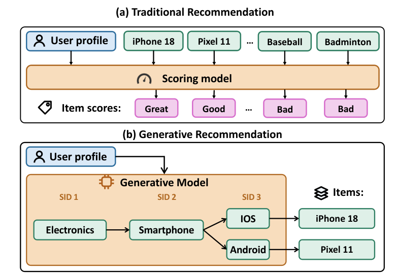
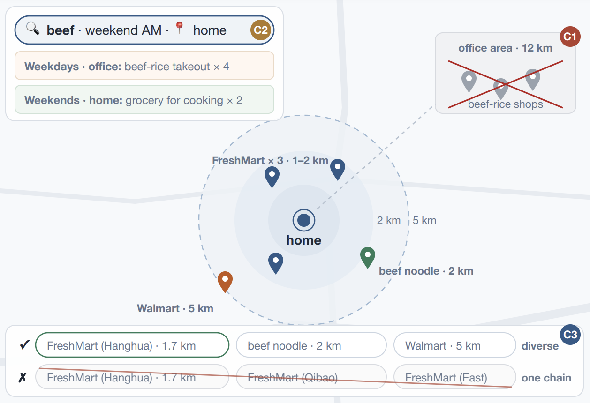

## 总览
今天这批论文整体成色不错，五篇里没有纯凑数的，主线很清楚：一条是生成式推荐和广告从模型走向生产，一条是把上游大模型的能力更便宜地搬到下游排序。最值得花时间的是快手那篇生成式推荐服务系统，它难得地把“为什么 LLM serving 那套直接套不上 GR”讲透了，runtime 与 engine 解耦、beam 裁剪后的 KV 压实、按步做 shape 规划，都是真踩过坑才写得出来的东西，而且有九个月、四亿 DAU 的线上证据；但也得留个心眼，全篇只有吞吐和延迟，没给任何推荐效果的收益对比，属于“跑得起来”而不是“跑得更好”。腾讯那篇把上游 interaction layer 的 cross representation 用时间感知 EMA 聚合成 user 级向量、从而把上下游推理彻底解耦，是今天工程上最实用的一招，线上 GMV 和那组 single/dual branch 的消融也站得住，缺点是对上游体量依赖太重、离线只在一个数据集上做 pCTR，评估偏薄。Wayfair 那篇的双路 ANN 召回离线消融是全场最扎实的，query 视角和候选视角互补而不是冗余这个结论可信，但线上 CTR 涨六个点这种量级，得结合他们原来的序列模块偏弱来打折读；[Slim](#note-4) 那篇思路不难懂，可“字段名本身是静态的，为什么每个请求还要过一遍 4.5B 模型”这个根本问题没正面回答，我看它 latency-critical 的立论是悬着的。淘天那条生成式广告召回目前只看到标题，先记一笔，等有摘要再判断。今天优先看 [RecoGEM](#note-1) 和 [LFM4Ads](#note-3)，前者看系统设计怎么绕开 LLM serving 的结构性错配，后者看上游能力迁移的范式，Wayfair 那篇可以当工程落地参考顺手翻。
## 论文列表

### 1. RecoGEM: A Serving System for Production-Scale Generative Recommendation
- 论文链接：[AlphaXiv](https://alphaxiv.org/abs/2611.12296v1)
- 更新时间：2026-11-09 12:20 UTC
- 机构：The University of Hong Kong，Kuaishou Technology，Peking University，Renmin University of China
- 工业优先级：强

**生成式推荐服务，别硬套LLM那套 🧩**

各位算法同学们：把LLM serving那套直接搬来做生成式推荐，可能是最省事也最容易踩坑的选择——快手线上这套系统给出的数字是单实例1000+ QPS、P99压在35ms以内，比代表性基线吞吐高2.88倍，而它做的第一件事恰恰是承认“LLM那套假设在这里不成立”。

📄 RecoGEM: A Serving System for Production-Scale Generative Recommendation

🔧 架构上把“运行时”和“执行引擎”拆开：解码步之间的候选状态迁移、词表与选择策略的热更新这些GR特有逻辑，全交给专门的runtime；engine只负责张量计算，两者靠一份per-step接口的部署契约连接。这样在线更新频繁时不用动执行路径。

🧩 执行侧专门吃GR的三个特点：短前缀、大候选池、每步shape可预测。row-tiled self-attention把大量独立的短attention行拼在一起摊薄kernel开销；step-granular planning按单步的窄shape画像做规划，而不是一套动态计划打通所有步；候选选择本身被当成关键路径上的计算来优化，不做成LLM里那种轻量采样尾巴。

⚙️ 论文把这套设计归因于两个mismatch：一是每步词表语义不同、张量形状还要从输入序列扩成一批候选，与LLM同词表同形状的均匀解码循环对不上；二是GR每行attention只attend很短的候选序列，长序列kernel的优化前提在这里失效。

📊 OneModel生产负载上，单serving实例1000+ QPS，P99低于35ms，相比代表性基线吞吐提升2.88倍。

📈 集群层面峰值流量60000 QPS，MFU做到55.3%，同时支撑高频在线更新。

✅ 线上跑了九个多月，覆盖搜索、广告、推荐场景，日均约4亿DAU，支持十余个GR模型家族，包括OneModel、OneRec-v2、UniSearch。

总结感想：这篇的价值不在某个kernel技巧，而在给出了“GR-native serving”该长什么样的对照表——如果你正在把推荐从打分改成自回归生成，先盯P99和候选选择占关键路径的比例，再看MFU；坑在于它的优化强依赖step shape可预测和固定步数，一旦你的模型步数动态变化或词表频繁重构，step-granular planning和部署契约都要重新设计。

### 2. Query- and Candidate-Aware Long User Sequence Modeling for Sponsored Product Ranking in Search
- 论文链接：[AlphaXiv](https://alphaxiv.org/abs/2611.11675v1)
- 更新时间：2026-11-08 23:00 UTC
- 机构：Wayfair LLC
- 工业优先级：强
- 备注：Accepted to ACM RecSys 2026 Workshop on Context-Aware Recommender Systems (CARS)

**搜索广告长序列：双路召回+早融合**

各位算法同学们，长序列模型里最容易被当成配角的两个 context token，这篇里砍掉直接掉 4.7 个点 AUC——比加一路召回掉得还狠。Wayfair 这篇讲的是搜索广告排序里怎么同时用 query 和候选商品两把钥匙，去开用户一年的行为历史。

📄 Query- and Candidate-Aware Long User Sequence Modeling for Sponsored Product Ranking in Search

🔧 双路检索：长期历史按两种方式各取 50 条，candidate-NN 取和候选 SKU 语义最近的行为，query-NN 取和当前 query 最相关的行为；再加最近 100 条，总长压在 200 条，同一事件被两路同时命中只保留一次

🧩 两个专属 context token：query token 和 candidate token 直接放在序列最前面，跟历史 token 一起进 Transformer，让模型自己决定该读哪段历史

⚙️ candidate-aware early fusion：候选 SKU 的表示不是最后才拼，而是在构造每个历史 token 时就写进去；attention 用了分段混合 mask，前 M 层历史侧因果、context token 只互相看，后几层才放开双向

📊 离线相对生产 baseline：只加 candidate-NN 是点击 AUC +1.16%、7 日下单 AUC +1.35%；只加 query-NN 是 +1.00%/+1.16%；两路一起 +1.37%/+2.19%，确实互补

📈 去掉 early fusion，增益基本被抹平（+0.45%/+0.28%）；去掉两个 context token 变负向（-4.71%/-6.06%）；去掉 NAL 辅助损失还有 +1.11%/+1.46%

✅ 线上 A/B 在 sponsored search 流量上 CTR、归因转化率、每曝光订单量三项都涨，论文只给了方向没给幅度

总结感想：做搜索侧广告或推荐排序、已经有最近行为序列的同学可以看，真正能抄的是 100/50/50 的检索预算切法和那套混合 mask，而不是模型结构本身。坑在于历史池只有 10 的 3 次方量级，换成十万级行为时双路检索的延迟要重新算；另外线上只有方向没有幅度，复现对比时盯住点击 AUC 和 7 日下单 AUC 两个指标，别只看 CTR。

### 3. LFM4Ads: Large Foundation Model for Ads Recommendation
- 论文链接：[AlphaXiv](https://alphaxiv.org/abs/2508.14948v2)
- 更新时间：2026-11-09 10:23 UTC
- 机构：Tencent，Tsinghua University
- 工业优先级：强
- 备注：Revised after CIKM 2026

**广告大模型不实时推理，GMV涨2.45%**

各位算法同学们，这篇工业论文给出的反常识结论是：想用大模型的 user-item 交叉表征，不必让上游模型跟着下游一起实时推理。腾讯和清华的 LFM4Ads 把交叉表征提前聚合成用户级向量存起来，线上完全不跑上游，依然拿到全平台 2.45% 的 GMV 提升。

📄 LFM4Ads: Large Foundation Model for Ads Recommendation

🔧 上游同时抽取 UR、IR 和 CR，关键在 CR：直接取 DCNv2 这类交互层的输出，比两塔吐出的用户、物品向量细一个粒度，这也是以往工作基本丢掉的部分。

⏱ 用时间感知的指数滑动平均把样本级 CR 压成用户级 CR，β(t) 随距上次更新的时间衰减：沉默用户 β≈0 偏向当前行为，活跃用户 β≈1 多留历史。这一步才真正把上游推理和线上 serving 解耦，比要实时算 TAE 的方案少一路工程负担。

🧩 下游给三级用法：特征级用非线性 gate 把 CR 融进 embedding，模块级微调上游产出 CR 的模块，模型级拿 CR 和 IR 做匹配检索。粒度越粗，下游模型越薄、训练越轻。

📊 KuaiRand-1K 八个场景离线：特征级 gating 平均 AUC +0.0025，模块级微调 +0.0016，模型级检索 +0.0189。

📈 2024 Q4 起在腾讯广告平台上线，支撑 10+ 次发布，全平台 GMV +2.45%，年收入增加数亿元。

✅ 分场景看：微信朋友圈特征级融合 GMV +1.35%，多个 pCVR 模型模块级微调 +1.88%，微信视频号模型级检索 +1.17%。

⚙️ 层选错会掉点：特征级用中间层的 CR 最好，模型级用最深层的 CR 最好，作者是实打实扫过的。

总结：适合已经有上游大模型、但线上 latency 卡死、不想再挂一路推理的团队。要盯的是 β 函数形状和取哪一层这两个超参；另外 AUC +0.002 量级不一定等价成线上收益，模型级那个 +0.0189 更接近检索侧换了匹配目标，跟直出 CTR 模型横向比意义有限。

### 4. Slim Foundation Models for Latency-Critical Recommendation Serving
- 论文链接：[AlphaXiv](https://alphaxiv.org/abs/2611.11013v1)
- 更新时间：2026-11-07 23:17 UTC
- 机构：未披露机构
- 工业优先级：中

**LLM砍掉44%，CTR延迟降3.4倍**

各位算法同学们，在线跑LLM做CTR，代价是普通CTR模型的290倍，所以现有工作基本都退回去离线缓存，不敢在线serving。这篇偏要在请求链路里跑，把LLaMA3-8B剪到4.5B，延迟比LLM增强baseline低3倍多。

📄 Slim Foundation Models for Latency-Critical Recommendation Serving

🔧 依赖感知结构化剪枝：用DepGraph把注意力和FFN里结构耦合的参数打成组，用next-token loss的Taylor展开估组重要性，整组剪到4.5B（小44%），尽量不伤下游语义抽取能力。
🧩 字段感知LoRA微调：主干冻结只训LoRA，任务是判断这个特征值属于哪个field（比如Black Rose归到Movie Title），用InfoNCE对比学习逼出可区分的字段级embedding。
⚙️ 语义引导融合：把LLM字段embedding的pairwise余弦相似度过一层可学习变换，去重加权CTR模型的pairwise特征交互，训练时再加KL散度对齐两套相似度分布。

📊 4个数据集和6个CTR骨干（FM、DeepFM、FwFM、FmFM、FinalMLP、Wukong）全部跑了一遍。
📈 单样本延迟15.98–17.58ms，KAR是54.6–55.1ms，LLM-CF是46.5–47.5ms，最高3.4倍加速；参数量4504M对KAR的8032M。
✅ 相对各骨干base的平均AUC：Gift Cards +1.69%、Video Games +1.36%、Digital Music +1.39%、MovieLens-1M +0.13%。
📉 剪枝曲线：6B保留99.88%平均AUC，4.5B保留99.77%，压到2B也还有99.62%。

总结：想在线吃LLM语义、又被P99延迟卡死的召回、精排链路，这套pipeline可以跟。但别只看均值，24个骨干和数据集组合里它只有10个拿到同组最高AUC，FmFM在Gift Cards还是-2.12%，上之前先在自己那一格复现；还有缓存派省的是离线算力，它省的是在线延迟，两笔账要分开算。

### 5. TS-GEAR: Taobao Shangou GEnerative Ad Retrieval
- 论文链接：[AlphaXiv](https://alphaxiv.org/abs/2611.12180v1)
- 更新时间：2026-11-09 10:30 UTC
- 机构：Alibaba Group
- 工业优先级：未标注

**外卖搜索把地理写进ID，收入涨4.2%**

各位算法同学们，先看一个数字：一个 0.1B 的骨干模型，每天承载淘宝闪购 1.5 亿次搜索查询，线上广告收入还提升了 4.2%。更反常识的是它的关键改动：把配送范围直接编进商家 ID，而不是等生成完再过滤。

📄 TS-GEAR: Taobao Shangou GEnerative Ad Retrieval

🔧 Geo-Semantic ID：商家标识被拆成地理前缀（分层 geohash）加语义后缀（RQ-KMeans 残差量化），前缀级约束解码让能不能送到从后置硬截断变成生成目标，beam 预算不再浪费在那些送不到的门店上。

🧩 Query-Geo Target Attention：用实时 query 和当前位置作为双 target 聚合历史行为，同时把每条行为自身发生的位置编码进 attention key，于是你工作日中午在办公室点牛肉饭的历史，不会影响周末在家搜牛肉时想买生鲜食材的意图。

⚙️ GMPO：把 GRPO 的 advantage 改写成去重组奖励加留一法边际优势，直接用集合级信号抑制近重复候选，不需要再额外加一个辅助多样性 loss。

📊 离线对比中，HitRate 和地理有效性两个指标都稳定超过现有生成式检索方法

📈 线上 7 天 A/B：广告曝光 +3.8%，广告收入 +4.2%

✅ 骨干只有 0.1B，却运行在日均 1.5 亿查询的搜索广告链路里，说明这套结构不是靠堆参数堆出来的

总结：做本地生活、LBS 搜索或外卖推荐的，可以看看这种把硬约束写进 ID 的思路；评估时要盯地理有效性和候选集合的多样性，而不只是 HitRate。落地有两个风险：网格粒度和分层 geohash 的划分强依赖业务配送半径；GMPO 的组奖励设计也依赖你手里的点击、下单这类强弱信号是否分层清楚。

