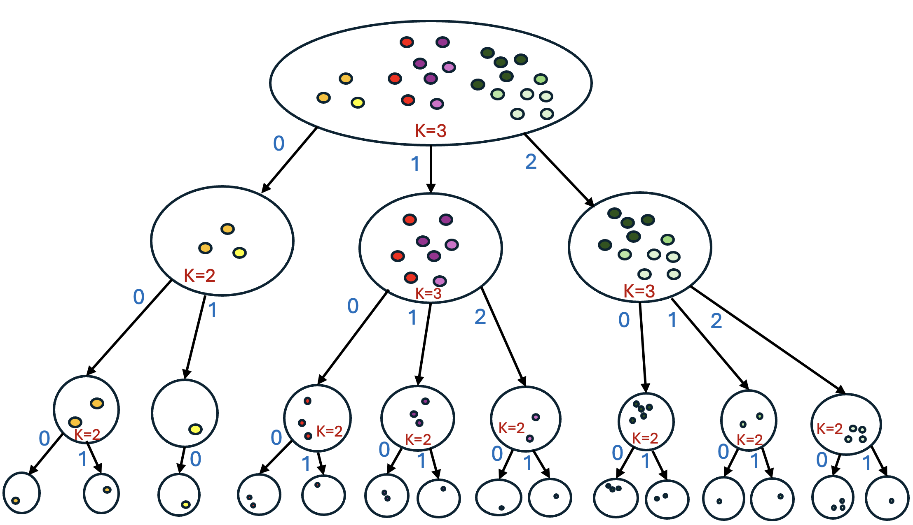

## 总览
今天这两篇质量都挺硬，而且难得地形成了一条共同主线：大家都在重新审视推荐系统里那些被当成默认前提的东西，一个问「要不要每个模型都从头编码一遍用户序列」，另一个问「semantic ID 的每个 token 是不是真的各自携带独立语义」，两篇都用实证把假设掀开再动手改，读起来很过瘾。字节那篇是典型的工业界重活，切分点选在原生 KV 接口而不是压成固定 user embedding，思路干净，更关键的是线下几乎无损、线上还有实打实的 A/B 和 ROI 数据，这种带真金白银证据的论文不多见，工程细节也写得够实。另一篇则胜在问题本身提得好，共享前缀的相似度分析基本把 SID 是树路径这件事钉死了，后面顺着结论做的自适应分支加质量约束也就顺理成章，而且 head/tail 的 Pareto 都落在前沿，不是拿长尾换头部。当然两篇都有明显的坑：前者强绑存储与调度基础设施、迁移成本高，后者全是离线小数据集、协同信号没进树、构建成本也上去了，看的时候心里要有数。今天优先看 [SepLRM](#note-1) 和 AST 这两篇，前者学工程切分与线上验证的思路，后者学怎么用一组实证把领域假设问倒。
## 论文列表

### 1. SepLRM: A Foundation Model Paradigm for Recommendation
- 论文链接：[AlphaXiv](https://alphaxiv.org/abs/2611.10356v1)
- 更新时间：2026-11-07 00:36 UTC
- 机构：ByteDance; § Institute of Software, Chinese Academy of Sciences
- 工业优先级：强

**推荐大模型续命：一个底座带多个垂类**

各位算法同学们，长序列堆到后面边际收益越来越薄，可每个推荐阶段、每个业务还在各自把同一份用户行为历史重新编码一遍——这部分算力花得最冤。SepLRM 要做的事，就是把这部分重复编码抽成公共底座。

📄 SepLRM: A Foundation Model Paradigm for Recommendation

🔧 把多个端到端 LRM 重组成“一个 RFM 加多个独立优化的垂类模型 VM”，通用序列建模和场景特化分开演进，RFM 升一次级，多个阶段、多个业务同时受益。

🧩 分离接口选在 KV cache：RFM 用 encoder 导出与候选无关的最后一层 KV，比 logits 或聚合用户向量保留了更细的行为信息；每个 VM 用自己的候选构造 query 走 cross-attention，和原 E2E 模型的 query-KV 交互形式一致，架构错配小。

⚙️ 为能落地还配了 cache 压缩、用户级 KV 复用、训练侧异步流水线让 cache IO 与计算重叠、serving 侧把 KV 准备和召回粗排并行，外加 LG-Store 做分布式 KV 存储。

📊 三个大规模数据集离线 SOTA，无损缓存下迁移率约 100%。

📈 线上 GIP 的 ADSS/ADVV 提升 1.961%/2.107%，电商 GMV 提升 0.35%–4.81%。

✅ ROI 分别是同口径 E2E LRM 的 8.62 倍和 2.62 倍，跨模型迭代、跨推荐阶段、跨业务都能迁。

总结感想：更适合已经有好几个 LRM 各自跑长序列、平台算力账单明显上涨的团队，单模型单场景的小团队拿不到多少好处。要盯的是迁移率 TR 和 cache 存储成本、命中率；坑主要在 KV 压缩率和效果之间的取舍，以及 LG-Store 这类存储基础设施得先有，不然线上关键路径省不下来。

### 2. Not All Branches Are Equal: Adaptive Semantic ID Construction for Generative Recommendation
- 论文链接：[AlphaXiv](https://alphaxiv.org/abs/2611.11549v1)
- 更新时间：2026-11-08 18:48 UTC
- 机构：Ben-Gurion University of the Negev
- 工业优先级：中
- 备注：RecSys '26

**语义ID不是独立token，树路径才对 🌳**

各位算法同学们，先抛个反常识结论：语义ID里最后一个token基本没有全局意义，单独看它几乎是噪声。这篇工作用数据把这件事摊开讲了。

📄 Not All Branches Are Equal: Adaptive Semantic ID Construction for Generative Recommendation

🔧 作者先做了个很朴素但关键的验证：在Beauty数据上用RQ-VAE的4位语义ID，测共享前缀的item相似度。只共享第1位是0.758，共享前两位0.874，前三位0.920，全局基线才0.554，前缀越长越像，单调得离谱。反过来，只共享第1位能到0.740，而共享后三位却只有0.582（基线0.570），说明后面的token离开前缀就不携带稳定语义。

🧩 既然语义ID本质是树上的路径，那就别指望残差量化“顺带”emergence出合理结构。作者直接改成自顶向下分裂聚类，构造Adaptive Silhouette Tree，每个节点用轮廓系数最大化来动态决定分几叉。稠密区域分得细，同质区域就保持粗粒度，不再全局固定branching factor。

⚙️ 长尾问题单独处理：分裂时用MILP给每个分支加最小概率质量约束，避免出现监督信号极少的退化前缀，这类前缀在推荐数据里本来就多。

📊 五个不同规模与领域的Amazon Review数据集，所有指标上平均至少比最强baseline好13%。

📈 分析实验里也拆了head和tail表现，说明长尾那部分提升不是靠热门item堆出来的。

✅ 消融把自适应分叉和质量约束分开验证，两个组件各自有贡献，不是只靠其中一个撑着。

总结：如果你在做生成式召回、正在调tokenizer那一步，这篇的结构视角可以直接抄思路——别只盯重构loss，去看ID的路径是否符合数据的层次。落地要盯的指标是长尾item的召回和前缀覆盖率，坑在于树是离线构建的，新item怎么插进已有树（论文给了方案）以及树深和分叉上限怎么定，得按你自己的数据分布重新扫。

