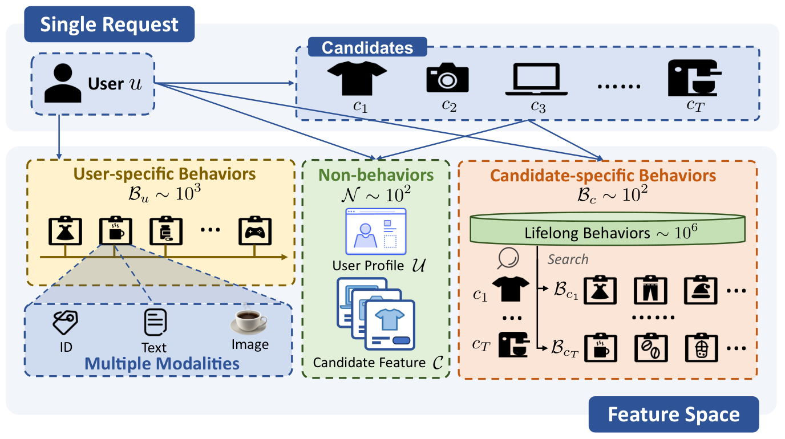
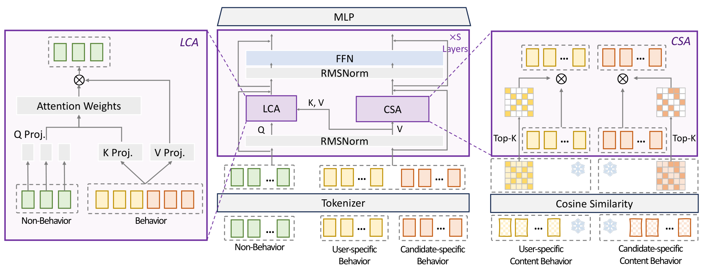

## 总览
今天这两篇不多，但都属于「把话说清楚」的类型，一篇讲怎么在线上毫秒级约束里真把 scaling law 跑起来，一篇直接把持续学习的坑挖开给你看，读完都不算浪费时间。主线其实是一条：大家终于不再比谁模块堆得花，而是比谁能拿证据做减法——第一篇是用注意力矩阵的 effective rank 和 block-wise masking 反推哪些交互该砍，砍完还能在淘宝拿到 3.27% RPM 和 1.22% CTR 的线上增益，这种从可视化到线上收益的闭环很难得；第二篇则是用真实 30 天数据把灾难性遗忘和多任务崩盘摆到台面上，Day1 的 HR@50 从 39 掉到 0.19 这种断崖，比任何综述都有说服力。要提醒的是两篇的边界都很明确：前者强依赖大盘模型热启，从零训打不过跑了几万亿样本的产线模型，内容特征还全程冻结；后者全是离线 benchmark，baseline 也就那几家，别当成线上定论。如果只有时间看一篇，我建议先看 EST，方法论可迁移性更强；做持续学习或者检索方向的同学，[KuaiRecV2](#note-2) 的负面结论值得对着自己的 pipeline 逐条排雷。今天优先看 EST 和 [KuaiRecV2](#note-2)，前者学思路，后者避坑。
## 论文列表

### 1. EST: Towards Efficient Scaling Laws in Click-Through Rate Prediction via Unified Modeling
- 论文链接：[AlphaXiv](https://alphaxiv.org/abs/2602.10811v2)
- 更新时间：2026-11-12 08:32 UTC
- 机构：𝒂 {}^{\hskip 0.81949pt{\color[rgb]{0.75,0,0.25}\boldsymbol{a}}} Taobao & Tmall Group of Alibaba, Beijing, China
- 工业优先级：强
- 备注：Accepted by KDD2026

**统一建模后，CTR也能出scaling📈**

各位算法同学们，把用户行为序列压成一个定长向量再喂给模型，这个用了快十年的老套路，可能正是CTR模型扩不动的根因。淘宝这篇把CTR的全部原始输入放进同一条序列，做出了稳定的幂律扩展曲线，线上RPM还涨了3.27%。

📄 EST: Towards Efficient Scaling Laws in Click-Through Rate Prediction via Unified Modeling

🔧 轻量交叉注意力LCA：把非行为特征当query、行为token当context，省掉行为之间开销很大的all-to-all自交互，只算真正有影响的跨特征依赖，省下来的算力都用于扩大模型规模。

🧩 内容稀疏注意力CSA：用内容相似度动态挑选高信号的行为token做稀疏注意力，候选相关行为不再被pooling成定长摘要，细粒度信号保住了。

⚙️ 完全统一建模：非行为、用户行为、候选行为以及ID和图文等模态各走各的tokenizer，然后进入同一序列，不做早期聚合，这是它和部分统一方案的关键差别。

📊 淘宝展示广告线上：RPM +3.27%，CTR +1.22%。

📈 论文报告了稳定且高效的幂律scaling关系，模型规模往上走，收益基本可预测，不是靠调参碰运气。

✅ 相比早期聚合的分层建模，在同等算力预算下扩展收益更明显；稀疏注意力是效率来源，不是精度牺牲点。

总结：做工业推荐、行为序列动辄10^3 token、延迟又卡在毫秒级的团队，这篇的架构取舍可以直接借鉴。要盯两件事：幂律斜率在你们的数据分布上是否还稳得住，以及CSA的top-k在真实QPS下的延迟曲线。坑在于统一序列后长度变长，非行为特征那种高信息密度的先验得重新标定，别原封不动照搬LLM那套dense attention。

### 2. KuaiRecV2: Benchmarking Large-Scale Continual Learning for Diversified and Multi-task Recommendation
- 论文链接：[AlphaXiv](https://alphaxiv.org/abs/2611.16795v1)
- 更新时间：2026-11-12 13:39 UTC
- 机构：未披露机构
- 工业优先级：中
- 备注：This paper has been accepted to NeurIPS 2026

**离线涨点线上掉点？这个榜单挺敢**

各位算法同学们，离线指标涨了线上却掉点，八成不是模型不行，而是评测协议在骗你。KuaiRecV2把“边训边评”写进了benchmark，只有最后一天的交互才算成绩。

📄 KuaiRecV2: Benchmarking Large-Scale Continual Learning for Diversified and Multi-task Recommendation

🔧 30天连续学习流水线：每天用前一天训练出的权重作为初始化，在新一天的数据上继续训练，从而避开传统benchmark里“拿未来数据训练、再回头评过去”的老问题。

🧩 7天滑窗动态候选池：第t天创建的物品会在第t+1天入池，第t-6天创建的物品会在第t+1天被移除，冷启物品和热门物品需要一起应对。

⚙️ 三项指标一票否决：检索准确率、多样性（token级和item级都要看）、多任务表现，只有全部提升才算有效进步，单点涨分不算。

📊 FullMonth数据集：12.4万用户、2489万物品、4.84亿条交互、连续30天，稀疏度99.9843%（用户侧做了100-core过滤）。

📈 Small子集只取前两天：245万物品、3895万条交互，用来快速验证模型有没有基本有效性。

✅ 物品侧给了64维多模态embedding和8级semantic ID，tokenizer全程冻结、没碰这30天日志，规避了信息泄漏。

📉 一个反直觉结果：没有约束的RL偏好对齐，长期跑下来反而可能把性能拉低。

总结：做生成式召回或排序、且要跨天增量上线的同学，可以拿它当压力测试场。重点盯第30天的指标和遗忘幅度，别只拿Small子集的分数自我安慰；另外token级多样性要和业务类目对齐，这层映射论文没替你解决，得自己补。
