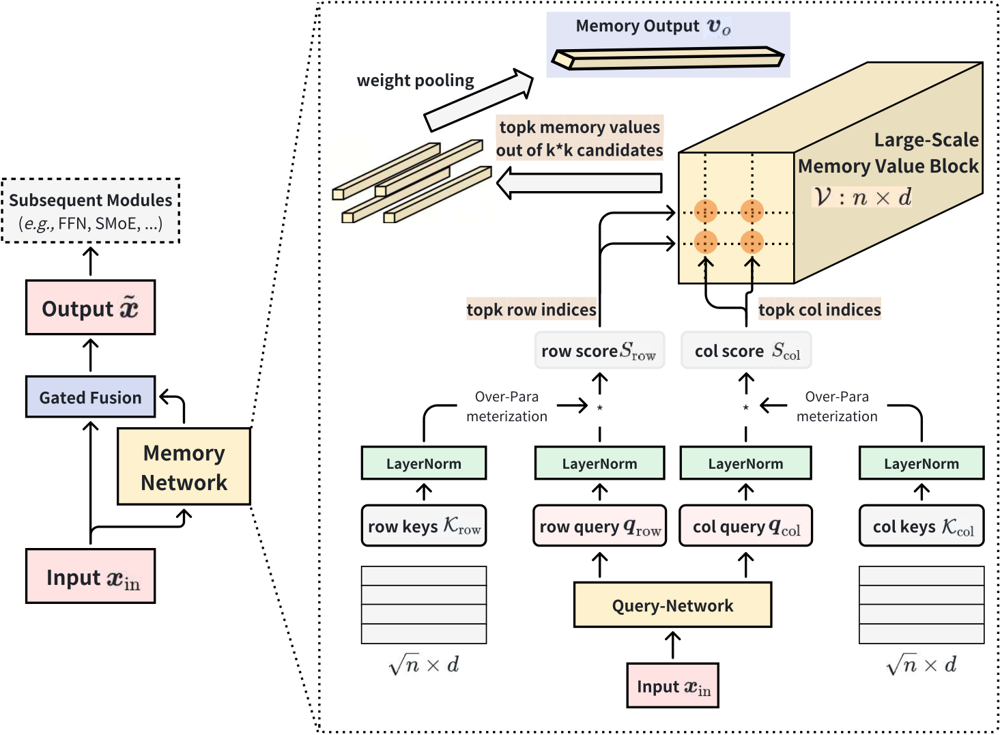
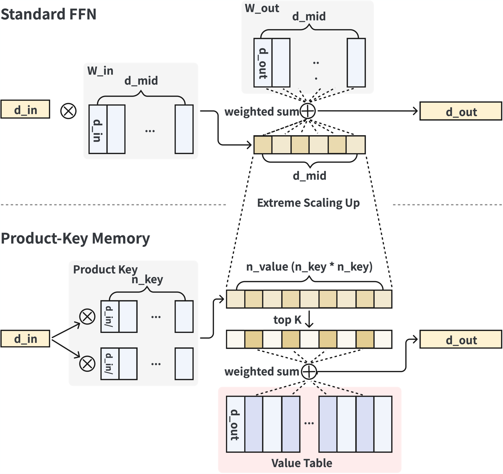
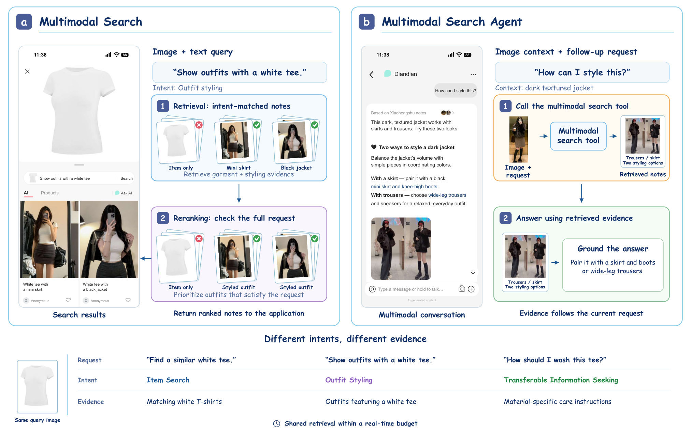
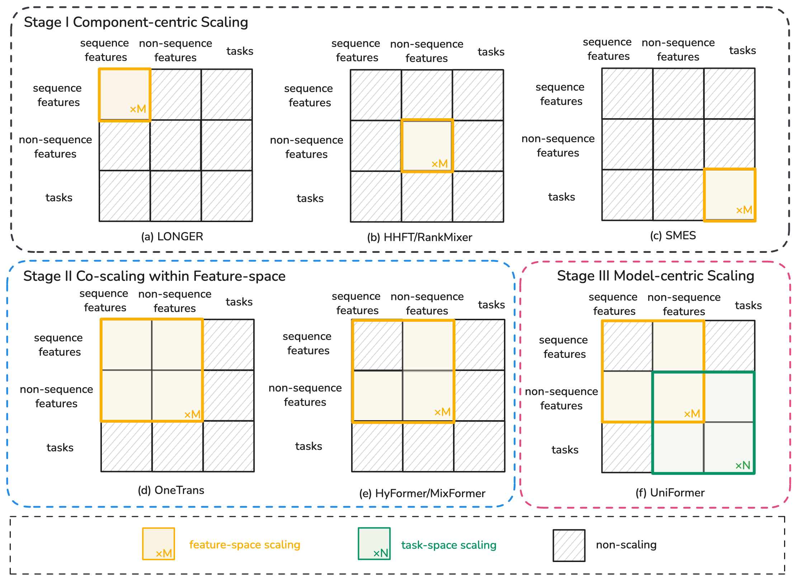
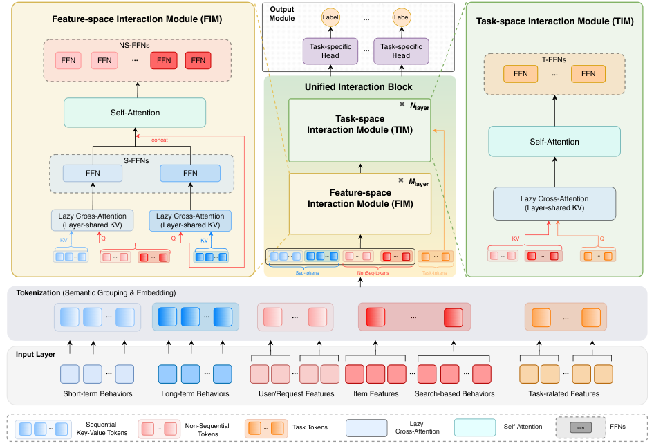
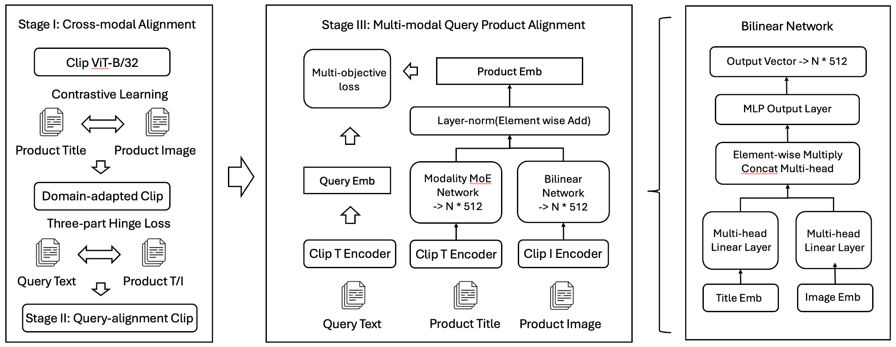

## 总览
今天这六篇几乎全是工业界落地报告，没有什么纯学术的漂亮想法，读起来像几家大厂各自把自家链路重做一遍的复盘。主线大致三条：一条是想要更多参数但不愿多花算力——MSN 用稀疏参数检索代替稀疏计算，[UniFormer](#note-3) 把 DIN/MMoE 那堆手工算子收成一套标准 Transformer，[TokenFormer](#note-6) V2 用分组布局在长历史上做取舍，本质上是同一个焦虑的三种解法；一条是多模态与意图——小红书那篇把「意图」当成统一准则来贯穿数据构造、embedding 和精排，两塔检索那篇则只在 item 侧融合图像，同时保证线上延迟不增加，两种路线各自都有巧思；还有一条是 Target 那篇，直接把多路召回的融合层交给 LTR，做法朴素，但真跑出了线上收益。共同的毛病也很一致：线上涨幅普遍在小数点后两位，离线消融很多落在 0.05pp 这种噪声量级，而且大部分收益没做归因拆解，别被标题里的大数字带走。真要我挑，[UniFormer](#note-3) 是今天最扎实的一篇，它把效率到底省在哪儿讲透了，FLOPs 也敢跟同行硬碰；小红书那篇的「意图当准则」是全文最值钱的设计，但 CTR 涨近 30% 这种幅度得当混合增益打折看。所以今天优先看 [UniFormer](#note-3) 和 [IntentFlow](#note-2)，想抄工程细节的再补 MSN 的稳定性三件套和 Target 那套标签加权。
## 论文列表

### 1. MSN: A Memory-based Sparse Activation Scaling Framework for Large-scale Industrial Recommendation
- 论文链接：[AlphaXiv](https://alphaxiv.org/abs/2602.07526v2)
- 更新时间：2026-11-14 08:41 UTC
- 机构：ByteDance Search，ByteDance AML
- 工业优先级：强
- 备注：9 pages. Updated to the KDD 2026 camera-ready version; publication metadata corrected

**SMoE 省了算力，坑在带宽上 🔧**

各位算法同学们，SMoE 一直说自己省算力，但每个被激活的专家都是一个完整 FFN，访存代价 O(d²)——在带宽吃紧的推理场景里，这个开销往往比算力先成为瓶颈。这篇来自字节搜索和 AML 的工作换了个思路：不激活专家，改为去大参数记忆表里检索个性化表示。

📄 MSN: A Memory-based Sparse Activation Scaling Framework for Large-scale Industrial Recommendation

🔧 核心是用 Product-Key Memory 把记忆索引空间拆成两个 key 子空间，检索复杂度从线性降到次线性，这样记忆表可以继续扩，而计算和访存都压得住。

🧩 检索出来的不是直接拼进特征，而是通过 Memory Gating 当作调制信号去作用在原始特征表示上，再接下游特征交互模块，等于给每个用户做细粒度个性化，而只增加一次轻量查表。

⚙️ 工程侧补了两块：LayerNorm 加 query 和 key 的学习率 warm-up，再对 key embedding 做过参数化，防止记忆槽利用率失衡和检索塌缩；同时写了定制 Sparse-Gather 算子并接入 AirTopK，保证训练和线上推理效率。

📊 访存复杂度这条线：单次激活从 FFN 的 O(d²) 换成了记忆查表，检索复杂度由线性降到次线性。

📈 定位是 model-agnostic 的插件，论文里是直接挂在已有的 SMoE 模型上做增量，离线指标稳定提升，不是换掉整个 backbone。

✅ 已上线抖音搜索排序系统，大规模线上 A/B 相对当前线上 SOTA 模型有显著收益（摘要只写了 significant，具体幅度要去正文实验表里看，别拿二手转述当结论）。

总结：如果你们模型扩参已经卡在 P99 延迟和带宽利用率上，而不是卡在 FLOPs，这套思路是可以直接搬的；盯两个指标，memory 槽的利用率分布和线上长尾请求的延迟，而不是只看 AUC。坑也明显——没有 LN、warm-up 和过参数化，检索很容易塌到少数槽；没有 Sparse-Gather 这类定制算子，原生框架下省下的算力会被访存开销吃回去。

### 2. IntentFlow: An Intent-Driven Real-Time Multimodal Search System with Image-Text Queries at Xiaohongshu
- 论文链接：[AlphaXiv](https://alphaxiv.org/abs/2611.20448v1)
- 更新时间：2026-11-16 03:17 UTC
- 机构：未披露机构
- 工业优先级：强
- 备注：29 pages, 7 figures. Technical report

**同一张白T恤图，意图不同结果全变**

各位算法同学们，同一张白T恤图，用户问“找同款”和问“怎么洗”，该出的笔记根本不是一类——但多数多模态检索把它们当同一个query。这篇把“意图”显式建模，还真上了十亿级索引的线上。

📄 IntentFlow: An Intent-Driven Real-Time Multimodal Search System with Image-Text Queries at Xiaohongshu

🔧 意图体系按“检索目标”而不是“物体类别”来分：第一层拆Visual Search（图就是答案）和Information Seeking（还要文字信息），第二层给具体目标，再和query里的target/constraint一起定相关性判据，让召回和重排共用同一套标准。

🧩 离线agentic流程造监督：自动捞候选、补证据、按意图判据核验相关性，产出verified正例和hard负例；embedding这边是意图感知对比学习+分级排序+分布蒸馏三件套拼起来。

⚙️ 精排器不看图文像不像，而是按预测出的一二级意图判断“这条候选有没有给出满足请求的证据”；线上靠query侧特征适配和残差投影迭代，避免全量重编码。

📊 小红书用户级A/B：Top-4 query CTR相对+28.17%，整体query CTR相对+18.96%
📈 人均搜索结果页停留时长相对+12.56%
✅ 端到端P50 1.07s、P90 1.34s，索引规模十亿级

总结：做UGC或电商多模态搜索、以及给多模态agent供检索工具的同学，可以跟这套“意图→判据→数据→召回→重排”对齐的做法。真正要盯的是意图识别准确率和召回阶段意图特定负例的质量，一级意图分错，后面全线偏。坑在于意图体系得先人工梳理，agentic标注链路成本不低，且文档索引不能随便重编码，模型迭代空间被query侧适配约束着。

### 3. UniFormer: Efficient and Unified Model-Centric Scaling for Industrial Recommendation
- 论文链接：[AlphaXiv](https://alphaxiv.org/abs/2606.27058v2)
- 更新时间：2026-11-16 07:46 UTC
- 机构：Kuaishou Technology
- 工业优先级：强

**推荐模型别再只scale特征了**

各位算法同学们，推荐模型这两年都在喊scaling law，但真正被scale的基本只有特征那一侧，任务建模还停在MMoE/PLE那套老架构上。快手这篇UniFormer把特征空间和任务空间放进同一个co-scaling框架，算是把model-centric scaling这件事件补全了一半。

📄 UniFormer: Efficient and Unified Model-Centric Scaling for Industrial Recommendation

🔧 把整体建模空间拆成feature space和task space，分别用堆叠的FIM和TIM建模，两者都走标准Transformer的attention加FFN结构，于是参数量可以在两个空间之间灵活分配，而不是全堆在特征交互里。

🧩 semantic-based tokenization让user和item在推理阶段解耦，不用每次请求都重算用户侧token，实现request-level的推理加速，这是能落地工业场景的关键一手。

⚙️ 多序列cross-attention分别建模异构行为（短期交互、长期压缩兴趣、候选相关序列），再用self-attention做融合，避免一股脑拼接导致的attention collapse；另外给序列、非序列、任务信号各配一套multi-view FFN，参数扩展不被单个模块绑架。

📊 线上A/B覆盖两个场景（快手主站和极速版）：App Stay Time +0.101% / +0.260%，Watch Time +0.729% / +1.113%。

📈 两个场景同向提升，说明不是某个流量池的偶然波动。

✅ 效率上靠省掉intra-sequence交互和序列与任务之间的交互来换容量，本质是“用结构换算力”的取舍。

总结感想：这篇的价值不在单点模块，而在给出一套可复用的拆分方式——特征侧和任务侧分开堆叠、FFN分视图扩展。要跟的话重点看它在你自己的场景里，request-level推理加速能否覆盖多堆几层的开销；如果任务数少、任务侧信号本来就弱，TIM那部分的收益可能没这么明显。另外这是工业A/B指标，0.1%级别的提升建议先对照你自家指标的方差再判断。

### 4. Beyond Text: Text-Image Fusion for Scalable Two-Tower Retrieval
- 论文链接：[AlphaXiv](https://alphaxiv.org/abs/2603.04836v3)
- 更新时间：2026-11-16 04:22 UTC
- 机构：未披露机构
- 工业优先级：强
- 备注：Accepted as a regular paper to the Industry & Government Program of the 2026 IEEE International Conference on Big Data (IEEE BigData 2026), Phoenix, AZ, December 14-17, 2026. 9 pages, 6 figures, 5 tables. v2: accepted version (revised title and text). (c) 2026 IEEE. Personal use of this material is permitted. Permission from IEEE must be obtained for all other uses

**电商检索只吃文本？图白扔了 📦**

各位算法同学们，先说个反差：电商检索这么多年几乎只读标题文本，商品图基本没参与排序，而这篇把图片接进双塔后，nDCG@1 最高涨了 4.86%。有意思的是，作者并不认为难点在融合结构，而在“让 query 同时对齐文本和图”这件事，这点挺反直觉。

📄 Beyond Text: Text-Image Fusion for Scalable Two-Tower Retrieval

🔧 融合只发生在 item 塔：图片编码器全程离线跑，item embedding 照样提前算好，线上 query 塔仍是单个轻量文本编码器，同一个 ANN 索引直接复用，CPU 服务路径一行不改；这才是它敢上生产的原因。

🧩 模态专家混合 + 双线性交互：门控 MLP 输出自适应权重 α 做加权融合，再用多头双线性项（逐元素相乘后拼接）抓文本与图片的细粒度交叉，残差加 LayerNorm 收尾，结构很轻。

⚙️ 三段式课程训练：先做电商领域微调，再让 query 分别对齐商品标题和商品图，最后才训完整融合模型；损失是多目标的，同时管用户 engagement 和语义相关性。

📊 训练规模 20M query-item 对，800 万商品目录；对比强纯文本基线，desirability 的 nDCG@1 最高 +4.86%，relevance +2.36%。

📈 收益集中在视觉主导类目，比如家居装饰这种靠风格、颜色、细节做判断的品类；标题写得越像关键词堆砌、越缺描述，图文互补的空间就越大。

✅ 线上服务延迟与纯文本方案持平，索引不重建，属于“加模态不加成本”的改法。

我的判断：做电商或内容检索、又被 CPU 双塔成本卡住的团队可以认真看，重点盯视觉主导类目的 nDCG@1，以及高 QPS 下的 P99 延迟有没有被门控和双线性拖慢。坑在训练侧：领域微调和分模态对齐这两步省掉，直接拿现成 CLIP 拼个融合层，大概率拿不到这个数。

### 5. Unified Ranking Across Retrieval Channels: A Large-Scale E-Commerce Approach
- 论文链接：[AlphaXiv](https://alphaxiv.org/abs/2602.23530v4)
- 更新时间：2026-11-16 04:54 UTC
- 机构：未披露机构
- 工业优先级：强
- 备注：Accepted as a regular paper to the Industry & Government Program of the 2026 IEEE International Conference on Big Data (IEEE BigData 2026), Phoenix, AZ, December 14-17, 2026. 10 pages, 4 figures, 2 tables. v4: accepted version (revised title and text)

**多路召回融合，别调权重了，学个模型**

各位算法同学们，多路召回融合这件事，不少团队还在手调 RRF 的 k 和加权交错的权重；Target 的做法更直接：不再用融合规则，而是学一个排序模型。线上转化 +2.85%，p95 延迟压在 50ms 以内。

📄 Unified Ranking Across Retrieval Channels: A Large-Scale E-Commerce Approach

🔧 把 rank fusion 重新表述为 channel-aware 的 LTR：每个候选都带上成员特征（来自哪些通道）和各通道原始分数，让模型自己学通道之间的交互，不再用一套全局权重套所有 query。

🧩 监督信号是周级的 funnel-weighted graded relevance，把曝光、点击、加购、购买按漏斗权重压成一个标量标签，直接对齐转化目标。

⚙️ 特征里加入了近期的 query-item 聚合行为，捕捉“人群当下在买什么”；计数每周重置，避免老爆款靠历史热度长期占位。

📊 随机在线 A/B：用户转化相对已上线的 weighted interleaving 提升 2.85%。

📈 重排阶段 p95 延迟低于 50ms，满足高流量生产环境的约束。

✅ 已在 Target.com 部署，上游召回和通道内排序逻辑都没有改动，只替换重排这一层。

总结：这套思路对已经有多路召回、还在手调融合权重的搜索团队最直接，改动面小、收益路径清楚。评估时不要只盯着 NDCG，要同时看转化和 p95 延迟两条线。两个问题需要先想清楚：通道集合是固定的，新增一路召回就得重训模型；周级标签在长尾 query 和冷启 item 上会波动，需要有兜底方案。

### 6. TokenFormer V2: Breaking the Resolution-Complexity Dilemma in Unified Recommendation
- 论文链接：[AlphaXiv](https://alphaxiv.org/abs/2611.19074v1)
- 更新时间：2026-11-14 01:24 UTC
- 机构：未披露机构
- 工业优先级：强
- 备注：Technical Preprint. 12 pages, 5 figures

**长历史全保留，算力还省5.1倍 🔧**

各位算法同学们，长行为序列这件事，直觉上“一个token都不压缩”应该最贵，这篇工作偏偏反着来：每个行为都留着独立token，前向FLOPs却只有MixFormer的19.5%。它要解决的就是推荐里的resolution–complexity dilemma——建模细，算力爆；摘要压缩，证据丢。

📄 TokenFormer V2: Breaking the Resolution-Complexity Dilemma in Unified Recommendation

🔧 分组token布局：把行为序列切成连续段，每段挂一组非序列字段token和可学习的组中继token，段内做Local Group Attention，让每条行为都能看到邻居和字段上下文。

🧩 层级组合并：层数加深时相邻组合并，四条的组并成八条的组，交互范围扩大但不做pooling、不丢token，分辨率全程不掉。

⚙️ 两条轻量通信路径 + Full-Resolution Readout：NS Fusion把不同组更新过的字段表示混一遍再发回去，Global Sync只在中继token和少量readout token之间交换全局信息；最后用readout token对全部编码token做candidate-aware cross-attention，预测阶段仍然能直接读到每一条行为。

📊 TAAC 2026 上八个统一推荐backbone横向比，AUC最高、log loss最低，前向FLOPs只要MixFormer的19.5%，也就是省5.1倍。

📈 微信视频号十亿参数：输入特征完全相同时，整体AUC比MixFormer高0.0572pp，简化输入版本到0.0712pp，摘要口径最高+0.07pp；历史长度翻倍和行为域不均衡的分群里优势还在。

✅ 线上A/B对比现网生产模型，GMV提升2.33%，统计显著。

总结感想：适合长行为序列、serving预算又被卡死的工业排序团队看。真要跟，重点盯FLOPs随序列长度增长的那条斜率，以及长历史上AUC有没有掉，这两个指标才是它宣称的地方。坑在于组大小、合并时机、中继token数量都是新增超参，调起来不轻松，而且效果依赖字段侧token化的工程量；对比基线记得选MixFormer和OneTrans，别只跟DIN比。
