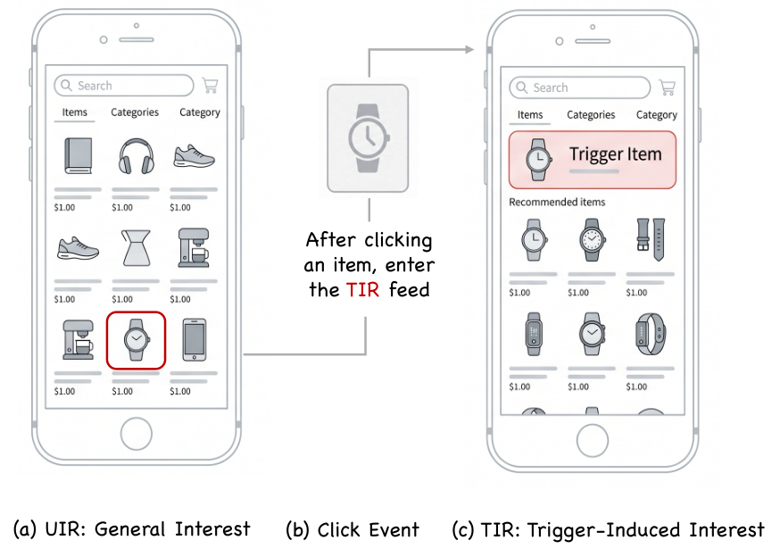
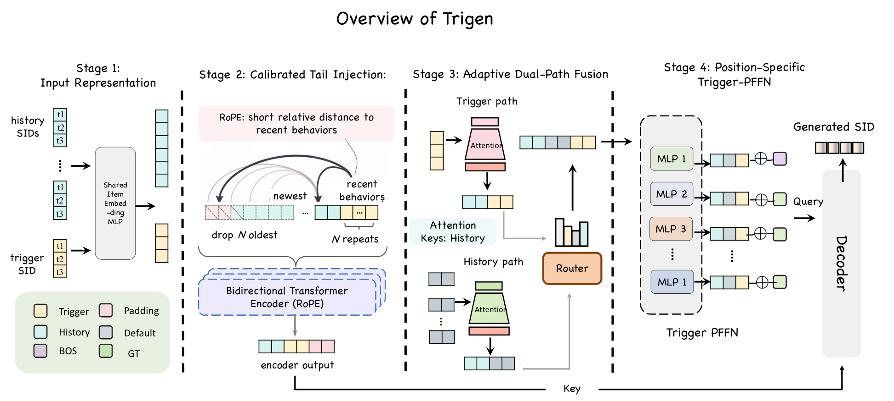
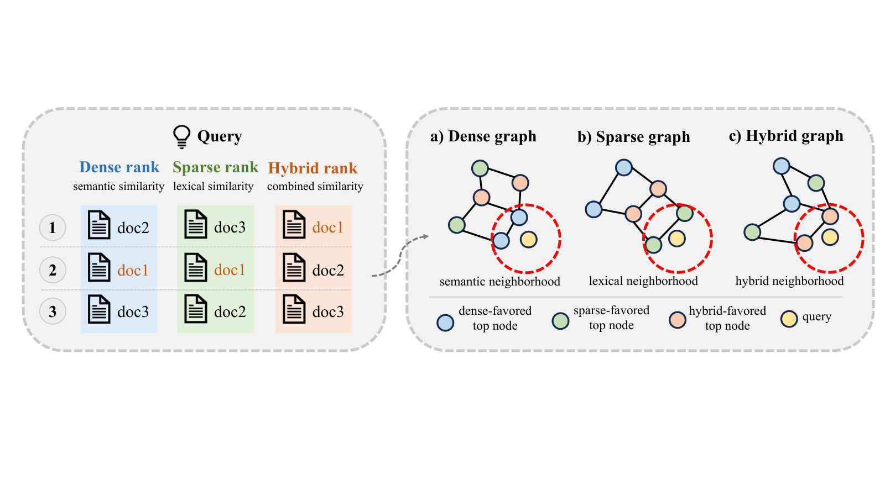

## 总览
今天这批论文质量不错，四篇里有两篇是真正能落地的工业级工作，而且凑巧串成了一条主线：生成式推荐怎么在真实业务里把细节做对。阿里国际的两篇值得优先细读，一篇解决触发式场景下 trigger 怎么进生成模型——靠 RoPE 对齐、双路条件加请求级门控、每层 SID 单独注入，六个东南亚市场的线上 A/B 加上全量上线是最硬的证据；另一篇则把长尾召回拆到推理链路上逐段量化，指出大部分尾目标压根进不了匹配阶段，然后用长并行 SID、去偏 beam 和容错部分匹配打组合拳，小 beam 反而更高这个对比很有说服力。不过两篇的坑也都明摆着：前者公开集只是竞争性、GMV 涨跌因市场而异，后者本质是拿容错换召回、公开集整体指标略输最强基线，属于明确的尾-头权衡，读的时候别被线上数字冲昏头。另外两篇一个是把用户兴趣做成可看可改的自然语言条目、还让显式编辑压过模型推断，思路漂亮但 grounding 一提阈值 recall 就掉到三成；另一个用 α-cover 建统一图解决动态混合检索，工程巧思多、离线 QPS 提升实在，可线上只有一句“已部署”，说服力打了折扣。今天优先看阿里那两篇生成式推荐的，先把 trigger 注入和尾可达率这两条改进链路吃透，再回头翻 [CLEAR](#note-3) 的可控性设计。
## 论文列表

### 1. TriGen: A Generative Paradigm for Trigger-Induced Recommendation
- 论文链接：[AlphaXiv](https://alphaxiv.org/abs/2611.16395v1)
- 更新时间：2026-11-12 07:07 UTC
- 机构：Alibaba International Digital Commerce Group，Nankai University，Independent Researcher
- 工业优先级：强

**点完商品那屏推荐，生成式模型怎么接？**

各位算法同学们，生成式推荐最尴尬的地方不是生成得慢，而是你刚点进一个商品、平台马上给你开一屏相关推荐的时候，模型还在按“长期历史平滑续写”，完全没接住那一瞬间的意图。这篇补的正是这个洞：TIR（点击触发的二级推荐）此前基本是判别式打分的天下，生成式范式几乎空白。

📄 TriGen: A Generative Paradigm for Trigger-Induced Recommendation

🔧 校准式尾部注入：把 trigger 的表示重复拼到历史序列尾部，用 RoPE 管相对位置、用重复次数管 trigger 的权重强度，绕开“单个 trigger token 被长历史淹没”这个坑，让它在编码阶段就把局部上下文重写一遍。

🧩 自适应双路融合：历史偏好和即时冲动拆成两条路径，再靠 input-dependent 的 gating 按请求动态分配话语权，避免静态融合方案在“随便逛逛”和“明确换兴趣”之间两头不讨好。

⚙️ 位置相关的 TriggerPFFN：SID 是从粗粒度类目到细粒度属性逐层展开的，只在第一步做条件注入会一路衰减；它把 level-aware 变换塞进 decoder 层里，让 trigger 引导跟着每个解码步的语义粒度变。

📊 离线：工业级电商数据和公开基准上，对序列式、生成式、判别式 TIR 基线都稳定领先。

📈 线上：六个国家市场 A/B，流量加权 Revenue +3.27%、GMV +0.90%。

✅ 已全量上线承接主流量，不是实验室 demo。

总结一下：做生成式推荐、又多入口/点击进二级 feed 的团队，这套“编码—融合—解码”三段式改法可以直接对照自己的 pipeline 找位置。要盯的坑有两个：尾部注入的重复次数是个强先验超参，跨场景迁移前先扫一遍；gating 在稀疏请求上容易抖，得看分国家、分流量层的一致性。另外对比时别拿整体大盘的 +3.27% 当模型净收益，要看 TIR 场景内部的增量，再和判别式 TIR 基线对同一批流量比。

### 2. ReSID: Rethinking Long-Tail Retrieval in Generative Recommendation through Item Reachability
- 论文链接：[AlphaXiv](https://alphaxiv.org/abs/2611.16404v1)
- 更新时间：2026-11-12 07:12 UTC
- 机构：Alibaba International Digital Commerce Group，Nankai University
- 工业优先级：强

**长尾召不回，问题可能不在模型**

各位算法同学们，生成式推荐长尾召回差，很多人的第一反应是模型没学好，但阿里国际这篇的结论是：信号大概率已经学到了，是 beam search 在解码早期就把尾部候选的路径剪没了。图 1 里尾部目标的精确路径比头部早得多地丢光，而头部还好好的。这篇有意思的地方在于，它把 SID 构建、解码、匹配三段串起来算了一次“可达性”的账，而不是只盯训练目标。

📄 ReSID: Rethinking Long-Tail Retrieval in Generative Recommendation through Item Reachability

🔧 同等码长下，并行 SID 比串行 SID 对长尾更友好。逻辑是串行残差会逐层累积热门偏置，并行则把语义切成独立子空间、位置间误差互不传染。在码空间完全相同（256³ = 16⁶）的前提下，短码配置把 Tail Recall@200 从 8.62% 提到 13.02%，长码配置把尾部有效覆盖从 4.70% 提到 9.16%。

🧩 完整 SID 生成失败不等于没有信息。并行结构下剩余位置的 token 仍是局部一致的，把精确匹配放宽成部分匹配，就能从这些残留 token 里捞回相关尾item。图 1(b)：头部可达率 41.32%→59.77%，尾部 9.75%→41.56%，尾部涨得更凶。

⚙️ 但这种恢复有硬上限，卡在上游 beam。给定容错度，只要 beam search 在早期把所有可能补全的前缀剪干净，后面匹配再花哨也救不回来。ReSID 因此做了两件事：beam 打分去流行偏置，不让头部霸占窄 beam；用用户行为语义引导搜索方向，再配合部分 SID 匹配把幸存 token 兑现成候选。

📊 线上主流量：广告收入 +1.3%，CTR +1.1%，GMV +0.8%，长尾曝光占比 +4.0%。
📈 窄 beam 下召回的相关尾item反而更多，延迟更低、吞吐更高，这一点比单纯涨点更有工程意义。
✅ 离线在长尾召回与覆盖类指标上是 SOTA，整体准确率保持竞争力；对比 Ghost 那类靠牺牲整体换长尾的做法，这是明显的取舍差异。

总结：如果你在做生成式推荐、线上 beam 又开不大，这套排查顺序可以照搬——先看 SID 是串行还是并行，再统计精确匹配丢掉了多少“半对”序列，最后看 beam 剪枝位置。需要提前预判的问题是部分匹配会带来误召回，容错度和去偏强度得重新调；另外它依赖长并行 SID，短码或小码本的场景收益未必有这么大。

### 3. CLEAR: Legible and Steerable Recommendation via Grounded Natural-Language Interests
- 论文链接：[AlphaXiv](https://alphaxiv.org/abs/2611.19110v1)
- 更新时间：2026-11-14 02:44 UTC
- 机构：未披露机构
- 工业优先级：强
- 备注：18 pages, 6 figures

**让用户自己改兴趣标签，Meta跑了一年**

各位算法同学们，如果告诉用户“系统认为你喜欢真人秀，你可以删掉，还能自己加个油画”，推荐会变差还是变好？Meta 的答案是后者，而且这套东西已经在 Instagram 和 Facebook 四个入口跑了一年多。它的关键不在“给用户看标签”，而在让用户的一次编辑真正进入召回、排序和曝光链路。

📄 CLEAR: Legible and Steerable Recommendation via Grounded Natural-Language Interests

🔧 把兴趣层做成一份有优先级的状态契约：LLM 从最近行为里提出自然语言兴趣候选，用户显式添加或屏蔽的条目单独存储，优先级高于后续模型推断；推断兴趣可以随证据衰减过期，但用户的修改不会被下一轮推理悄悄覆盖。

🧩 行为接地不是让模型自说自话：每个推断出的兴趣要反查用户自己的历史事件，凑出 support set，再用它做三件事——过滤证据不足的候选、识别“对这个人来说是近重复”的两条兴趣、以及给出证据加权的排序信号。用户新声明的兴趣可以没有历史支撑，走另一条路径，冷启动声明不被当成过去行为的证据。

⚙️ 同一个兴趣对象直接当 serving 地址用：label 加画像改写走词法检索，support events 做行为召回，兴趣向量投影查 ANN 索引，稳定 id 负责跨来源归因和曝光记账。行为召回是合取条件——既要在用户自己的共互动邻域附近，又要内容上对题，避免“全局相关但和这个人无关”和“行为相近但跑题”两类噪声。

📊 用户直接审阅中，约 88.5% 的展示兴趣被评为准确。

📈 统一评测协议的离线基准上，专用 3B 生成器 mean-user F1@10 为 0.3967，Gemini 2.5 Pro 是 0.3633，上一版生成器只有 0.1911。

✅ 针对“新声明兴趣”的用户随机累积消融：当日曝光损失分别是兴趣排序项 8.7 个百分点、预留顶部坑位 11.1 个百分点、兴趣条件候选召回 13.7 个百分点，注意这是条件于所测移除顺序的结果。

📈 组件在生产环境运行超过一年，覆盖两个平台四个界面。

我的判断：做可控推荐、LLM 用户建模、冷启动兴趣表达的同学可以把这篇当工程参考，它把“可读”和“可操作”拆开定义，这点比多数 profile 论文清晰。要盯的指标不止 F1@10，更关键是线上可归因曝光和屏蔽兴趣的复现率；坑有两处，累积消融带顺序依赖，那些百分点不能横向相加或跨系统比较，另外兴趣层只是被展示的排序子集，别把它当成模型全量隐状态可见。

### 4. UniGraph: A Unified Graph-based Index for Dynamic Hybrid Dense-Sparse Vector Retrieval
- 论文链接：[AlphaXiv](https://alphaxiv.org/abs/2611.20758v1)
- 更新时间：2026-11-16 09:06 UTC
- 机构：未披露机构
- 工业优先级：强
- 备注：Under ICDE 2027 Review, 14 pages

**混合检索别再建两个索引了🧩**

各位算法同学们：混合稠密+稀疏检索现在基本还是“双路召回再重排”，但你想过没有——真正该排第一的 doc，可能在稠密和稀疏两路里都进不了前列，重排时压根没进候选集。蚂蚁这篇 UniGraph 想干的事就是：把多个 α 权重下的邻居合并进一张图，查询时带上 α 直接搜，索引不用重建。

📄 UniGraph: A Unified Graph-based Index for Dynamic Hybrid Dense-Sparse Vector Retrieval

🔧 α-cover 构图：在多个混合权重 α 下分别采样邻居集合，取并集后裁到固定出度 M，用一张有界度的图覆盖多个权重的邻域，切换 α 不需要重建索引，这是全文最关键的一步。

🧩 自适应入口点：根据查询的 α 决定从稀疏侧还是稠密侧引导进入图，让初始化与查询偏好对齐，避免固定入口在极端权重下多绕很多弯路。

⚙️ 稠密优先剪枝：先算稠密距离分量，再结合稀疏向量范数判断这次精确稀疏内积能否跳过，把大量不必要的稀疏距离计算省掉。

📊 五个真实数据集，混合权重设定下，Recall@100 ≥ 0.95 时 QPS 比最快基线高 27.6%~52.3%。

📈 固定权重场景下，QPS 达到最快基线的 1.18×~2.85×。

✅ 已在蚂蚁生产环境规模部署，线上确实存在 query 级动态权重的需求，不是纯实验品。

总结感想：如果你在做 RAG 或搜索的混合召回，而且 α 是随 query 变的，这套“一张图吃多个权重”的思路比双路各取一批再重排少一次检索，工程上值得借鉴。真要落地，先盯两件事：α 分布拉得很开（接近 0 或接近 1）时召回是否明显下降，论文主要报的是混合权重下的平均表现；以及多权重邻域合并后的构建耗时和内存占用。图的度分布会不均匀，这部分成本得先量出来，再决定是替换现有双路管线，还是只当作重排阶段的补充索引。

