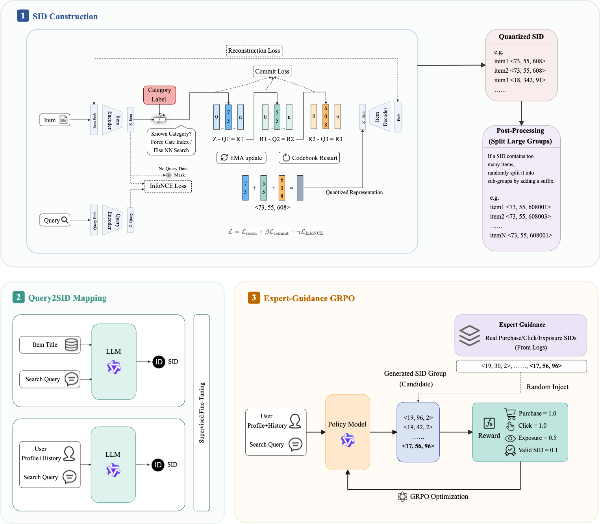

## 总览
今天这三篇看下来质量挺实在，都是工业界真刀真枪落地过的活，不是刷榜论文。主线很清楚：都在跟"用户行为分布不均"和"分布漂移"较劲，只是切法不同——TikTok 那篇从标签侧下手，把绝对时长换成分位数，用样本对比较直接估 CDF，推导干净、线上负反馈降了近 7 个点，这是今天最值钱的一篇；飞猪那篇拆历史表示和活动期分数校准，线上 CVR 涨 3 个多点有信号，但离线只领先 TEN 零点几个千分点，组合优势没表格看着那么稳，读的时候要多留个心眼；淘宝天猫那篇走生成式检索加语义聚类 ID 和专家引导 RL 的路子，工程味道最重，适合做电商搜索的同学细看。要说遗憾，三篇共性的问题都是关键复现细节留白——内存怎么省、时间核怎么调、负样本池怎么建，都得靠猜。建议今天优先精读 [PEARL](#note-1)，[COTTI](#note-2) 挑 ABA 那节看就行，第三篇按需。
## 论文列表

### 1. PEARL: Unbiased Percentile Estimation via Contrastive Learning for Industrial-Scale Livestream Recommendation
- 论文链接：[AlphaXiv](https://alphaxiv.org/abs/2605.21752v2)
- 更新时间：2026-11-17 03:24 UTC
- 机构：TikTok，ByteDance
- 工业优先级：强
- 备注：Accepted to KDD 2027 ADS Track

**直播推荐去偏：别回归时长，估分位 🎯**

各位算法同学们，同一个视频，有人看10秒有人看10分钟，直接回归观看时长会怎样？高活用户把训练信号带偏，模型学到的是“谁爱刷”而不是“谁喜欢”。PEARL 的思路很干脆：不估绝对时长，只估这个用户自己的分位。上线 A/B 里举报率降了 6.91%，这个数字比涨时长更值得看。

📄 PEARL: Unbiased Percentile Estimation via Contrastive Learning for Industrial-Scale Livestream Recommendation

🔧 不需要辅助模型估分布：把预测目标从绝对互动量换成用户内的相对分位，直接用训练数据里天然存在的成对样本做对比（同一用户两次互动谁看得更久），用 BCE 学相对顺序。相比 RAD 那套先估条件互动分布再转分位的做法，少了一层估计误差和一套线上分布追踪。论文给了理论证明：这类成对比较得到的就是分位数偏好信号的无偏估计。

🧩 稀疏离散反馈用预测做平滑：点击、送礼这类是离散标签，经验分位太粗、样本太薄，用基于预测的 bootstrapping 把粗糙经验分布换成连续先验，缓解标签稀疏带来的抖动。

⚙️ 加权形式加协同训练：value-weighted 形式让不同互动的重要性可以不同；co-training 引入互补监督信号，让表征学和排序目标同时受益，不是单纯换个 loss。

📊 离线：多个排序目标上 User AUC 稳定提升，行为偏置得到明显缓解。

📈 线上 A/B（十亿级用户的直播推荐系统）：Watch Duration +2.10%，Consumption Amount +0.80%，Interaction Rate +1.49%。

✅ Report Rate -6.91%，而且时长是涨的，不是靠推更刺激的内容换来的。

适合直播、短视频这类“用户行为强度差异大、回归目标长尾”的排序场景。落地要盯两件事：成对样本是否够密（决定分位估计方差），以及离散目标上的平滑强度，照搬权重容易过平滑。如果你们还在用需要辅助分布模型的去偏方案，这个是更轻的替代路径。

### 2. COTTI: Contrastive Training and Time-Aware Inference for Robust Industrial Recommendation under Promotional Drift
- 论文链接：[AlphaXiv](https://alphaxiv.org/abs/2611.22597v1)
- 更新时间：2026-11-17 11:18 UTC
- 机构：未披露机构
- 工业优先级：中

**离线AUC微涨，线上CVR+3.14%**

各位算法同学们，大促期间最反直觉的一点是：离线AUC从0.8101挪到0.8127，几乎看不出变化，线上CVR却相对涨了3.14%。涨得最多的那部分不在训练里，而在打分那一刻——这篇论文就是把这两件事拆开做的。

📄 COTTI: Contrastive Training and Time-Aware Inference for Robust Industrial Recommendation under Promotional Drift

🔧 CPC跨期对比对齐：同一个用户的日常历史和大促历史配成正样本做InfoNCE，权重η=1−σ(v)由两个视图的方差距离决定，差得越远权重越小，而且η参与反向传播，模型可以自己选“对齐”还是“把门关小”，不是硬拉齐。

🧩 RW按历史距离重加权：促销样本权重ω=exp(−γ(d−μ)/σ)，距离低于批次均值的样本权重大于1、远的小于1，直接乘进损失，不裁剪也不做均值归一，保留转化标签作为监督。

⚙️ ABA只在线调logit：冻结预测器参数，用head dropout多次前向拿到预测波动U，再乘时间事件核α(t)，得到δ去修正logit。训练期和服务期彻底分离，κ、β在早期验证集上选好后不再动。

📊 Fliggy离线AUC 0.8127，TEN是0.8101，TEN单加ABA是0.8123，ABA作为即插即用的校准层也能起作用。

📈 十天线上实验对在服的HDR模型：CVR相对+3.14%，RPM相对+2.68%。

✅ 端到端p99 38.9ms，吞吐14700 QPS，开ABA只多2.2ms，代价很小。

⚠️ 但交叉类目分析有代价：整体区分度提升的同时，新类目下已购商品的召回下降，这是他们自己写明的权衡。

总结：适合已经在跑HDR、TEN这类大促自适应方案的团队，把COTTI当推理期轻量补丁比整体换模型划算。要盯的是新类目召回、ABA的校准窗口，以及Δ(u)这个表征漂移量——它只说明均值变了，不等于排序退化，别拿它当线上告警用。

### 3. Efficient Generative Retrieval for E-commerce Search with Semantic Cluster IDs and Expert-Guided RL
- 论文链接：[AlphaXiv](https://alphaxiv.org/abs/2605.14434v2)
- 更新时间：2026-11-17 02:49 UTC
- 机构：Taobao & Tmall Group of Alibaba
- 工业优先级：未标注

**一物一ID未必最优，淘宝这样改 🔧**

各位算法同学们，一个召回通道能吃掉线上 72.63% 的购买、58.96% 的点击，占总曝光 50.25%——但论文开篇就泼冷水：生成式召回不该端到端替代原来的多阶段漏斗，而是塞进去当召回补充。这篇的看点正是这个“退一步”的工程取舍。

📄 Efficient Generative Retrieval for E-commerce Search with Semantic Cluster IDs and Expert-Guided RL

🔧 CQ-SID 放弃一物一 ID，把 SID 当“语义簇编号”用：RQ-VAE 三级码本 2048×1024×1024，第一级直接拿商品类目 ID 强制约束（1711 个有效类目），二三级走常规最近邻量化，同簇共享前缀、允许有限碰撞但给每簇设上限，beam search 复杂度因此大幅下降。

🧩 训练上加了 query-item 对比学习和分阶段 SFT，从商品标题到 query-item 关联再到用户个性化特征逐步喂进去，backbone 只用 Qwen2.5-0.5B，没堆大模型。

⚙️ EG-GRPO 解决的是稀疏 reward 下 policy gradient 不稳的问题：把 ground-truth 样本注入同一个 group 里做优势归一化，让召回目标与下游排序对齐时不会训崩。

📊 离线 TmallAPP 搜索日志：语义点击 hitrate 相对 RQ-VAE 基线提升 26.76%，个性化点击 hitrate 提升 11.11%，同时 beam size 减半。

📈 线上 A/B：GMV 提升 1.15%，UCTCVR 提升 0.40%。

✅ 该生成式召回通道在生产环境占曝光 50.25%、点击 58.96%、购买 72.63%。

🧠 我的判断：做工业召回、尤其被索引维护和延迟卡住的团队，这套“放粗 SID 粒度换效率”的思路可以拿来对照。但要盯的是簇内上限、beam size 和 hitrate 的联合曲线，只看 hitrate 会误判；和 CAT-ID、Hi-Gen 这类强调 ID 可区分性的工作比，它的差异就在于主动允许碰撞。坑也明显：第一级码本绑死类目体系，类目本身乱的话，后面全歪。

