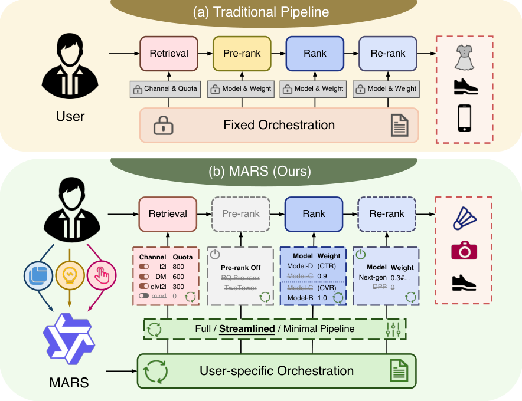
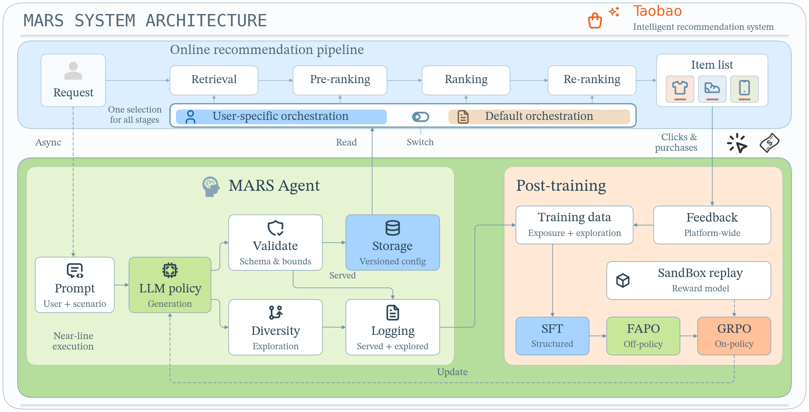
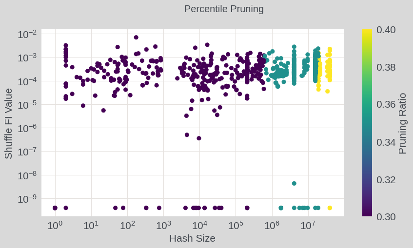
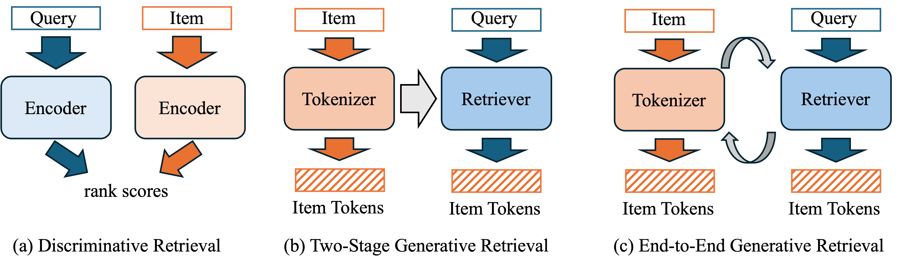
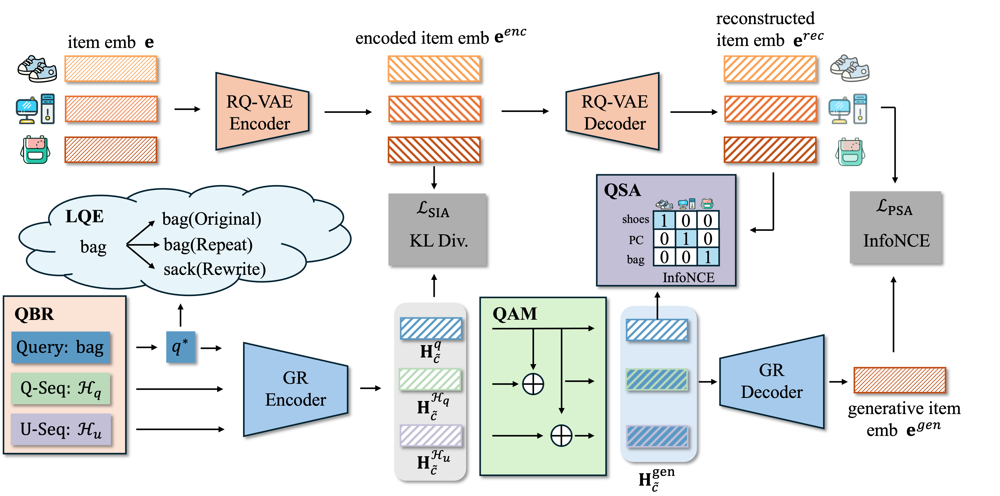

## 总览
今天这批论文整体质量不错，五篇里至少有四篇是能直接拿到工程会上聊的货，而且主题相当集中：三篇都在解决推荐系统和生成式检索里「怎么把该给的信号用对地方」这件事，只是切入角度不同。最值得细读的是 [MARS](#note-1) 和那篇讲 RL 后训练副作用的，前者把按用户生成整条链路编排配置这件脏活做成了可上线的工程闭环，其中只在真正不同的 action 值上做偏好比较、避免格式 token 稀释信号这一设计，我认为是整篇最有借鉴价值的地方；后者的价值不在于提出新方法，而在于用全库精确排序发现了 RL 只把前几十个位置做好、K 上百就开始掉点的隐蔽代价，还给出了很便宜可行的补救方案，这种「别只看 top-10 指标」的提醒对做生成式推荐的人尤其重要。X-split [Argus](#note-2) 和 [IntentGR](#note-4) 属于扎实的落地与改进型工作，方法组合不算新，但胜在把可复用性、预算分配、刷新节奏这些工程约束和线上收益一并交代清楚，把拆分、蒸馏、意图注入这些点串起来了，适合当设计参考。另外值得留意的是，这一批论文的结论大多建立在离线评估和点估计上，好几篇的收益量级已经贴近显著性门槛，而且都没有线上 A/B 佐证，所以看这类数字时要多留一分怀疑。今天优先看 [MARS](#note-1) 和那篇 RL 后训练分析，再看 X-split [Argus](#note-2)。
## 论文列表

### 1. MARS Technical Report
- 论文链接：[AlphaXiv](https://alphaxiv.org/abs/2611.24006v1)
- 更新时间：2026-11-18 07:56 UTC
- 机构：未披露机构
- 工业优先级：强
- 备注：46 pages, 5 figures

**0.6B小模型接管推荐全链路调度🤖**

各位算法同学们，淘宝这次线上A/B里最猛的一条增益，不是换了个更大的排序模型，而是把「开哪几路召回、每路留多少配额、用哪个CTR/CVR模型、分数怎么融合」这些原本由工程师拍板、全场景共用的配置，改成按用户单独生成。这篇技术报告讲的就是这套编排智能体怎么在不碰线上延迟的前提下跑起来。

📄 MARS Technical Report

🔧 决策单元被换掉了：不再调单阶段模型，而是让一个微调过的Qwen3-0.6B输出七维结构化动作——pipeline模式、召回通道子集与各通道配额、CTR/CVR模型选择、各级融合权重、reranker设置，全部落在受限动作空间内；生成走近线异步，校验后原子写入版本化缓存，在线级联读缓存，从不等待LLM推理。

🧩 三段式后训练各解一个问题：置信度感知SFT把schema合法率从1.0%拉到99.8%，同时用Wilson筛选的执行证据对齐推荐效率；FAPO用ActionMask只在动作值不同的位置上做偏好比较，按后验访问-购买率加权，避免格式token把训练信号摊薄；GRPO靠Sandbox快照回放加冻结奖励模型做on-policy精修，探索性配置不暴露给真实用户。

⚙️ 安全壳做得比模型本身更细：生成侧和消费侧各做一遍schema、模型名、配额与权重合法性检查，更新失败保留上一版有效缓存，无缓存或读取超时就回退现网配置，另有总开关一键回滚全量流量。

📊 五个淘宝营销场景、两周A/B、日活超千万，各场景关键指标点估计均为正。

📈 最大增益 +5.22% V2P、+7.34% GMV，两个点击面的CTR点估计也都为正。

✅ 约20%请求被路由到Minimal轻量模式，评估部署下线上服务路径平均延迟比生产基线低12ms。

我的判断：做多阶段级联、编排还停留在人工调参的团队可以认真看架构那几节，尤其是缓存+回退+kill switch这套，比分数更可复用。要盯的指标是回退率、缓存命中率和延迟分布，而不是只看GMV；和GreenFlow、MaRCA那类在固定结构内分算力的工作比，MARS动的是结构本身，代价是奖励模型与Sandbox的保真度直接决定上限，而且探索永远不进线上，信号来源天然受限——这两点是落地时最容易踩的坑。

### 2. X-split Argus: Learning Reusable History Tokens for Efficient CTR Prediction
- 论文链接：[AlphaXiv](https://alphaxiv.org/abs/2611.24283v1)
- 更新时间：2026-11-18 11:58 UTC
- 机构：未披露机构
- 工业优先级：强
- 备注：Alexander Ploshkin, Nikita Stepanov and Alexey Pismenny contributed equally to this work

**历史压成K个token，CTR线上还涨了**

各位算法同学们，线上CTR最贵的往往不是模型参数，而是每个候选都要把用户长历史重算一遍。这篇给出的答案是：历史离线压成K个token、全候选共享复用，线上只处理最近M条事件，A/B还能涨。

📄 X-split Argus: Learning Reusable History Tokens for Efficient CTR Prediction

🔧 两段式结构：history compressor 用因果自注意力把历史编码成逐事件状态，取前缀最后K个state当压缩token，离线算好、跨候选复用；线上ranker只对这批token和最近M条事件做cross-attention，候选相关信息在注意力里再注入。

🧩 压缩器和ranker是端到端一起训的，loss由两部分组成：历史点击反馈的自回归预测，加上一个用未压缩全历史的更大teacher给出的candidate级click logits蒸馏；蒸馏的梯度经过ranker回传到压缩器，等于直接教会它哪些信息值得留下。

⚙️ K和M是显式的算力调节参数，直接对应serving预算，调它们不用动整体结构，这点比很多“改一处就要重训”的方案实用。

📊 离线NE相对降0.81%（对比生产基线Context-aware ARGUS），并且保留了teacher相对基线增益的70%以上。

📈 部署在约十万QPS的实时竞价系统里，线上推理成本只多15%，用的是同型号GPU，延迟预算没破。

✅ 线上A/B：ACV（广告主转化金额口径）相对+4.65%，点击相对+2.96%。

总结感想：压缩历史这个方向并不新，VISTA、TM20K、HELIX都在做，这篇真正有信息量的是“15%算力换4.65% ACV”这笔账的实测。想跟进的话盯两个指标：蒸馏后保留teacher增益的比例，以及K和M调小后NE的衰减曲线，掉太快说明压缩token没学到候选相关信号。坑在teacher要用未压缩全历史，离线链路得跑得动这个大模型，否则这套监督根本不成立，小团队先算清这块成本再谈上线。

### 3. Intelligent Embedding Pruning for Large-Scale Recommendation Models
- 论文链接：[AlphaXiv](https://alphaxiv.org/abs/2611.25288v1)
- 更新时间：2026-11-18 23:26 UTC
- 机构：未披露机构
- 工业优先级：强

**剪枝比例别按表大小，看特征重要性 🔧**

各位算法同学们，112 张 GPU 的训练作业砍到 80 张，单卡 P90 吞吐反而高了 8%。靠的不是换硬件，是给 embedding 剪枝换了一套定比例的方法。这篇 Meta 的工作把特征重要性塞进了 in-training pruning，内存省下去，NE 却没掉。

📄 Intelligent Embedding Pruning for Large-Scale Recommendation Models

🔧 原版 ITEP（AdaEmbed）按表大小定剪枝比例：大表剪得最狠，小表只轻轻剪，完全不看这个特征对 loss 有没有贡献，所以精度偶尔会掉一截。

🧩 FI-ITEP 改用特征重要性打分：permutation shuffle 或 Shapley Value Sampling 在 batch 内扰动某个特征、看 loss 变化多少，分低的表给更高剪枝比例，比例从“按尺寸分档”变成“按分数线性插值”。

⚙️ FI 只算一次，采样固定在每 batch 4096 条、每天 256 个 batch，1–2 GB 数据，跟模型规模无关，所以模型越大，这笔开销摊得越薄。

📊 三个工业级 DLRM（80GB、390GB、1.1TB）：同等激进度下总内存降 20–40%，相对 percentile 基线多省 8.3%–14.2%。

📈 NE 方面：390GB 模型 eval NE 回退 1.4%（基线 2.2%），1.1TB 模型 eval NE 改善 -0.059%（基线 -0.039%），小模型回退也小（0.017% vs 0.025%）。

✅ 开源 DLRM + Criteo 1TB 复现：50% 内存削减下 AUROC 0.6395 vs 0.6176（+0.0218）；80% 削减、1000 batch 时训练快 29%，percentile 只有 14%。

✅ FI 本身开销 4.3%–11%，但按 launch 算省下 1000+ GPU-hours；FI 分数一个月内 top-100 的 Spearman 相关 0.85–0.92，漂移不算问题。

⚠️ 我的判断：embedding 撑爆 HBM、又高频重训的大模型最划算；小模型省下的 trainer 时间可能盖不住 FI 那笔固定成本，这种情况继续用 size-based 剪枝就行。真要跟，盯 eval NE 的相对变化（0.02% 就算显著）、单卡吞吐、FI 占总训练时间比例这三项，基线就选 percentile ITEP。坑在于 SVS 那套调起来更敏感，论文里 Models 2/3 都退回了 shuffle；另外实际要调的是“低重要性表的最小尺寸下限”，别只盯总剪枝率。

### 4. IntentGR: Enhancing Intent for End-to-End Personalized Generative Retrieval in Search
- 论文链接：[AlphaXiv](https://alphaxiv.org/abs/2611.22788v1)
- 更新时间：2026-11-17 13:51 UTC
- 机构：Zhejiang University，Alibaba International Digital Commercial Group
- 工业优先级：中
- 备注：11 pages, 3 figures; Accepted by WSDM 2027 Findings

**生成式检索别把query只当输入🔍**

各位算法同学们，端到端生成检索有个大家都清楚、却很少有人正面写出来的问题：query在模型里基本只算一个输入特征，既不参与SID的学习，也不参与解码引导，于是生成的语义ID容易漂向高频token模式，跟你这次搜的意图对不上。这篇就在四个阶段把query重新当成主角来强调。

📄 IntentGR: Enhancing Intent for End-to-End Personalized Generative Retrieval in Search

🔧 QBR：把同一query下更早的历史行为单独拼成一条query级行为序列，作为新的输入信号，跟用户长期偏好一起放进同一个encoder，让模型自己去找和当前query相关的历史兴趣。

🧩 QSA：在tokenizer和生成器联合优化时加一个共享的query-item语义目标，让生成端的query表示去对齐tokenizer重建出的目标item表示，而不是各自只围着item重建和SID预测转。

⚙️ LQE 和 QAM：前者对长尾query做增广，提高出现次数和语义多样性，缓解头部query主导训练分布；后者在解码阶段用query语义调制attention上下文，让解码器生成SID时更受query引导。

📊 在公开基准AOL4PS上，Recall@10相对最强baseline提升8.11%；在阿里国际的工业级电商数据集AE上提升11.96%。

📈 长尾query上的增益比整体更明显，说明LQE这部分确实在起作用。

✅ 四个机制是互补的，从输入表示、联合优化、训练分布到解码上下文各管一段，少一段效果都会下降。

总结感想：做搜索侧生成式检索、手上有query级行为日志的团队，这套结构可以借鉴。要盯的指标很明确：整体Recall@10和长尾query分桶后的Recall@10一起看，同时监控生成SID的频次分布有没有继续向头部集中。容易出问题的地方在数据侧：QBR依赖同一query下的历史行为，长尾和冷启动query本来就稀疏，LQE的增广质量直接决定上限；另外对比基线是ETEGRec这类推荐向端到端方法和ASI++这类只把query当对齐信号的检索方法，跟它们比才有意义。

### 5. Better Rankers, Worse Retrievers: The Hidden Cost of RL Post-Training in Generative Recommendation
- 论文链接：[AlphaXiv](https://alphaxiv.org/abs/2611.22838v1)
- 更新时间：2026-11-17 14:19 UTC
- 机构：The Hong Kong University of Science and Technology，Trip.com Group
- 工业优先级：中

**RL后训练让召回悄悄掉了📉**

各位算法同学们，你有没有想过：RL后训练把hit@10刷上去的同时，可能正在悄悄弄丢你的候选池？这篇论文用全库精确排序量了一把，RL后的模型在K=500处的召回是实打实地掉。

📄 Better Rankers, Worse Retrievers: The Hidden Cost of RL Post-Training in Generative Recommendation

🔧 作者把“只报top10”这个习惯性做法翻了个面：在五个数据集上做全目录精确排序，测到hit@K一直算到K=500。结果是在Office上增益到K≈20就转成损失，Industrial在K≈50翻转。同一个模型，做ranker更强，做retriever更弱。

🧩 原因定位得挺准。每个用户只记录一个next item，rollout里其余候选全被GRPO打上负advantage；可这些候选恰恰是模型眼里最合理的替代项，常常就是相似用户的下一个点击。商品集合又只有那么多条，同一个item会被大量用户反复罚，分数一路往下掉，掉出这些相似用户的候选列表。作者还验证了：只保留负advantage，召回损失至少放大三倍。

⚙️ 补救办法是一行loss：out-of-rollout anchoring。rollout内部GRPO原样不动，只额外加一项，保住SFT模型对rollout之外M个采样item的相对排序。作者的出发点就来自这个诊断：损伤发生在rollout外，保护外面就够了。

📊 Office上NDCG@10从11.59%升到12.55%，但hit@50从25.73%掉到24.22%，hit@500从52.84%掉到47.69%，SFT前500里的测试目标有22%不再出现。加anchor后，Office丢的5.1个点hit@500里找回4.4个，top端增益保留，五个数据集NDCG@10与GRPO持平。

📈 恢复点跟损失点对得上：K=50时，加anchor的模型在五个数据集上都是三者中最好的；在Office上，那些next item被罚得最狠的用户，hit@500比GRPO高20个点。

✅ 换成别的RL配置，anchor同样有效，说明它没绑死在某个超参上。

总结感想：如果你的生成式召回是级联里的召回层，候选是要往后传几百上千条的，那就别只看hit@10，至少把hit@100和hit@500一起报，否则容易在离线指标很好看的同时把下游可选项削掉一层。这里有个细节要注意：anchor的收益依赖SFT模型的排序质量，SFT本身排得乱的话，保住它也保不住多少；另外论文主要在五个公开数据集上验证，线上长尾分布更陡的场景还得自己补一轮评测。
