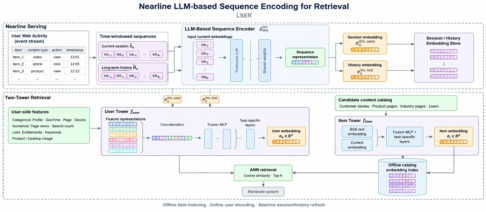
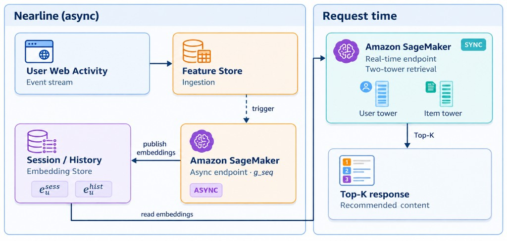
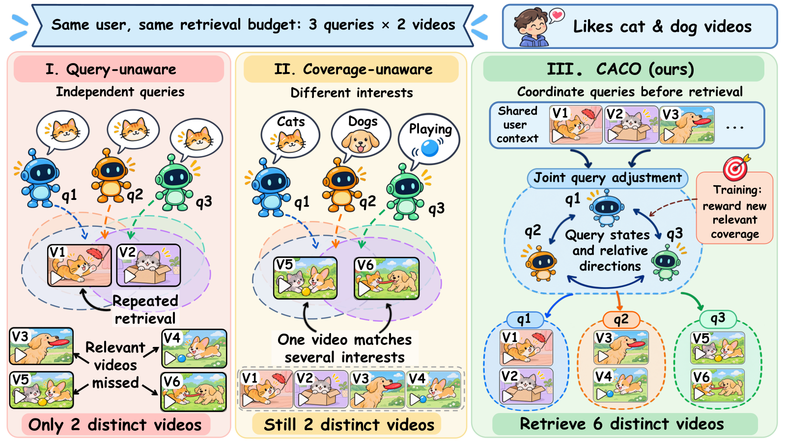
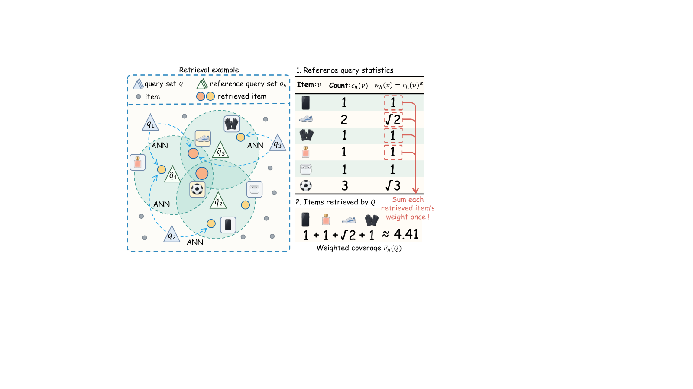

## 总览
今天这批整体不水，五篇里三篇其实都在处理同一件事：瓶颈不在模型容量，而在于层与层、步与步之间流动的信息根本没变，所以单纯堆深度、堆 query、堆候选都没用。阿里那篇把 cross-attention 堆深却不涨点归因到 KV 侧反复读同一份行为序列，让序列随 request 逐层被重塑，这个诊断比方法本身更值钱；同样 forward FLOPs 下，DNA-4 用四成算力打平 28 层，这组对比足够有说服力，但它对服务成本只给了 FLOPs 估算，没有给出压测，线上也只有一组 A/B 对比，读的时候要把这两块分开看。[CACO](#note-4) 说的是生成式召回里多条 query 挤在同一邻域投票浪费，用 set-level coverage 绕开 top-K 不可导，思路干净、验证面铺得很开，但收益很依赖 base 自身 query 重叠有多严重，KuaiRec 上几乎没有提升，就是最诚实的反例。整页生成那篇把 MPO 那套搬到 slate 上，能证每步单调不降，partial scoring 对评估器调用贵的场景也很关键，但评估器冻结、工业集只做重排这两点，会把那一个多点的提升打折，看的时候自己掂量。Autodesk 的 LLM embedding 召回反而是最诚实的一篇：增量只出现在语义鸿沟大的 surface，真正值钱的是近线链路和回退兜底；Meta 那篇从标题看是给 fleet 规模排序模型做成本感知的特征优化 agent，可惜摘要还没到手，先记下。今天优先看 DNA 和 [CACO](#note-4)，想找可复用的训练范式，再去啃整页生成那篇的推导。
## 论文列表

### 1. DNA: Unlocking Depth Scaling in CTR Models
- 论文链接：[AlphaXiv](https://alphaxiv.org/abs/2611.25659v1)
- 更新时间：2026-11-19 07:40 UTC
- 机构：Alibaba Group
- 工业优先级：强
- 备注：10 pages, 5 figures

**CTR模型加层不涨？瓶颈在KV侧**

各位算法同学们，淘宝搜索上把cross-attention从16层堆到28层，AUC只多0.02个点，深度等于白加。阿里这篇DNA就盯着一个问题：卡住的到底是不是query那一侧。

📄 DNA: Unlocking Depth Scaling in CTR Models

🔧 先给结论：瓶颈在key-value侧。每层都从同一条行为序列投影K/V，加深只是把一条不变的序列多读几遍，query修得再细也没新信息进来。

🧩 所以让序列自己随深度演化。每层先让request表示（搜索词、用户特征、场景）去读序列；接着每个行为token反过来对更新后的request做attention，用读到的内容更新自己。下一层读到的，是被当前请求塑造过的序列。

⚙️ 更新只依赖request、跟候选无关，一次请求算一遍，上千个候选共享同一份序列状态；读和更新对序列长度都是线性；多个行为域各自保留顺序和投影，不用先合并到一条时间线。

📊 等前向FLOPs下，DNA比cross-attention栈高0.08到0.26 pt AUC，六个算力档位都领先。

📈 同样的算力增量，baseline从16层到28层只涨0.02 pt，DNA从6层到10层涨0.13 pt；DNA-4用约40%的FLOPs就超过了28层版本。

✅ 淘宝搜索线上A/B，DNA-4对生产模型CTR +0.8%、GMV +0.5%。

这条路的适用面挺明确：做长序列排序、又被加层不涨卡住的团队，可以先用4层DNA跑个同算力对照，看ΔAUC有没有继续往上走。要留意的点也有——序列更新完全不含候选信息，候选间差异特别大、或者候选自带强上下文的场景得自己再验一遍；对齐指标记得按等FLOPs算，别只比层数。

### 2. Learning Generative Ranking Policies for Whole-Page Optimization
- 论文链接：[AlphaXiv](https://alphaxiv.org/abs/2611.25527v1)
- 更新时间：2026-11-19 05:27 UTC
- 机构：未披露机构
- 工业优先级：强

**整页推荐不是单点最优拼盘，这篇给了新解法**

各位算法同学们，把每个位置单独挑到最优的 item 拼在一起，整页往往不是最优的——这话不新，但少见的是真把“整页”做进生成器训练目标里的。它的核心一句话：每个位置该比的不是候选自己多好看，而是选了它之后整页能拿多少分。

📄 Learning Generative Ranking Policies for Whole-Page Optimization

🔧 位置级监督直接来自整页：在同一前缀下把每个候选放进去，让当前生成器 π_k 把剩下的位置补完，用补完的整页打分，再按 exp(score/τ) 重新加权得到这个位置的目标分布。每个位置学的是“对整页更好”的 item。

🧩 这个目标有闭式解，本质是 KL 正则下的重加权，和 MPO 那套同源；文中还证明了精确更新能提升期望页分，反复精确全量更新会收敛到最优页分。

⚙️ 训练分轮迭代：π_k 造数据、造目标，拟合出 π_{k+1}，下一轮的数据和目标跟着新生成器重建。对比之下，模仿离线 beam 搜索固定目标的做法，目标不随生成器更新，容易训着训着就脱节。

📊 KuaiRand-1K 和 RL4RS-SeqSlate 上，分别覆盖多目标选品和带约束排序，每个长度设置都超过生成式重排 baseline 和几个代表性 RL 算法。

📈 和 prefix-score beam search 比，在每个测过的宽度和设置下页质量更高，实测平均生成时间低不少，serving 时不需要 evaluator 查询。

✅ 工业日志页数据集上同样超过 baseline；在已知最优页的合成 benchmark 上最接近最优。消融显示增益主要来自两件事：用完整页给候选打分，以及用更新后的生成器重建训练数据。

我的判断：线上已经有稳定 page evaluator、想把重排从“单点打分再排”改成整页联合决策的团队可以跟；evaluator 还没跑稳的先别急。要盯的就是页级分数和生成时延两个指标，坑在于 evaluator 的偏差会原样进到训练目标里，τ 和迭代轮数得调，分轮采样训练也比单轮蒸馏贵。

### 3. From Sessions to Serving: Integrating LLM-Based Embeddings into Retrieval for Production Content Recommendation
- 论文链接：[AlphaXiv](https://alphaxiv.org/abs/2611.26096v1)
- 更新时间：2026-11-19 13:31 UTC
- 机构：Autodesk
- 工业优先级：中

**召回塞LLM向量，坑不在模型**

各位算法同学们，召回用户塔里加入一路 LLM 向量，真正麻烦的地方不在模型，而在这路向量上线后怎么保持新鲜。这篇 Autodesk 的工业论文把后半段讲得比较细，涨点反而没有多讲。

📄 From Sessions to Serving: Integrating LLM-Based Embeddings into Retrieval for Production Content Recommendation

🔧 它没有替换原有序列编码器，而是在召回用户塔里拼接一路 LLM 产出的 session 级和历史级向量，作为辅助特征做增量，原链路不动，工程风险可控。

🧩 用户行为被切成两段：当前 session 的短期意图，加上更早多天窗口的历史行为；点击和 learn 两个通道还各自物化成平行序列字段，实现上是四条 item-id 列表，分别过滤后再在塔内融合。

⚙️ 真正的工程量在近线：异步刷新序列向量和 LLM 向量并写进 embedding store，主推荐服务请求时直接读取，不阻塞在线路径。

📊 消融实验在它们全量多内容类型目录上做，覆盖 customer stories、product pages、industry pages、learning content，验证的是 LLM 特征在原有序列编码器之上的增量。

📈 线上在多个投放面跑了 A/B，engagement 和下游转化都有改善。

✅ 但摘要只给了“有改善”的定性说法，具体涨幅没披露，看的时候重点盯它消融的对照组是怎么设的。

总结感想：做多内容类型 marketplace、召回侧序列特征已经调到瓶颈、想试语义向量的团队，看这篇比看纯模型论文有用。要盯两件事：LLM 向量相对序列编码器的增量是否稳定，以及近线刷新的延迟和向量过期率。别指望它替换双塔，它是加法，不是替换。

### 4. CACO: Coverage-Aware Coordinated Optimization for Continuous Generative Retrieval
- 论文链接：[AlphaXiv](https://alphaxiv.org/abs/2611.25738v1)
- 更新时间：2026-11-19 08:48 UTC
- 机构：Hunan University，Huazhong Agricultural University
- 工业优先级：中
- 备注：21 pages, 16 figures, 12 tables

**召回预算不变，重复率砍掉一半🎯**

各位算法同学们，同一个用户、3 条 query、每条取 2 个视频，6 个坑位最后只回来 2 个不重复的视频——问题不在模型不 genergy，而在几条 query 互相不知道对方捞走了什么。这篇就盯着这个被忽略的「集合级检索几何」做文章。

📄 CACO: Coverage-Aware Coordinated Optimization for Continuous Generative Retrieval

🔧 把从冻结底座采样出的参考 query 的经验召回频次当作相关性代理，构造无标签的集合覆盖目标：同一个 item 只计一次权重，召回重复项增益直接为零，不用 ground truth 也能选 query。

🧩 为了不在推理时生成大 query 池，用一个协调调整网络，把 inter-query 双向注意力和门控相对方向拼起来，最后在切空间做有界投影加球面 retraction 更新 query，数量、深度、底座全不动。

⚙️ 训练靠切向对偶扰动加反事实单 query 替换来量每条 query 的边际增益，绕过 top-K 不可导，拿到平滑集合覆盖的无偏梯度估计。

📊 8 个公开 benchmark 加一个自建 24 分区流式工业数据集，跨 6 个冻结的 flow matching 与扩散 backbone。

📈 相对最强 baseline，Recall@100 最高 +23.7%，Recall@400 最高 +23.9%。

✅ query 间重叠下降 53.3%–64.9%，额外推理延迟只有 0.5%–3.0%。

📈 离线贪心选择实验里，30 个 backbone–dataset 组合的召回全部提升。

总结感想：这套后训练只适合已经在用 flow matching 或扩散做生成式召回、并且确实是多 query 并行取数的团队，单 query 场景没什么收益。上线前要盯的是固定 L×K 下的重叠率和 Recall@100，而非 query 分布多样性指标。坑有两个：覆盖目标的权重来自参考 query 的召回频次，参考池采样分布和线上分布一偏，权重就跟着偏；另外它只动 query 不动底座，底座本身召不回来的 item 它救不了。

### 5. Cost-Aware Agentic Feature Optimization System for Fleet-Scale Ranking Models
- 论文链接：[AlphaXiv](https://alphaxiv.org/abs/2611.26531v1)
- 更新时间：2026-11-19 18:12 UTC
- 机构：Meta, Inc.
- 工业优先级：未标注

**🤖Meta用LLM给模型集群自动挑特征**

各位算法同学们，特征工程这项工作，Meta直接交给LLM agent去做了，线上A/B主指标涨0.20%；注意这是线上数据，并非离线数据。这篇讲的是：在上万个特征的共享池里，为一整个排序模型集群自动生成、排序并挑选特征，同时还要满足QPS和pipeline成本限制。

📄 Cost-Aware Agentic Feature Optimization System for Fleet-Scale Ranking Models

🔧 LLM只负责提出假设和召回候选，实验执行交给确定性工具：bigram交叉特征空间能到千万量级，先用一个在全集群效果上持续微调的检索LLM做一次前向计算进行粗筛，再交给特征重要性（FI）精排；模型优化得越多，这个生成器越准。

🧩 多任务模型不把各任务的重要性分数加权求和，而是按Pareto最优来选：特征i必须在所有任务上都不弱于i'，并且至少有一个任务更强，才能支配i'；然后逐层取前沿直到凑够N个，这样就不用再手动调任务权重。

⚙️ 搜索只给10-25次试验、最多4-8个并发，LLM Researcher在QPS和显存上限内调整各类特征配比与混合系数；pipeline成本由trimming控制：如果别的模型已经在用某个特征，这个特征就不额外计成本，一旦超预算就先删最贵的，再回填同类已用特征。

📊 在生产模型上，各模型在自身预算内把NE平均改善0.31%；论文称超过0.03%即显著。

📈 trimming把pipeline成本降低2.3%，且没有出现超出测量噪声的回退。

✅ 优化后的模型已上线，在线A/B测试中主指标提升0.20%。

总结：这套方案的难点主要不在LLM，而在于你是否有跨模型共享的特征成本记录；没有这套记录，trimming那一步就无从谈起。想跟进的话，盯两个指标：NE相对 incumbent 的增量，以及QPS卡死之后特征配比怎么变。小团队全量复现成本偏高，先借鉴Pareto前沿选特征那部分更现实。
