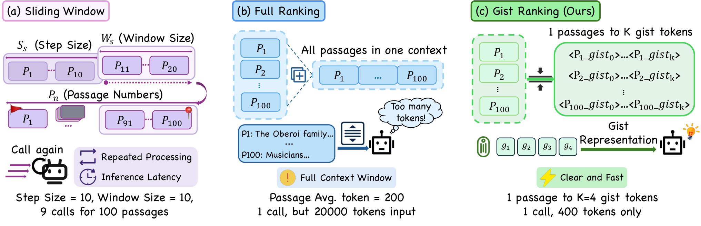
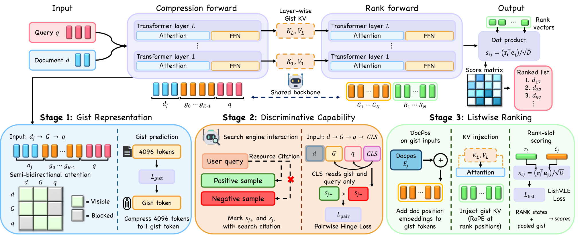

# 每条压成4个token，排序反而快14倍

各位算法同学们，一个100条候选的排序请求，全文本塞进prompt就是两万token，而把每条passage压成4个gist token后只剩400token，端到端快了14倍——之前大家都觉得软压缩必然掉点，这篇的结论是：掉点不是压缩本身的锅，是训练目标没跟排序对齐。

📄 GistRank: Gist-Compressed Listwise Ranking with Large Language Models

🔧 先修注意力：vanilla gist用严格因果编码，gist token对原文的吸收不充分，改成半双向注意力后，gist能更完整地看到整段passage，为后面的判别打底。

🧩 三阶段训练把“压缩”和“排序”缝起来：第一阶段只让模型靠gist预测后续token，学忠实表示；第二阶段原文隐藏、只留gist，用真实搜索交互数据做pairwise训练，逼出区分相近候选的能力；第三阶段才切到listwise目标，学直接输出排列。

⚙️ 推理时把gist位置的KV cache直接当压缩状态喂给rank阶段，不再重编码原文，候选内容长度从Σ|x(pj)|降到N×K。

📊 TREC DL19/20加五个BEIR子集，平均nDCG@10做到59.17，距最强全上下文基线只差0.89。

📈 端到端P50延迟DL19是1625ms、DL20是1634ms，相对one-shot全文本基线分别是14.05倍和13.93倍加速，这个数包含了压缩、KV组装和排序全流程。

✅ K固定为4，100条候选的passage部分从两万token压到400；分阶段测量显示rank forward只占约7%的模型时间，大头仍在候选压缩。

总结一下：做LLM reranker或RAG重排、延迟被卡住的团队可以跟，它比sliding window省掉了重叠块重复编码。但要盯两个指标：压缩阶段的耗时现在是真瓶颈，以及top几位的精细区分能力——平均只差0.89，可前几名排错在业务上更疼。坑在于第一阶段是重建式训练，换领域时gist的忠实度得重新验一遍；另外和蒸馏小模型比，要算上压缩这次前向的总账，别只看rank阶段。

原文：[AlphaXiv](https://alphaxiv.org/abs/2610.39610v1)
