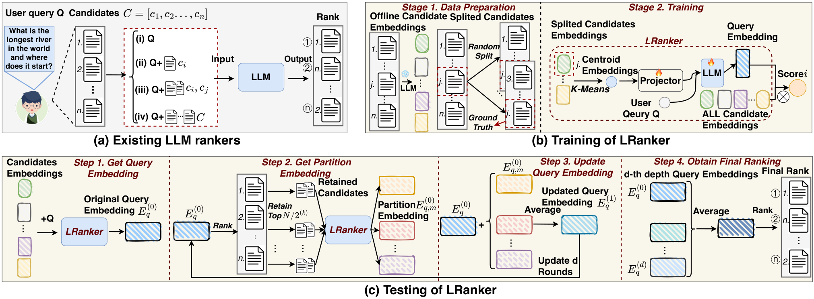

# 680万候选，LLM排序prompt不涨

各位算法同学们，680万个候选丢进去，prompt长度居然不随候选数量增长——这篇LRanker的做法是把LLM排序从“把所有候选文本塞进上下文”改成“聚类摘要当软提示＋缓存向量内积”，试图证明全库直排不必依赖先召回、再硬性截断。

📄 LRanker: Scaling LLM Ranking to Millions of Candidates with Test-Time Scaling

🔧 候选信息不再进上下文：离线候选embedding先做K-means，质心经可学习projector投影成soft prompt喂给LLM，排序时只拿query embedding和缓存好的候选向量做内积，固定质心数K下prompt长度和LLM前向次数与候选规模解耦。

🧩 “测试时扩展”用在query表示上：不是加长推理链，也不是堆模型参数，而是按候选分区反复做切分、剪枝、聚合，得到多个partition-conditioned query embedding，最后把这些embedding的打分ensemble起来。

⚙️ 训练阶段随机采样候选子集来构造分区，让query表示对分区规模更鲁棒；架构上把“能排百万级”和“排得更准”两件事拆开，前者靠聚合编码＋缓存打分，后者靠测试时多轮计算。

📊 RBench-Large上相对最强基线的MRR提升：Rec-Movie 27.5%、Rec-Toy 3.9%、MS MARCO 0.9%、ESCI 8.9%。

📈 RBench-Small上Rec-Music提升26.7%，Routing-Balance提升6.1%。

✅ 680万候选的Rec-Clothing任务比Tiger高27.0%；消融显示候选聚合和test-time ensemble各有独立贡献。

总结：这套东西对候选池上百万、又想用LLM语义做全库直排的召回/粗排场景比较对口。两个坑要留意：一是本文报的是相对提升，MS MARCO只涨0.9%，说明纯文本检索类任务的收益并不普遍；二是论文没做端到端的retrieve-then-rerank级联对比，落地时建议同时盯MRR和额外推理轮次的延迟开销，先在自己候选规模上复现Rec-Clothing那一档，再决定测试时扩展开几轮。

原文：[AlphaXiv](https://alphaxiv.org/abs/2605.27810v2)
