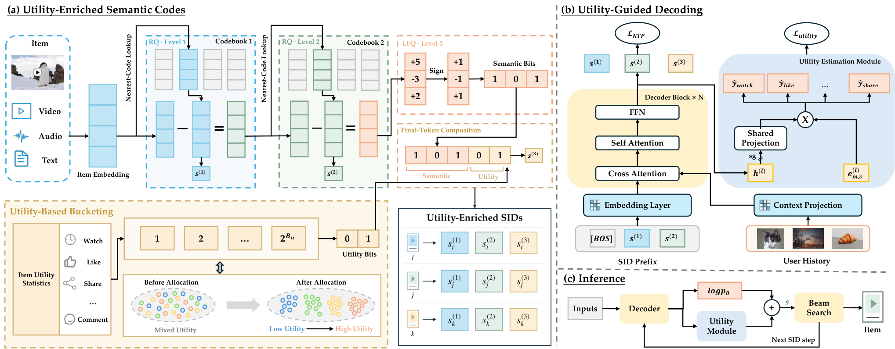
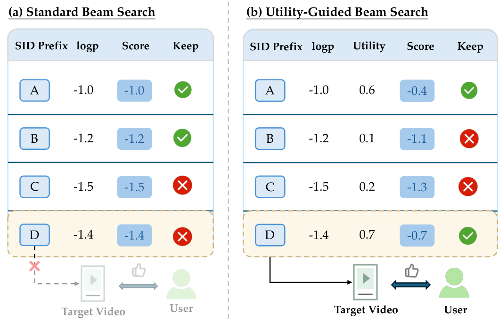

# 生成概率高≠用户爱看？快手这套改了

各位算法同学们，生成式推荐有个不太起眼的坑：beam search 剪枝看的是生成似然，但似然高的 item 不一定观看时长高，高收益的路径在中间解码步就被剪掉了，后面的重排再怎么救也救不回来。快手这篇 UAGR 就是冲着这个错位去的。

📄 Utility-Aware Generative Recommendation: Utility-Enriched Semantic Codes and Utility-Guided Decoding

🔧 UE-SID：最后一层 SID token 不纯讲语义了，用 LFQ 查表加把 item 级效用离散成 bit 写进去，SID 长度和词表大小都不涨；效用更新只动最后一层码本，不用重训语义量化器，也不用重跑 tokenization。

🧩 UGD：从解码中间态的 hidden state 预测完播、点赞、分享等多个后曝光目标，加权成一个可配置的效用分，和 logp 一起参与 beam 打分，让高效用前缀别在中间被剪掉。

⚙️ stop-gradient 隔离：效用模块的梯度不回传主干，生成能力不受干扰，线上调效用权重也不用动在线模型的训练。

📊 已在快手全量部署，线上 A/B 视频观看时长提升 0.206%。

📈 离线实验加真实流量 A/B 都验过有效性和可部署性，不是只在小数据集上跑通。

✅ 效用模块是插件式的，SID 长度、词表规模、序列解码成本都没增加。

我的判断：0.206% 放在快手这个量级是实打实的收益，但别把它当成能替代重排的万能方案——它解决的是“候选根本没进集合”的问题，不是“进了集合怎么排”。真要跟进的话盯两件事：效用 bit 的更新频率跟不跟得上信号漂移，以及 beam 里效用权重在多大范围内调参不掉点。多目标样本口径和冷启动 item 的效用估计是主要落地坑。

原文：[AlphaXiv](https://alphaxiv.org/abs/2611.02981v1)
