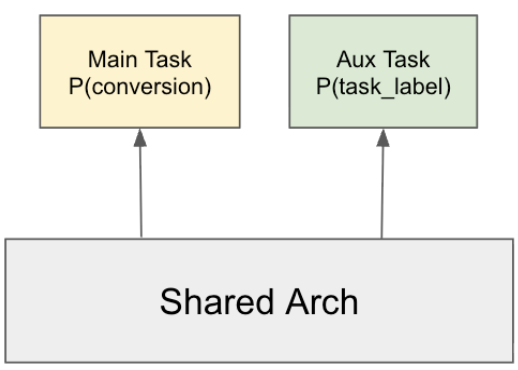
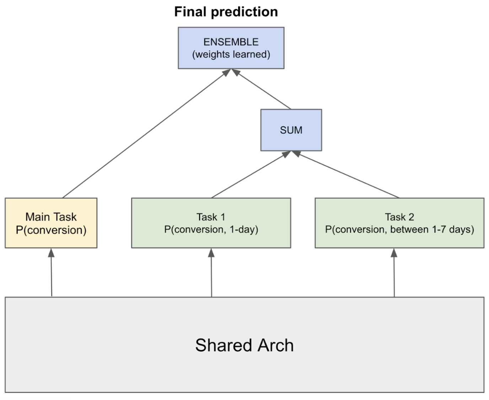

# CVR 太稀疏？给辅助标签挑挑精度

各位算法同学们：辅助任务的标签不是越多越好，精度不够反而拖后腿——这篇里 F-Beta 的 β 一旦 ≥1（也就是开始偏袒覆盖率），离线 NE 就稳定变差，最优解落在 β=0.02，辅助标签精度做到 91%。做 CVR 的人应该会想看一眼它怎么定义"什么信号值得当辅助任务"。

📄 Improving Ads Ranking Models with Auxiliary Supervision: Techniques and Insights（ICDM WAIP 2026）

🔧 线性化标签：把 dwell time 这类连续/有序信号按 n 分位数切成 2 到 4 个桶，做成多分类任务，比二值标签粒度更细；也可以把"转化 / 停留>10s / HTML 加载完成"按预测力排成有序列表，取第一个命中的作为真类。分桶阈值不用统一，电商广告可以给大桶、线索类广告给小桶。

🧩 Split architecture：把 7 天窗口的 pCVR 拆成 0–1 天和 1–7 天两个互斥且完备的子任务，子任务预测之和在数学上就等于整体的 0–7 天 pCVR，再和主任务做 ensemble。另外缺失标签（比如没在浏览器打开的点击没有 dwell time）要用 gating 只在该信号可用的样本上训，别粗暴当负样本。

⚙️ LaCo 标签组合：多个辅助标签各自开任务会互相打架，于是用 F-Beta（相对主转化标签算 precision/recall）去搜 AND、OR、NOT OR、NOT AND、XOR 的组合，合成一个降噪的派生标签。每个模型 n≤10 个信号，穷举完全跑得动。

📊 基线 pCVR 的 NE = 0.54，越低越好，线性化标签、split architecture、LaCo 三者在离线 NE 上都比基线有改善。

📈 调 β 扫了 0.001 到 10，最优 β=0.02，对应辅助标签高精度（91%）、中等召回；思路是先保精度到 90% 左右，再在这个约束里尽量抬召回。

✅ 训练侧还试了 DivideMix 和 Tri-Training 这类抗噪训练法，其中 Tri-Training 在 pCVR 上继续带来 NE 改善。

总结感想：如果你的 CVR 模型正卡在标签稀疏、想加辅助任务但一加就掉点，这篇的排查顺序值得照抄——先看辅助标签相对主标签的 precision/recall，再决定要不要组合降噪。落地要盯的是 NE 和精度-覆盖率曲线，别只盯 AUC；坑在于 β 和分桶阈值都随数据分布变，得自己重扫，另外这套是在 Meta 体量上验证的，小数据量下辅助任务可能先学噪声。

原文：[AlphaXiv](https://alphaxiv.org/abs/2611.01280v1)
