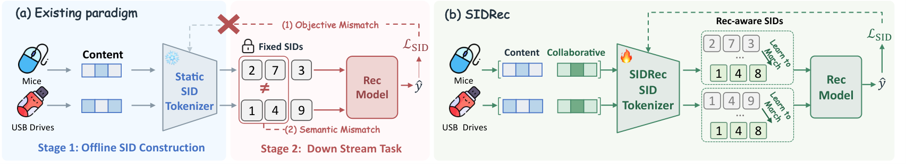

# 语义ID一建好就冻住？这篇改成端到端🔧

各位算法同学们，把 item 压成语义 ID，AUC 却追不平独立哈希 ID。这篇给的答案很直接：真正的问题出在内容语义和协同偏好、SID 构建和推荐目标这两处彼此不匹配，量化器本身够不够好并非关键。

📄 SIDRec: End-to-End Semantic ID Representation and Modeling for Recommendation

🔧 自更新融合：协同 embedding 表先由训练好的排序模型初始化，训练中继续更新，与预训练内容表示显式融合，而不是只在 loss 上做对齐，避免量化环节把融合后的信息丢掉。

🧩 MMoE 式联合优化：共享专家加各任务独立 gate，推荐梯度可以直接穿过多位量化，让码本边界跟着点击目标动。

⚙️ 把两阶段改成端到端：SID 不再是离线固化、下游只能学着用的静态 ID，构建过程本身会被排序目标反向修改。

📊 三个公开基准上 AUC 与 GAUC 全部领先所有对比方法，相对最强 baseline 最高提升 5.15%。

📈 消融：融合和端到端两项一起去掉，AUC 相对掉 7.19%、GAUC 掉 7.11%，说明两块是互补，不是重复叠 buff。

✅ 除公开基准外，摘要提到工业数据集也做了验证，这个方向在真实场景里不是纸面结论。

总结：如果你们线上还在用 content-only 的 SID，并且效果被 HID 打平，这篇的融合加端到端思路可以借鉴。要盯的坑有两个：协同表初始化依赖一个已训好的排序模型，冷启动和模型换代时这套自更新未必稳；端到端意味着 tokenizer 参与每一步训练，训练成本得先算清楚。对比时对准 DIG、DAS 这类对齐路线，看清涨的到底是 AUC 还是 GAUC。

原文：[AlphaXiv](https://alphaxiv.org/abs/2611.01136v1)
