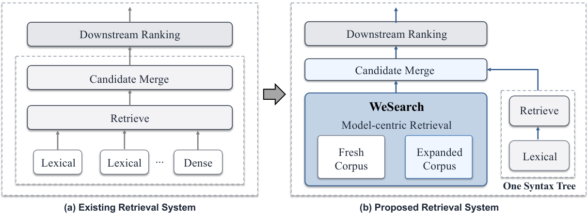
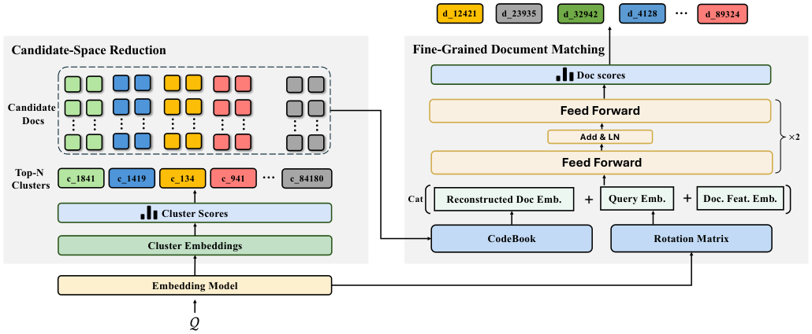

# 微信搜索换掉语义ID检索，成本降41%

各位算法同学们，先甩一个反常识的结论：给每篇文档绑定一条固定的层级 Semantic ID、再逐层解码，这套在内容型搜索里是个坑。一篇同时讲签证、机票、酒店攻略的图文，硬塞进一条语义路径，前缀错一步，后面全废。WeSearch 干脆不这么干了。

📄 WeSearch: A Unified Model-Centric Retrieval Framework for WeChat Search

🔧 聚类只当“候选空间裁剪器”，不再当文档的固定标签：先用向量召回 query 相关簇，再取簇内所有原子文档做细粒度相关性排序，多主题文档不用被迫走单一路径，也躲开了前缀解码错误一票否决的问题。

🧩 检索链路收敛成一条模型主导的语义路径，外加一棵词法语法树。原来多路 dense/lexical 拼接带来的重复计算、通信开销和优化目标割裂，被一次性收掉了。

⚙️ 工程配套才是能上线的关键：OPQ 紧凑文档表示 + 非对称距离计算（ADC）加速打分，新文档滚动挂载进已有簇空间、不用重建全量索引，模型刷新从月级压到周级，必要时天级。

📊 一个月全流量 A/B：CTR +0.68%，人均图文点击 +2.27%，搜索结果页平均停留时长 +0.71%。

📈 质量涨的同时资源在降：检索资源成本 -41%，图文检索延迟 -19ms。

✅ 从数亿到数十亿文档的三组语料配置上，一周 A/B 均显著优于对应线上基线，目前已承接微信搜索 100% 生产流量。

🔍 离线对照还给出一个明确结论：层级 Semantic ID 检索在异质内容上不如这套方案，OPQ 表示稳定优于低维稠密压缩表示。

总结：如果你在做十亿级内容检索、又被 Semantic ID 的前缀错误和多路召回内耗折磨，这篇更该看的是系统设计而不是模型结构。要盯的指标是簇粒度带来的候选池规模和覆盖率——簇太粗省不下算力，太细又把好文档筛掉，这个粒度得按自己的语料重调。坑在于滚动训练和增量挂载对数据管道要求不低，不是换个 loss 就能复现的。

原文：[AlphaXiv](https://alphaxiv.org/abs/2611.00530v1)
