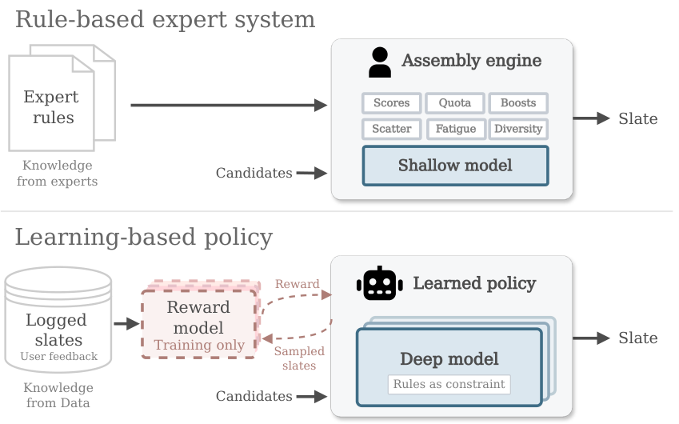
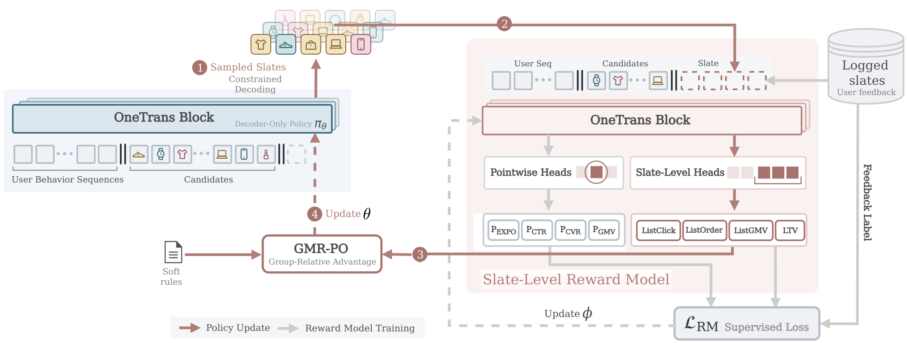

# 重排混排塞进一个解码器🧩

各位算法同学们，推荐系统最“玄学”的一环其实一直在靠人肉规则撑着：重排加混排那层，配额、打散、去重、商业加权，全是手调融合权重，模型再强也进不去这个组合空间。这篇把重排和混排直接改写成同一个自回归生成问题，而且在字节电商全流量上线了。

📄 OneTrans-GSR: A Generative Slate Ranking Paradigm Unifying Reranking and Mix-Ranking with One Autoregressive Transformer

🔧 把整屏 slate 当成一条序列生成：单个 decoder-only 策略从本次请求的候选池里直接解码出曝光位，商品卡、短视频、直播、广告卡混在一条序列里，线上只服务这一个模型，原来的装配引擎和下游重排都不在服务链路上
🧩 奖励模型打的是“整屏分”而不是把 item 分数相加：一个位置的收益取决于它的位置、邻居和内容类型组合，所以不能拆成独立监督；这个 reward model 只在训练用，容量受离线资源限制而不是线上延迟限制，可以做得比任何能上线的模型都大
⚙️ GMR-PO 处理多目标：把多个目标的 reward 聚合成标量，再把标量 reward 和业务偏好的 reward 分别标准化后合成 advantage；软偏好在训练里学，硬业务约束放到解码阶段强制，不靠下游重排来修

📊 线上 A/B：GMV/u 提升 2.63%，广告主价值提升 2.06%，复购率提升 2.03%
📈 端到端重排+混排延迟反而降了 13%，因为不用再多模型串行打分
✅ 离线随 reward model、decoder 和 rollout 算力增加，slate 质量单调变好，这条 scaling 曲线是它和规则系统最本质的区别

我的判断：这套更适合业务线多、混排规则包袱重的场景，比如电商首页这种多类型内容抢位。要盯两点，一是 reward model 的离线目标和线上长期收益是否真的对齐，二是解码期硬约束会不会把可行空间压得太小、把探索掐死。另外别忽略它对比的是 Generator–Evaluator 基线，涨幅是单位数百分比，如果团队还停在 pointwise 打分、reward 建模没打牢，先补数据和评估，直接上 RL 大概率跑不出这个数。

原文：[AlphaXiv](https://alphaxiv.org/abs/2611.04720v1)
