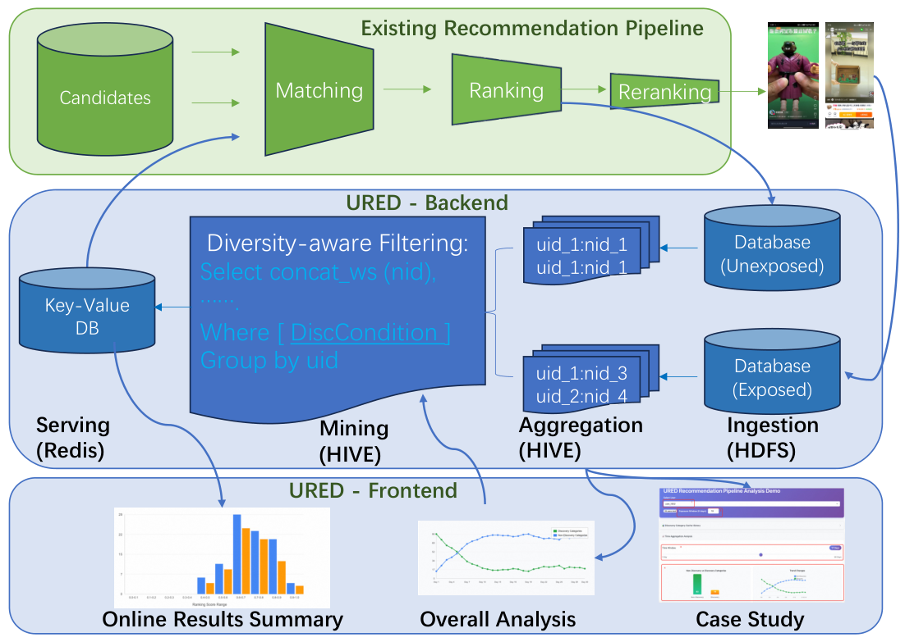

# 被排序丢掉的高分候选，成了发现流量

各位算法同学们，探索流量这件事最反直觉的地方在于：真正能带来“发现”的候选，不是那些从没出现过的冷启内容，而是已经让排序模型打过高分、却因为位置不够而被丢掉的候选。淘宝把这批候选重新回收进召回，线上 A/B 跑出了发现类目 +3.47%、内容丰富度 +8.47%，互动不但没掉，完成播放还涨了 +2.62%。

📄 From Waste to Discovery: Recycling High-Scored Unexposed Candidates in Taobao Feed Recommendation

🔧 先说明“硬推冷启内容为什么不行”：论文用生产日志量化了这一点——发现类候选的 PCOC（预估点击除以实际点击）为 1.147，非发现类为 1.042，RMSE 分别为 0.368 对 0.325。模型对冷启候选系统性高估，又排不出顺序，硬推就等于把最不可信的分数放大后塞给用户。

🧩 于是掉转方向，回收“高分未曝光”样本：这些样本通过了召回、被打分，只因位置竞争没被展示。高分本身含两层信息：候选相关，且模型对它有足够信号、预测可信，等于用分数做了一次信息充分性过滤。

⚙️ 工程侧不用训模型：每次排序后保留 top-k 未曝光样本，按用户在 30 天滑窗聚合，再用类目 d 天未见作为发现判据，召回时单次 O(1) 内存查表，延迟开销 <1%，也没有改动服务架构。

📊 线上 A/B：发现类目 +3.47%，内容丰富度 +8.47%，完成播放 +2.62%（显著），总播放 +0.36%（不显著）。

📈 渠道对比：URED 曝光内容中 85.9% 属于发现类目，是平台均值的 13.9 倍、最强近线召回的 6.3 倍；有效播放率为平台均值的 1.03 倍。

✅ 消融实验更能说明问题：聚合窗口缩到 1 天，发现增益只剩 +0.55% 且不显著；去掉分数过滤、改成随机注入，收益消失，互动还变为 -0.17%。

总结感想：这套方法适合召回阶段已经有稳定排序打分、又受限于人力和算力、暂时没法上 RL 探索的团队，本质上是以接近零的成本回收已经算过的信息。要盯的指标是发现类目提升与完成播放，不能只看总播放；坑在于窗口不能太短，长尾用户的高分未曝光池会很稀，冷启用户几乎拿不到候选。

原文：[AlphaXiv](https://alphaxiv.org/abs/2611.05997v1)
