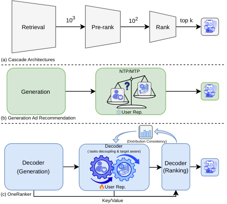

# 🧩腾讯广告把生成和排序塞进一个模型

各位算法同学们，生成式推荐喊了两年，真正的瓶颈从来不是生成质量，是生成阶段压根不知道 eCPM 长什么样——高价值候选在 top-k 那一步就被悄悄筛掉了，后面的排序模型再强也救不回来。这篇腾讯的工作把生成和排序放进同一个模型，给了一个工程上能跑的答案。

📄 OneRanker: Unified Generation and Ranking with One Model in Industrial Advertising Recommendation

🔧 价值感知的多任务解耦：保留 MTP 的多兴趣头保覆盖广度，另开一个 value-aware 头专门学商业价值；两者共享底层用户表示，但用独立 task token 隔开输出空间，不让 eCPM 信号把兴趣建模挤死。再叠加“曝光→点击→转化→价值”的任务序先验和 causal mask，让高层价值任务顺着因果链吸收低层兴趣知识。

🧩 由粗到细的目标感知：用全量 item 空间 K-means 聚出的 Fake Item Tokens 做粗粒度隐式感知，配双通道表示（语义匹配 + 目标感知）在内积检索时自然融合；排序 decoder 再做候选级 cross-attention，做细粒度的价值对齐。

⚙️ 双侧一致性保证：输入侧，排序 decoder 的 Key/Value 直接透传生成侧表示，排序决策继承生成过程的信息；输出侧，用 Distribution Consistency loss 把 ranker 的价值信号当软标签回灌给 generator，总损失就是 MTP + rank + DC 三项联合优化。

📊 已在腾讯微信视频号广告系统全量部署，首轮 5% 流量灰度阶段 GMV-Normal +1.34%。

📈 这个数字是线上大盘业务指标，并非离线指标，在广告系统里含金量比离线涨点高得多。

✅ 论文的核心结论是：不选单阶段融合（优化打架），也不选阶段解耦（信息不可逆丢失），而是“共享表示、隔离输出空间”，靠 KV 透传和 DC 软标签把两端接上。

做生成式召回、排序统一架构的同学可以跟进，但盯指标别只看离线 top-k 命中，要看线上 eCPM 和 CTR 是否同向涨；坑在于任务 token 和 causal mask 强依赖你自家漏斗顺序的定义，换业务场景基本要重排任务链，DC loss 的权重也得重调。和 GPR、GRank 相比，它更像是把“解耦 + 透传”写成了一套可复用的架构范式，而非又一个 trick。

原文：[AlphaXiv](https://alphaxiv.org/abs/2603.02999v4)
