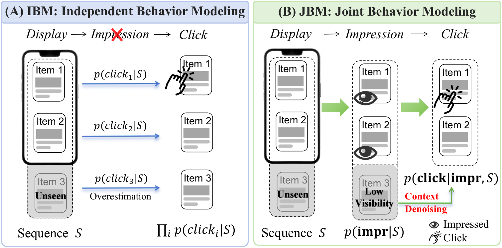
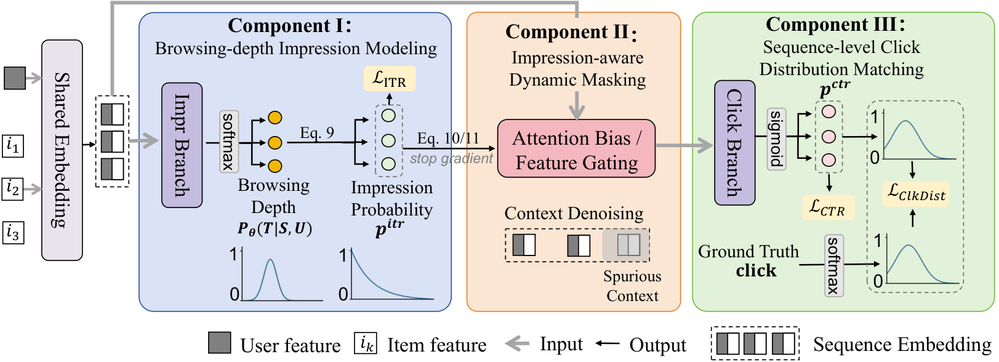

# 重排评估别只算独立CTR了🔧

各位算法同学们，先问一句：你们的重排评估器是不是把序列每个位置的CTR单独算出来再加和？坑就在这——用户压根没滑到第15个位置，你却按“全都看到了”给尾部商品记了一笔收益，于是离线指标好看、线上没动静。CIKM'26这篇就是来堵这个漏的。

📄 Beyond Independent Predictions: Learning the Browsing Journey for Sequence-Level Re-ranking

🔧 把“展示→曝光→点击”拆成链式建模，先预测一条浏览深度分布，估出每个位置真实的曝光概率，补上展示到曝光之间的落差，而不是默认20个位置曝光率都是1。

🧩 拿到曝光概率后做动态掩码：建模点击时，把没被曝光的商品从上下文里压掉，避免它们被当成“有效邻居”污染表示，这也是尾部虚高的来源之一。

⚙️ 加了一个点击分布匹配目标，捕捉序列内的竞争关系：用户点了某个商品并且满意后，后面同类商品的边际效用会掉，这种“互相遮蔽”独立建模学不到。

📊 在多种评估器backbone上做离线实验，都能挂上去用，属于即插即用，换架构不用改框架。

📈 淘宝App 14天线上A/B：点击+0.70%，商业收入+3.67%，之后走了全流量部署。

✅ 论文另外把ITR、CTR、ITCTR分开定义，端到端从展示到点击的转化用ITCTR衡量，比只看CTR更能暴露偏差。

总结感想：做重排G–E框架、且评估器还停留在逐物品打分的人可以直接拿来试，改动集中在评估器侧，不碰generator。上手前先确认两件事：曝光标签本身噪声大不大，浏览深度分布的位置假设跟你们实际列表长度是否对得上；另外别只盯CTR，把ITR和尾部位置的校准一起看，否则很容易又回到虚高的老路。

原文：[AlphaXiv](https://alphaxiv.org/abs/2611.07591v1)
