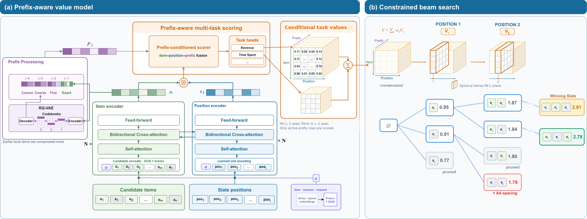

# 整页排序一次编码，NAR 也记住顺序了

各位算法同学们：NAR 排序模型有个老毛病——同一个广告排在第 2 位还是第 5 位，打分是一样的，因为它压根不知道前面已经放了什么。这篇来自 Meta 的工作想做的就是：在保留 NAR 一次性编码效率的前提下，把“已选前缀”塞进打分里。

📄 Towards Efficient Whole Page Ranking with One-Pass Inference

🔧 一次编码、多轮复用：候选集和槽位的表示每个请求只算一遍，beam search 过程中只对“当前存活前缀 + 候选”的轻量条件打分做更新，而不是每扩展一个候选就把整个候选池重新编码一次。论文特意说明，one-pass 指的是共享编码，不是一步生成整页。

🧩 三种上下文拆开建模：全局自注意力建模候选之间的互作用，且不给输入候选加位置 embedding，避免把召回顺序误当成展示顺序；局部前缀建模从直接前驱到完整有序历史；item–slot 交叉注意力负责表示“放在哪个坑位”。

⚙️ 长历史不硬存：历史状态用 RQ-VAE 的共享码本加每 item 的码元元组压缩，解码时只物化存活的 B×C 行分数，绕开“前驱组合爆炸”的稠密打分表。

📊 KuaiRand-1K 上 CPU 解码快 4.07×，RL4RS 上快 3.54×，生成质量接近自回归 CGA 这个高算力参照。

📈 大规模社交视频平台的随机实验：realization 指标 +0.104%，watch time +0.058%。

✅ 同一套服务下排序侧 CPU 消耗降 9.73%——质量略升、算力反降，这在重排场景里算比较少见的组合。

要不要跟，看你的现状：如果你正在跑 NAR 分配、又被 AR 的延迟卡住，这套前缀条件化是条相对低风险的路；如果你本来就是 listwise 小模型，收益可能没那么明显。要盯两个点：前缀长度这个旋钮（越长越接近 AR，但存储和打分成本也涨，论文专门做了长度权衡），以及 RQ-VAE 压缩带来的表示损失会不会在长历史下放大。对比基线别只挑 NAR，得同时对上 CGA 的质量和 NGA 的效率才算公平。坑在于线上增益是千分位量级，离线分差能不能对上线上、以及“one-pass”别被误读成恒定算力，做延迟预估时容易算错。

原文：[AlphaXiv](https://alphaxiv.org/abs/2611.05542v1)
