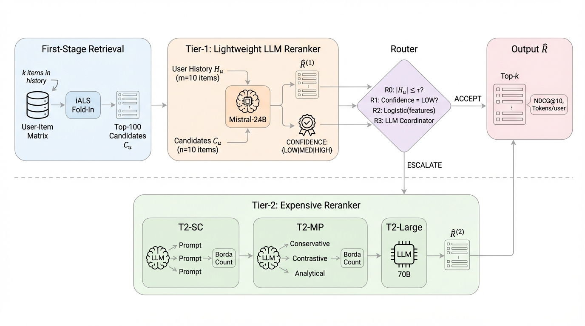

# 给冷用户上大模型重排，反而掉30%📉

各位算法同学们，把最贵的模型全量铺到重排链路上，指标不一定涨——论文里稀疏历史用户的NDCG@10最多掉了30%，把冷用户升级到更贵的推理只会让损失更大。这篇是少见的“线上跑了一个多月”的工业落地文，讲的是怎么用两级级联把LLM算力按请求分配。

📄 CascadeRec: Deployed Adaptive LLM Compute Allocation for Multi-Tenant Content Recommendation

🔧 两级级联加一个路由器：轻量Tier-1对全量请求做重排，同时吐一个粗粒度置信度（LOW/MEDIUM/HIGH），路由器判断“这单加算力大概率有用”才升级到Tier-2，其余直接用Tier-1结果
🧩 Tier-2给了三条可换的路：自一致性采样N=3、多角色多路推理、直接上更大模型，正好对应“多采样、多推理、换强模型”三个推理时扩展轴，升级后的多份排序用Borda聚合
⚙️ 把serving层的脏活写进正文：容忍式解析排行输出，解析失败就回退到上一级排序，用户侧永远不暴露LLM报错；硬超时加流式卡顿检测兜住尾延迟；Tier-1输出按(用户, 模型, seed)缓存，A/B对照臂看到完全一致的Tier-1结果，线上线下对比才干净

📊 线上A/B超过一个月，对比“全量走贵档”，推理成本降约10%，延迟影响很小，至今没观察到质量回退；作者只报parity，不吹增益
📉 离线在MovieLens-1M和Amazon-Electronics上做历史稀疏度控制：全量LLM重排让稀疏历史用户NDCG@10最多掉30%（配对bootstrap显著），唯一显著增益出现在MovieLens历史最长的分段，+27%
📈 在Amazon上给受损用户加自一致性或多路推理，损失反而变大——prompt里偏好证据本来就少，多出来的算力没东西可用
✅ 离线同配置下升级率60%时，Tier-2的token比全量升级少40-50%；解析失败率在0.1%到10%之间，随模型和目录变化

这篇适合做B端、低QPS高客单、租户流量高度倾斜的团队看：它真正的动机是少数重租户吃掉大部分GPU预算，级联既是省钱也是保别人的延迟。要盯的指标不是总体NDCG，而是按历史长度、租户规模切开的NDCG@10和升级率。坑也很明确：论文自己说生产分段阈值是拿租户流量测出来的，离线那个τ=5的冷启动升级规则没敢搬上线，你做的时候别直接抄。

原文：[AlphaXiv](https://alphaxiv.org/abs/2611.08566v1)
