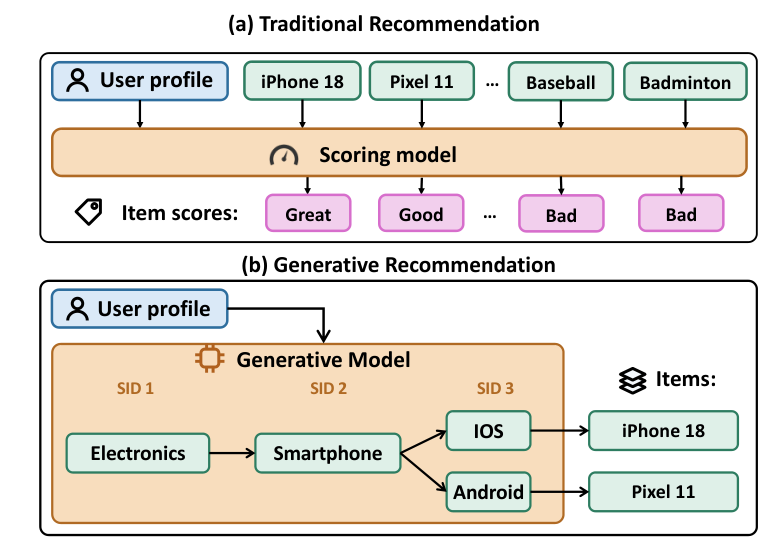

# 生成式推荐服务，别硬套LLM那套 🧩

各位算法同学们：把LLM serving那套直接搬来做生成式推荐，可能是最省事也最容易踩坑的选择——快手线上这套系统给出的数字是单实例1000+ QPS、P99压在35ms以内，比代表性基线吞吐高2.88倍，而它做的第一件事恰恰是承认“LLM那套假设在这里不成立”。

📄 RecoGEM: A Serving System for Production-Scale Generative Recommendation

🔧 架构上把“运行时”和“执行引擎”拆开：解码步之间的候选状态迁移、词表与选择策略的热更新这些GR特有逻辑，全交给专门的runtime；engine只负责张量计算，两者靠一份per-step接口的部署契约连接。这样在线更新频繁时不用动执行路径。

🧩 执行侧专门吃GR的三个特点：短前缀、大候选池、每步shape可预测。row-tiled self-attention把大量独立的短attention行拼在一起摊薄kernel开销；step-granular planning按单步的窄shape画像做规划，而不是一套动态计划打通所有步；候选选择本身被当成关键路径上的计算来优化，不做成LLM里那种轻量采样尾巴。

⚙️ 论文把这套设计归因于两个mismatch：一是每步词表语义不同、张量形状还要从输入序列扩成一批候选，与LLM同词表同形状的均匀解码循环对不上；二是GR每行attention只attend很短的候选序列，长序列kernel的优化前提在这里失效。

📊 OneModel生产负载上，单serving实例1000+ QPS，P99低于35ms，相比代表性基线吞吐提升2.88倍。

📈 集群层面峰值流量60000 QPS，MFU做到55.3%，同时支撑高频在线更新。

✅ 线上跑了九个多月，覆盖搜索、广告、推荐场景，日均约4亿DAU，支持十余个GR模型家族，包括OneModel、OneRec-v2、UniSearch。

总结感想：这篇的价值不在某个kernel技巧，而在给出了“GR-native serving”该长什么样的对照表——如果你正在把推荐从打分改成自回归生成，先盯P99和候选选择占关键路径的比例，再看MFU；坑在于它的优化强依赖step shape可预测和固定步数，一旦你的模型步数动态变化或词表频繁重构，step-granular planning和部署契约都要重新设计。

原文：[AlphaXiv](https://alphaxiv.org/abs/2611.12296v1)
