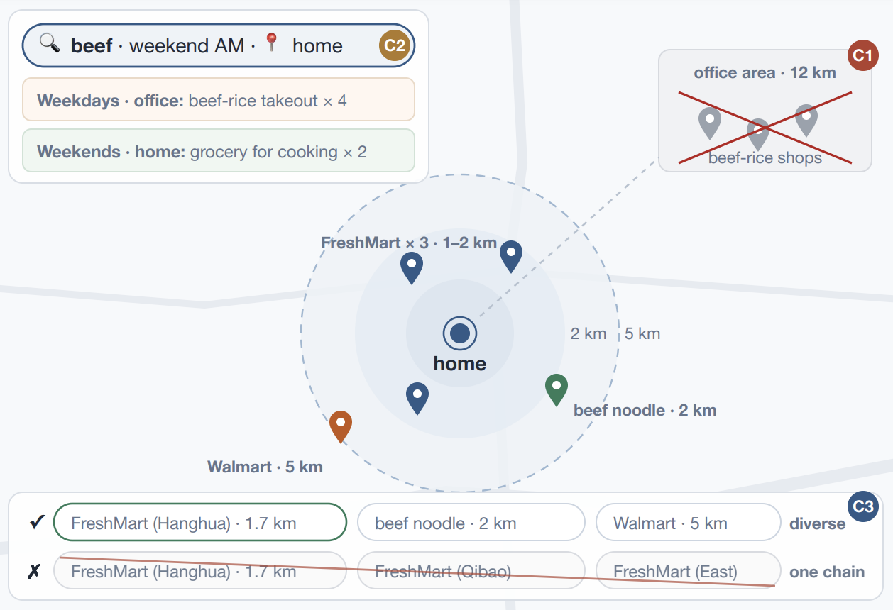

# 外卖搜索把地理写进ID，收入涨4.2%

各位算法同学们，先看一个数字：一个 0.1B 的骨干模型，每天承载淘宝闪购 1.5 亿次搜索查询，线上广告收入还提升了 4.2%。更反常识的是它的关键改动：把配送范围直接编进商家 ID，而不是等生成完再过滤。

📄 TS-GEAR: Taobao Shangou GEnerative Ad Retrieval

🔧 Geo-Semantic ID：商家标识被拆成地理前缀（分层 geohash）加语义后缀（RQ-KMeans 残差量化），前缀级约束解码让能不能送到从后置硬截断变成生成目标，beam 预算不再浪费在那些送不到的门店上。

🧩 Query-Geo Target Attention：用实时 query 和当前位置作为双 target 聚合历史行为，同时把每条行为自身发生的位置编码进 attention key，于是你工作日中午在办公室点牛肉饭的历史，不会影响周末在家搜牛肉时想买生鲜食材的意图。

⚙️ GMPO：把 GRPO 的 advantage 改写成去重组奖励加留一法边际优势，直接用集合级信号抑制近重复候选，不需要再额外加一个辅助多样性 loss。

📊 离线对比中，HitRate 和地理有效性两个指标都稳定超过现有生成式检索方法

📈 线上 7 天 A/B：广告曝光 +3.8%，广告收入 +4.2%

✅ 骨干只有 0.1B，却运行在日均 1.5 亿查询的搜索广告链路里，说明这套结构不是靠堆参数堆出来的

总结：做本地生活、LBS 搜索或外卖推荐的，可以看看这种把硬约束写进 ID 的思路；评估时要盯地理有效性和候选集合的多样性，而不只是 HitRate。落地有两个风险：网格粒度和分层 geohash 的划分强依赖业务配送半径；GMPO 的组奖励设计也依赖你手里的点击、下单这类强弱信号是否分层清楚。

原文：[AlphaXiv](https://alphaxiv.org/abs/2611.12180v1)
