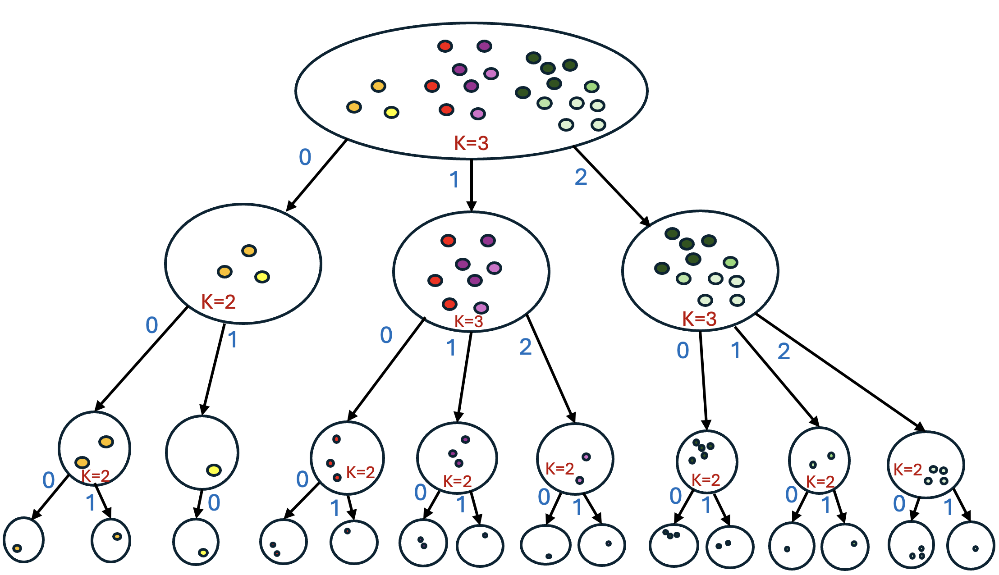

# 语义ID不是独立token，树路径才对 🌳

各位算法同学们，先抛个反常识结论：语义ID里最后一个token基本没有全局意义，单独看它几乎是噪声。这篇工作用数据把这件事摊开讲了。

📄 Not All Branches Are Equal: Adaptive Semantic ID Construction for Generative Recommendation

🔧 作者先做了个很朴素但关键的验证：在Beauty数据上用RQ-VAE的4位语义ID，测共享前缀的item相似度。只共享第1位是0.758，共享前两位0.874，前三位0.920，全局基线才0.554，前缀越长越像，单调得离谱。反过来，只共享第1位能到0.740，而共享后三位却只有0.582（基线0.570），说明后面的token离开前缀就不携带稳定语义。

🧩 既然语义ID本质是树上的路径，那就别指望残差量化“顺带”emergence出合理结构。作者直接改成自顶向下分裂聚类，构造Adaptive Silhouette Tree，每个节点用轮廓系数最大化来动态决定分几叉。稠密区域分得细，同质区域就保持粗粒度，不再全局固定branching factor。

⚙️ 长尾问题单独处理：分裂时用MILP给每个分支加最小概率质量约束，避免出现监督信号极少的退化前缀，这类前缀在推荐数据里本来就多。

📊 五个不同规模与领域的Amazon Review数据集，所有指标上平均至少比最强baseline好13%。

📈 分析实验里也拆了head和tail表现，说明长尾那部分提升不是靠热门item堆出来的。

✅ 消融把自适应分叉和质量约束分开验证，两个组件各自有贡献，不是只靠其中一个撑着。

总结：如果你在做生成式召回、正在调tokenizer那一步，这篇的结构视角可以直接抄思路——别只盯重构loss，去看ID的路径是否符合数据的层次。落地要盯的指标是长尾item的召回和前缀覆盖率，坑在于树是离线构建的，新item怎么插进已有树（论文给了方案）以及树深和分叉上限怎么定，得按你自己的数据分布重新扫。

原文：[AlphaXiv](https://alphaxiv.org/abs/2611.11549v1)
