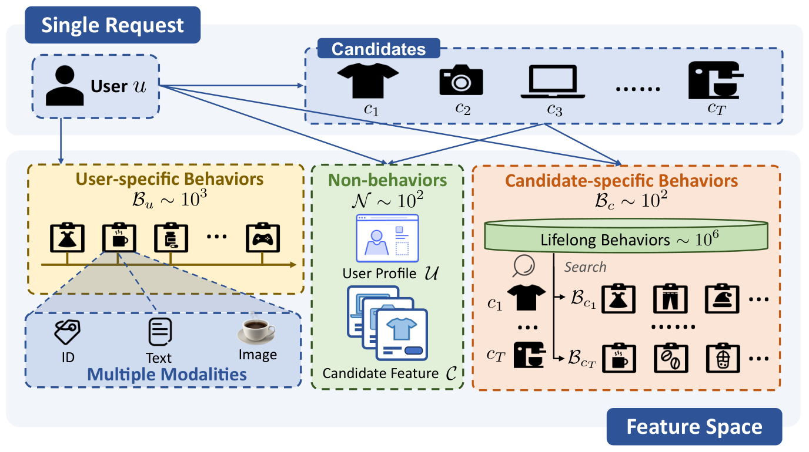
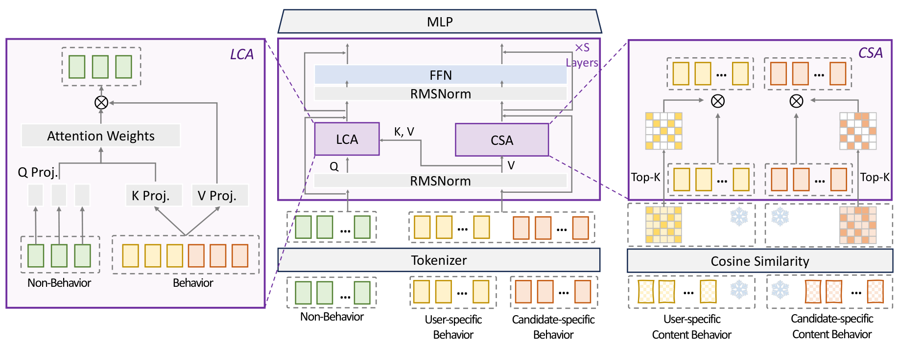

# 统一建模后，CTR也能出scaling📈

各位算法同学们，把用户行为序列压成一个定长向量再喂给模型，这个用了快十年的老套路，可能正是CTR模型扩不动的根因。淘宝这篇把CTR的全部原始输入放进同一条序列，做出了稳定的幂律扩展曲线，线上RPM还涨了3.27%。

📄 EST: Towards Efficient Scaling Laws in Click-Through Rate Prediction via Unified Modeling

🔧 轻量交叉注意力LCA：把非行为特征当query、行为token当context，省掉行为之间开销很大的all-to-all自交互，只算真正有影响的跨特征依赖，省下来的算力都用于扩大模型规模。

🧩 内容稀疏注意力CSA：用内容相似度动态挑选高信号的行为token做稀疏注意力，候选相关行为不再被pooling成定长摘要，细粒度信号保住了。

⚙️ 完全统一建模：非行为、用户行为、候选行为以及ID和图文等模态各走各的tokenizer，然后进入同一序列，不做早期聚合，这是它和部分统一方案的关键差别。

📊 淘宝展示广告线上：RPM +3.27%，CTR +1.22%。

📈 论文报告了稳定且高效的幂律scaling关系，模型规模往上走，收益基本可预测，不是靠调参碰运气。

✅ 相比早期聚合的分层建模，在同等算力预算下扩展收益更明显；稀疏注意力是效率来源，不是精度牺牲点。

总结：做工业推荐、行为序列动辄10^3 token、延迟又卡在毫秒级的团队，这篇的架构取舍可以直接借鉴。要盯两件事：幂律斜率在你们的数据分布上是否还稳得住，以及CSA的top-k在真实QPS下的延迟曲线。坑在于统一序列后长度变长，非行为特征那种高信息密度的先验得重新标定，别原封不动照搬LLM那套dense attention。

原文：[AlphaXiv](https://alphaxiv.org/abs/2602.10811v2)
