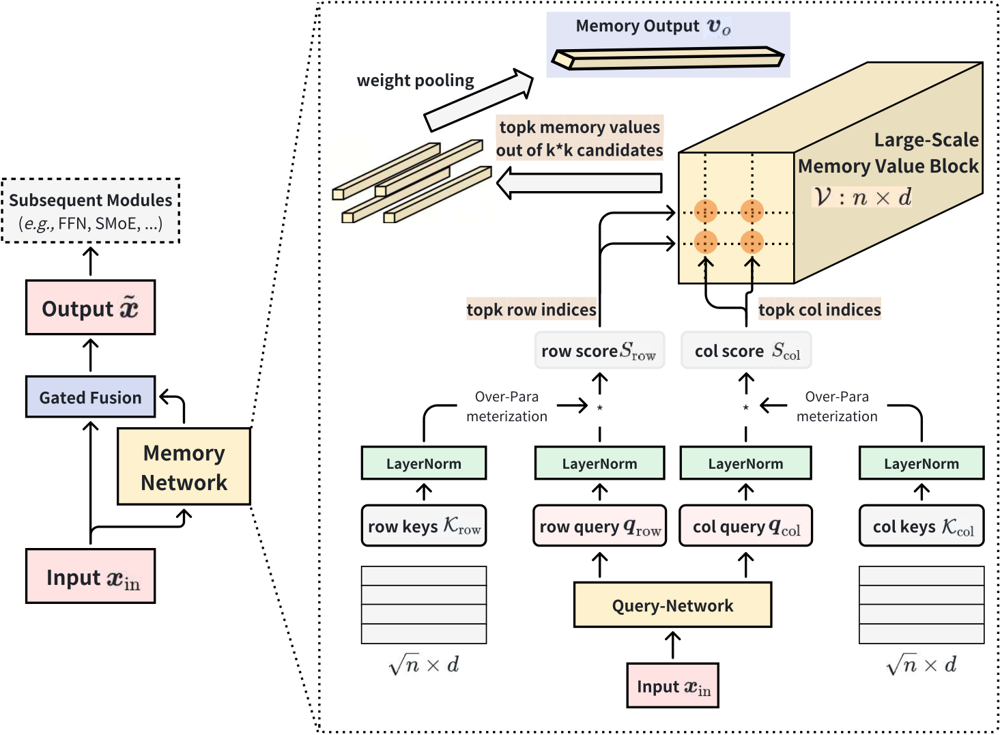
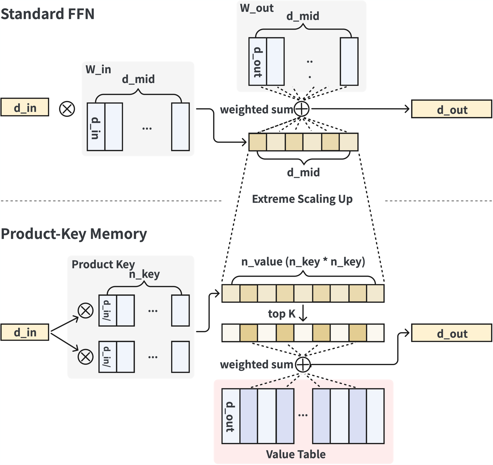

# SMoE 省了算力，坑在带宽上 🔧

各位算法同学们，SMoE 一直说自己省算力，但每个被激活的专家都是一个完整 FFN，访存代价 O(d²)——在带宽吃紧的推理场景里，这个开销往往比算力先成为瓶颈。这篇来自字节搜索和 AML 的工作换了个思路：不激活专家，改为去大参数记忆表里检索个性化表示。

📄 MSN: A Memory-based Sparse Activation Scaling Framework for Large-scale Industrial Recommendation

🔧 核心是用 Product-Key Memory 把记忆索引空间拆成两个 key 子空间，检索复杂度从线性降到次线性，这样记忆表可以继续扩，而计算和访存都压得住。

🧩 检索出来的不是直接拼进特征，而是通过 Memory Gating 当作调制信号去作用在原始特征表示上，再接下游特征交互模块，等于给每个用户做细粒度个性化，而只增加一次轻量查表。

⚙️ 工程侧补了两块：LayerNorm 加 query 和 key 的学习率 warm-up，再对 key embedding 做过参数化，防止记忆槽利用率失衡和检索塌缩；同时写了定制 Sparse-Gather 算子并接入 AirTopK，保证训练和线上推理效率。

📊 访存复杂度这条线：单次激活从 FFN 的 O(d²) 换成了记忆查表，检索复杂度由线性降到次线性。

📈 定位是 model-agnostic 的插件，论文里是直接挂在已有的 SMoE 模型上做增量，离线指标稳定提升，不是换掉整个 backbone。

✅ 已上线抖音搜索排序系统，大规模线上 A/B 相对当前线上 SOTA 模型有显著收益（摘要只写了 significant，具体幅度要去正文实验表里看，别拿二手转述当结论）。

总结：如果你们模型扩参已经卡在 P99 延迟和带宽利用率上，而不是卡在 FLOPs，这套思路是可以直接搬的；盯两个指标，memory 槽的利用率分布和线上长尾请求的延迟，而不是只看 AUC。坑也明显——没有 LN、warm-up 和过参数化，检索很容易塌到少数槽；没有 Sparse-Gather 这类定制算子，原生框架下省下的算力会被访存开销吃回去。

原文：[AlphaXiv](https://alphaxiv.org/abs/2602.07526v2)
