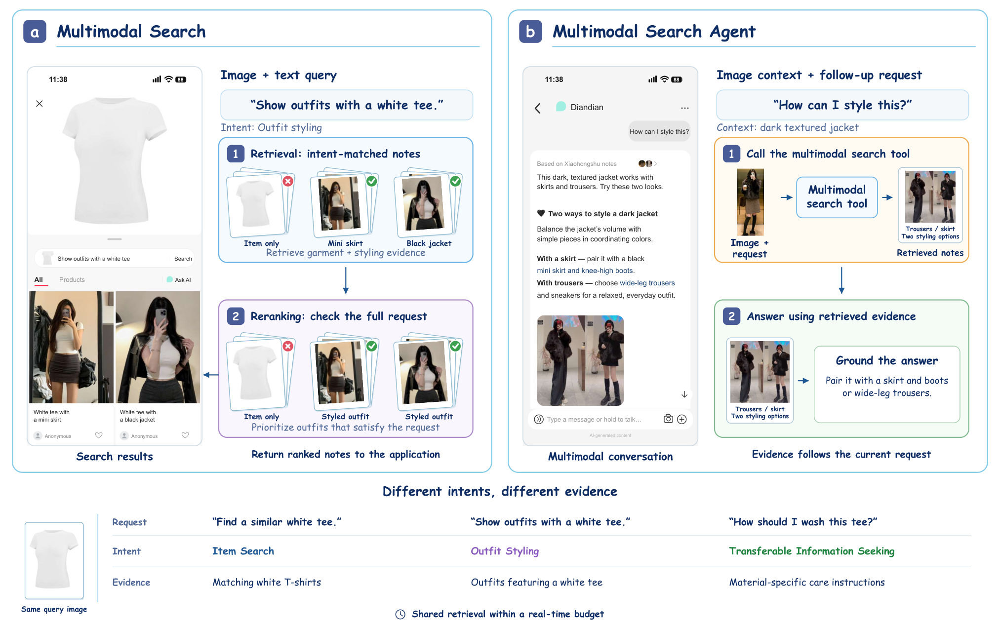

# 同一张白T恤图，意图不同结果全变

各位算法同学们，同一张白T恤图，用户问“找同款”和问“怎么洗”，该出的笔记根本不是一类——但多数多模态检索把它们当同一个query。这篇把“意图”显式建模，还真上了十亿级索引的线上。

📄 IntentFlow: An Intent-Driven Real-Time Multimodal Search System with Image-Text Queries at Xiaohongshu

🔧 意图体系按“检索目标”而不是“物体类别”来分：第一层拆Visual Search（图就是答案）和Information Seeking（还要文字信息），第二层给具体目标，再和query里的target/constraint一起定相关性判据，让召回和重排共用同一套标准。

🧩 离线agentic流程造监督：自动捞候选、补证据、按意图判据核验相关性，产出verified正例和hard负例；embedding这边是意图感知对比学习+分级排序+分布蒸馏三件套拼起来。

⚙️ 精排器不看图文像不像，而是按预测出的一二级意图判断“这条候选有没有给出满足请求的证据”；线上靠query侧特征适配和残差投影迭代，避免全量重编码。

📊 小红书用户级A/B：Top-4 query CTR相对+28.17%，整体query CTR相对+18.96%
📈 人均搜索结果页停留时长相对+12.56%
✅ 端到端P50 1.07s、P90 1.34s，索引规模十亿级

总结：做UGC或电商多模态搜索、以及给多模态agent供检索工具的同学，可以跟这套“意图→判据→数据→召回→重排”对齐的做法。真正要盯的是意图识别准确率和召回阶段意图特定负例的质量，一级意图分错，后面全线偏。坑在于意图体系得先人工梳理，agentic标注链路成本不低，且文档索引不能随便重编码，模型迭代空间被query侧适配约束着。

原文：[AlphaXiv](https://alphaxiv.org/abs/2611.20448v1)
