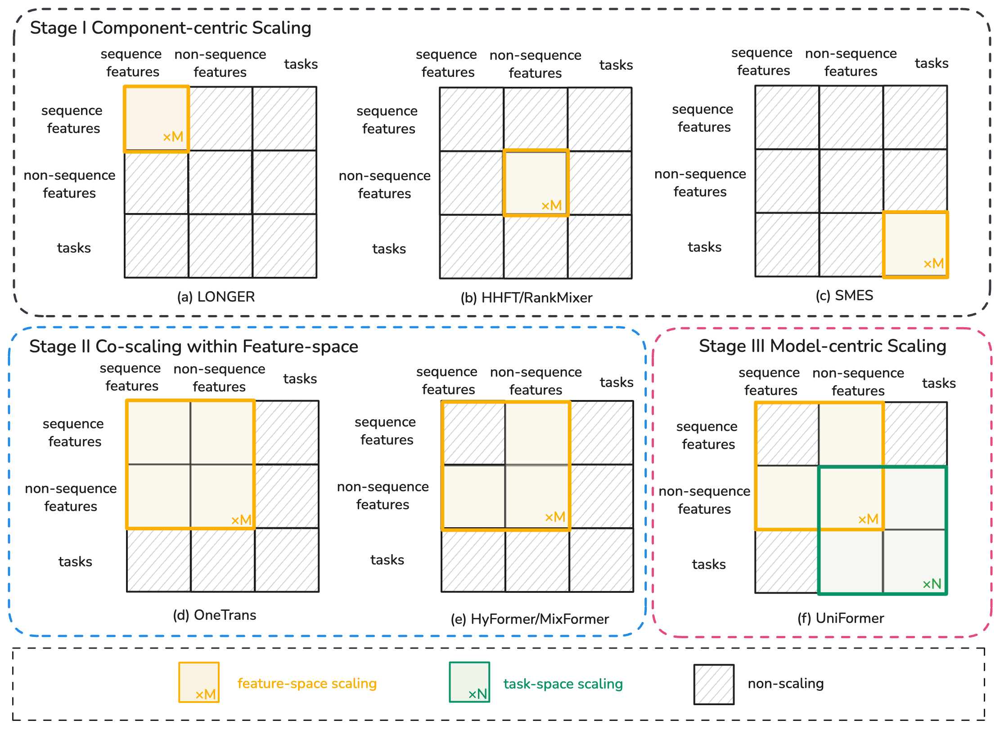
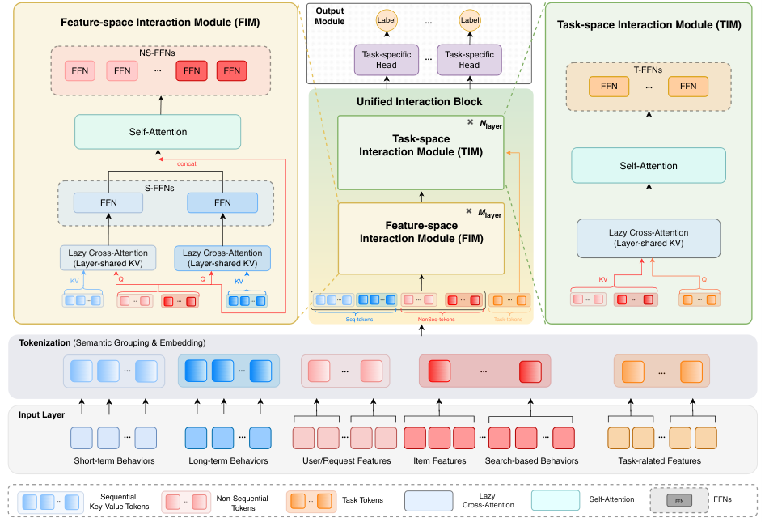

# 推荐模型别再只scale特征了

各位算法同学们，推荐模型这两年都在喊scaling law，但真正被scale的基本只有特征那一侧，任务建模还停在MMoE/PLE那套老架构上。快手这篇UniFormer把特征空间和任务空间放进同一个co-scaling框架，算是把model-centric scaling这件事件补全了一半。

📄 UniFormer: Efficient and Unified Model-Centric Scaling for Industrial Recommendation

🔧 把整体建模空间拆成feature space和task space，分别用堆叠的FIM和TIM建模，两者都走标准Transformer的attention加FFN结构，于是参数量可以在两个空间之间灵活分配，而不是全堆在特征交互里。

🧩 semantic-based tokenization让user和item在推理阶段解耦，不用每次请求都重算用户侧token，实现request-level的推理加速，这是能落地工业场景的关键一手。

⚙️ 多序列cross-attention分别建模异构行为（短期交互、长期压缩兴趣、候选相关序列），再用self-attention做融合，避免一股脑拼接导致的attention collapse；另外给序列、非序列、任务信号各配一套multi-view FFN，参数扩展不被单个模块绑架。

📊 线上A/B覆盖两个场景（快手主站和极速版）：App Stay Time +0.101% / +0.260%，Watch Time +0.729% / +1.113%。

📈 两个场景同向提升，说明不是某个流量池的偶然波动。

✅ 效率上靠省掉intra-sequence交互和序列与任务之间的交互来换容量，本质是“用结构换算力”的取舍。

总结感想：这篇的价值不在单点模块，而在给出一套可复用的拆分方式——特征侧和任务侧分开堆叠、FFN分视图扩展。要跟的话重点看它在你自己的场景里，request-level推理加速能否覆盖多堆几层的开销；如果任务数少、任务侧信号本来就弱，TIM那部分的收益可能没这么明显。另外这是工业A/B指标，0.1%级别的提升建议先对照你自家指标的方差再判断。

原文：[AlphaXiv](https://alphaxiv.org/abs/2606.27058v2)
