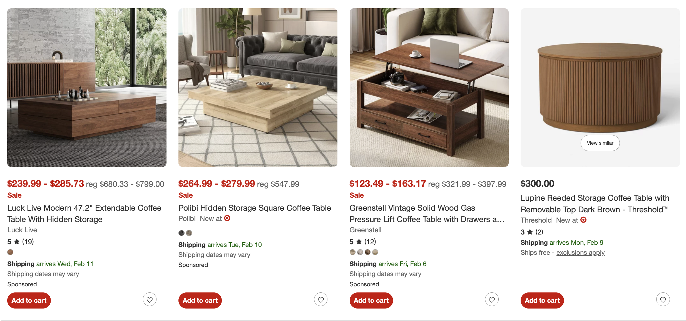
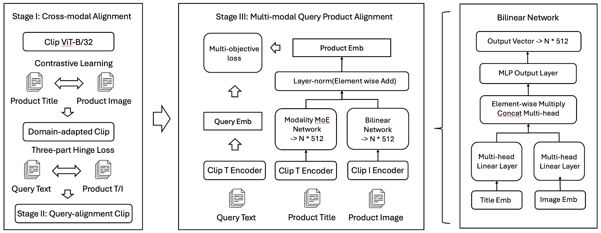

# 电商检索只吃文本？图白扔了 📦

各位算法同学们，先说个反差：电商检索这么多年几乎只读标题文本，商品图基本没参与排序，而这篇把图片接进双塔后，nDCG@1 最高涨了 4.86%。有意思的是，作者并不认为难点在融合结构，而在“让 query 同时对齐文本和图”这件事，这点挺反直觉。

📄 Beyond Text: Text-Image Fusion for Scalable Two-Tower Retrieval

🔧 融合只发生在 item 塔：图片编码器全程离线跑，item embedding 照样提前算好，线上 query 塔仍是单个轻量文本编码器，同一个 ANN 索引直接复用，CPU 服务路径一行不改；这才是它敢上生产的原因。

🧩 模态专家混合 + 双线性交互：门控 MLP 输出自适应权重 α 做加权融合，再用多头双线性项（逐元素相乘后拼接）抓文本与图片的细粒度交叉，残差加 LayerNorm 收尾，结构很轻。

⚙️ 三段式课程训练：先做电商领域微调，再让 query 分别对齐商品标题和商品图，最后才训完整融合模型；损失是多目标的，同时管用户 engagement 和语义相关性。

📊 训练规模 20M query-item 对，800 万商品目录；对比强纯文本基线，desirability 的 nDCG@1 最高 +4.86%，relevance +2.36%。

📈 收益集中在视觉主导类目，比如家居装饰这种靠风格、颜色、细节做判断的品类；标题写得越像关键词堆砌、越缺描述，图文互补的空间就越大。

✅ 线上服务延迟与纯文本方案持平，索引不重建，属于“加模态不加成本”的改法。

我的判断：做电商或内容检索、又被 CPU 双塔成本卡住的团队可以认真看，重点盯视觉主导类目的 nDCG@1，以及高 QPS 下的 P99 延迟有没有被门控和双线性拖慢。坑在训练侧：领域微调和分模态对齐这两步省掉，直接拿现成 CLIP 拼个融合层，大概率拿不到这个数。

原文：[AlphaXiv](https://alphaxiv.org/abs/2603.04836v3)
