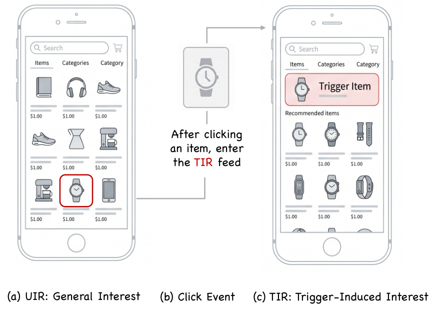
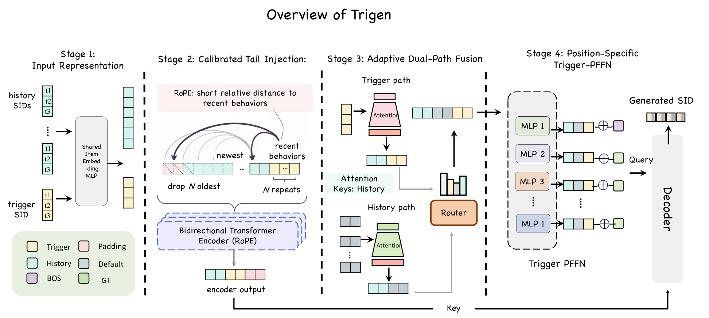

# 点完商品那屏推荐，生成式模型怎么接？

各位算法同学们，生成式推荐最尴尬的地方不是生成得慢，而是你刚点进一个商品、平台马上给你开一屏相关推荐的时候，模型还在按“长期历史平滑续写”，完全没接住那一瞬间的意图。这篇补的正是这个洞：TIR（点击触发的二级推荐）此前基本是判别式打分的天下，生成式范式几乎空白。

📄 TriGen: A Generative Paradigm for Trigger-Induced Recommendation

🔧 校准式尾部注入：把 trigger 的表示重复拼到历史序列尾部，用 RoPE 管相对位置、用重复次数管 trigger 的权重强度，绕开“单个 trigger token 被长历史淹没”这个坑，让它在编码阶段就把局部上下文重写一遍。

🧩 自适应双路融合：历史偏好和即时冲动拆成两条路径，再靠 input-dependent 的 gating 按请求动态分配话语权，避免静态融合方案在“随便逛逛”和“明确换兴趣”之间两头不讨好。

⚙️ 位置相关的 TriggerPFFN：SID 是从粗粒度类目到细粒度属性逐层展开的，只在第一步做条件注入会一路衰减；它把 level-aware 变换塞进 decoder 层里，让 trigger 引导跟着每个解码步的语义粒度变。

📊 离线：工业级电商数据和公开基准上，对序列式、生成式、判别式 TIR 基线都稳定领先。

📈 线上：六个国家市场 A/B，流量加权 Revenue +3.27%、GMV +0.90%。

✅ 已全量上线承接主流量，不是实验室 demo。

总结一下：做生成式推荐、又多入口/点击进二级 feed 的团队，这套“编码—融合—解码”三段式改法可以直接对照自己的 pipeline 找位置。要盯的坑有两个：尾部注入的重复次数是个强先验超参，跨场景迁移前先扫一遍；gating 在稀疏请求上容易抖，得看分国家、分流量层的一致性。另外对比时别拿整体大盘的 +3.27% 当模型净收益，要看 TIR 场景内部的增量，再和判别式 TIR 基线对同一批流量比。

原文：[AlphaXiv](https://alphaxiv.org/abs/2611.16395v1)
