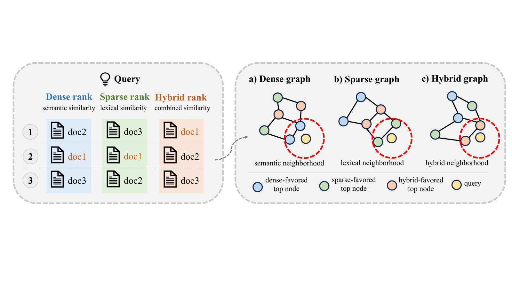

# 混合检索别再建两个索引了🧩

各位算法同学们：混合稠密+稀疏检索现在基本还是“双路召回再重排”，但你想过没有——真正该排第一的 doc，可能在稠密和稀疏两路里都进不了前列，重排时压根没进候选集。蚂蚁这篇 UniGraph 想干的事就是：把多个 α 权重下的邻居合并进一张图，查询时带上 α 直接搜，索引不用重建。

📄 UniGraph: A Unified Graph-based Index for Dynamic Hybrid Dense-Sparse Vector Retrieval

🔧 α-cover 构图：在多个混合权重 α 下分别采样邻居集合，取并集后裁到固定出度 M，用一张有界度的图覆盖多个权重的邻域，切换 α 不需要重建索引，这是全文最关键的一步。

🧩 自适应入口点：根据查询的 α 决定从稀疏侧还是稠密侧引导进入图，让初始化与查询偏好对齐，避免固定入口在极端权重下多绕很多弯路。

⚙️ 稠密优先剪枝：先算稠密距离分量，再结合稀疏向量范数判断这次精确稀疏内积能否跳过，把大量不必要的稀疏距离计算省掉。

📊 五个真实数据集，混合权重设定下，Recall@100 ≥ 0.95 时 QPS 比最快基线高 27.6%~52.3%。

📈 固定权重场景下，QPS 达到最快基线的 1.18×~2.85×。

✅ 已在蚂蚁生产环境规模部署，线上确实存在 query 级动态权重的需求，不是纯实验品。

总结感想：如果你在做 RAG 或搜索的混合召回，而且 α 是随 query 变的，这套“一张图吃多个权重”的思路比双路各取一批再重排少一次检索，工程上值得借鉴。真要落地，先盯两件事：α 分布拉得很开（接近 0 或接近 1）时召回是否明显下降，论文主要报的是混合权重下的平均表现；以及多权重邻域合并后的构建耗时和内存占用。图的度分布会不均匀，这部分成本得先量出来，再决定是替换现有双路管线，还是只当作重排阶段的补充索引。

原文：[AlphaXiv](https://alphaxiv.org/abs/2611.20758v1)
