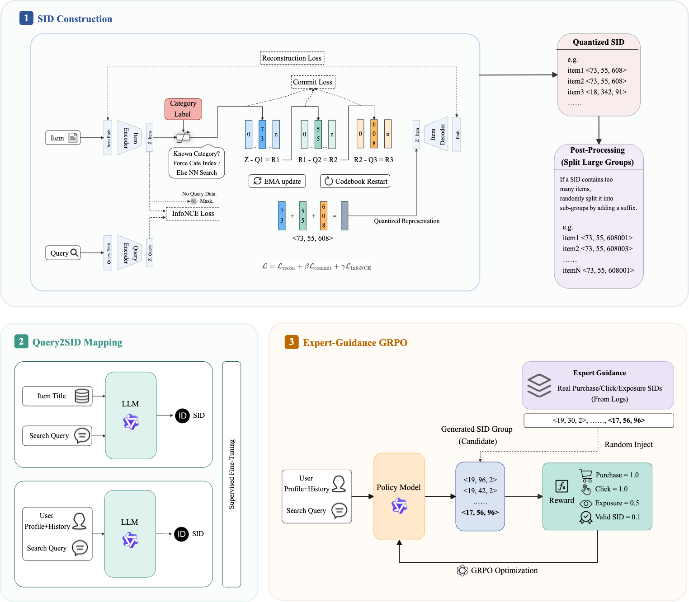

# 一物一ID未必最优，淘宝这样改 🔧

各位算法同学们，一个召回通道能吃掉线上 72.63% 的购买、58.96% 的点击，占总曝光 50.25%——但论文开篇就泼冷水：生成式召回不该端到端替代原来的多阶段漏斗，而是塞进去当召回补充。这篇的看点正是这个“退一步”的工程取舍。

📄 Efficient Generative Retrieval for E-commerce Search with Semantic Cluster IDs and Expert-Guided RL

🔧 CQ-SID 放弃一物一 ID，把 SID 当“语义簇编号”用：RQ-VAE 三级码本 2048×1024×1024，第一级直接拿商品类目 ID 强制约束（1711 个有效类目），二三级走常规最近邻量化，同簇共享前缀、允许有限碰撞但给每簇设上限，beam search 复杂度因此大幅下降。

🧩 训练上加了 query-item 对比学习和分阶段 SFT，从商品标题到 query-item 关联再到用户个性化特征逐步喂进去，backbone 只用 Qwen2.5-0.5B，没堆大模型。

⚙️ EG-GRPO 解决的是稀疏 reward 下 policy gradient 不稳的问题：把 ground-truth 样本注入同一个 group 里做优势归一化，让召回目标与下游排序对齐时不会训崩。

📊 离线 TmallAPP 搜索日志：语义点击 hitrate 相对 RQ-VAE 基线提升 26.76%，个性化点击 hitrate 提升 11.11%，同时 beam size 减半。

📈 线上 A/B：GMV 提升 1.15%，UCTCVR 提升 0.40%。

✅ 该生成式召回通道在生产环境占曝光 50.25%、点击 58.96%、购买 72.63%。

🧠 我的判断：做工业召回、尤其被索引维护和延迟卡住的团队，这套“放粗 SID 粒度换效率”的思路可以拿来对照。但要盯的是簇内上限、beam size 和 hitrate 的联合曲线，只看 hitrate 会误判；和 CAT-ID、Hi-Gen 这类强调 ID 可区分性的工作比，它的差异就在于主动允许碰撞。坑也明显：第一级码本绑死类目体系，类目本身乱的话，后面全歪。

原文：[AlphaXiv](https://alphaxiv.org/abs/2605.14434v2)
