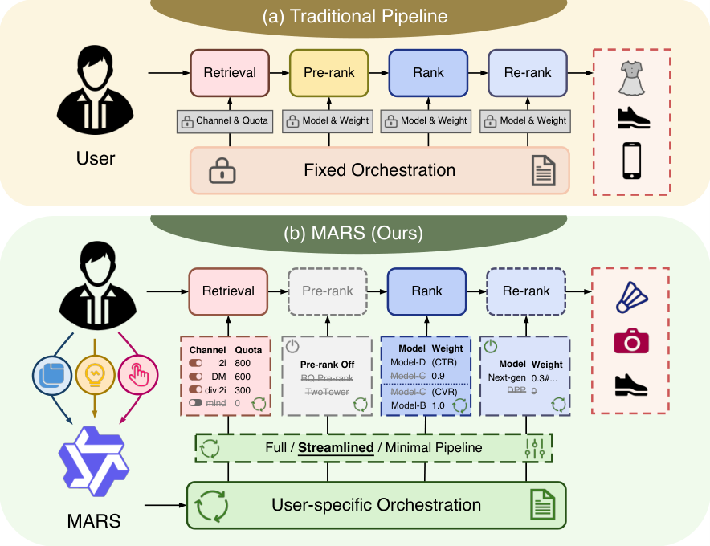
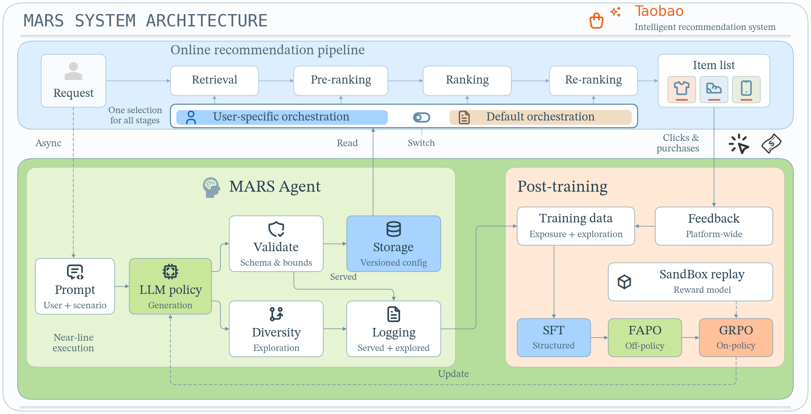

# 0.6B小模型接管推荐全链路调度🤖

各位算法同学们，淘宝这次线上A/B里最猛的一条增益，不是换了个更大的排序模型，而是把「开哪几路召回、每路留多少配额、用哪个CTR/CVR模型、分数怎么融合」这些原本由工程师拍板、全场景共用的配置，改成按用户单独生成。这篇技术报告讲的就是这套编排智能体怎么在不碰线上延迟的前提下跑起来。

📄 MARS Technical Report

🔧 决策单元被换掉了：不再调单阶段模型，而是让一个微调过的Qwen3-0.6B输出七维结构化动作——pipeline模式、召回通道子集与各通道配额、CTR/CVR模型选择、各级融合权重、reranker设置，全部落在受限动作空间内；生成走近线异步，校验后原子写入版本化缓存，在线级联读缓存，从不等待LLM推理。

🧩 三段式后训练各解一个问题：置信度感知SFT把schema合法率从1.0%拉到99.8%，同时用Wilson筛选的执行证据对齐推荐效率；FAPO用ActionMask只在动作值不同的位置上做偏好比较，按后验访问-购买率加权，避免格式token把训练信号摊薄；GRPO靠Sandbox快照回放加冻结奖励模型做on-policy精修，探索性配置不暴露给真实用户。

⚙️ 安全壳做得比模型本身更细：生成侧和消费侧各做一遍schema、模型名、配额与权重合法性检查，更新失败保留上一版有效缓存，无缓存或读取超时就回退现网配置，另有总开关一键回滚全量流量。

📊 五个淘宝营销场景、两周A/B、日活超千万，各场景关键指标点估计均为正。

📈 最大增益 +5.22% V2P、+7.34% GMV，两个点击面的CTR点估计也都为正。

✅ 约20%请求被路由到Minimal轻量模式，评估部署下线上服务路径平均延迟比生产基线低12ms。

我的判断：做多阶段级联、编排还停留在人工调参的团队可以认真看架构那几节，尤其是缓存+回退+kill switch这套，比分数更可复用。要盯的指标是回退率、缓存命中率和延迟分布，而不是只看GMV；和GreenFlow、MaRCA那类在固定结构内分算力的工作比，MARS动的是结构本身，代价是奖励模型与Sandbox的保真度直接决定上限，而且探索永远不进线上，信号来源天然受限——这两点是落地时最容易踩的坑。

原文：[AlphaXiv](https://alphaxiv.org/abs/2611.24006v1)
