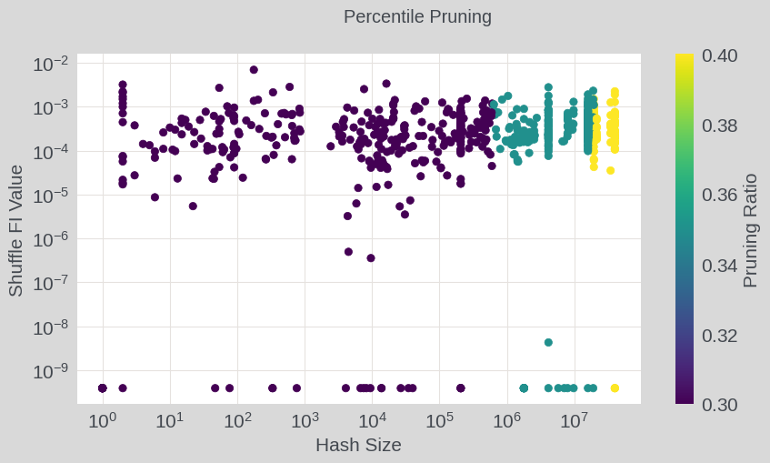

# 剪枝比例别按表大小，看特征重要性 🔧

各位算法同学们，112 张 GPU 的训练作业砍到 80 张，单卡 P90 吞吐反而高了 8%。靠的不是换硬件，是给 embedding 剪枝换了一套定比例的方法。这篇 Meta 的工作把特征重要性塞进了 in-training pruning，内存省下去，NE 却没掉。

📄 Intelligent Embedding Pruning for Large-Scale Recommendation Models

🔧 原版 ITEP（AdaEmbed）按表大小定剪枝比例：大表剪得最狠，小表只轻轻剪，完全不看这个特征对 loss 有没有贡献，所以精度偶尔会掉一截。

🧩 FI-ITEP 改用特征重要性打分：permutation shuffle 或 Shapley Value Sampling 在 batch 内扰动某个特征、看 loss 变化多少，分低的表给更高剪枝比例，比例从“按尺寸分档”变成“按分数线性插值”。

⚙️ FI 只算一次，采样固定在每 batch 4096 条、每天 256 个 batch，1–2 GB 数据，跟模型规模无关，所以模型越大，这笔开销摊得越薄。

📊 三个工业级 DLRM（80GB、390GB、1.1TB）：同等激进度下总内存降 20–40%，相对 percentile 基线多省 8.3%–14.2%。

📈 NE 方面：390GB 模型 eval NE 回退 1.4%（基线 2.2%），1.1TB 模型 eval NE 改善 -0.059%（基线 -0.039%），小模型回退也小（0.017% vs 0.025%）。

✅ 开源 DLRM + Criteo 1TB 复现：50% 内存削减下 AUROC 0.6395 vs 0.6176（+0.0218）；80% 削减、1000 batch 时训练快 29%，percentile 只有 14%。

✅ FI 本身开销 4.3%–11%，但按 launch 算省下 1000+ GPU-hours；FI 分数一个月内 top-100 的 Spearman 相关 0.85–0.92，漂移不算问题。

⚠️ 我的判断：embedding 撑爆 HBM、又高频重训的大模型最划算；小模型省下的 trainer 时间可能盖不住 FI 那笔固定成本，这种情况继续用 size-based 剪枝就行。真要跟，盯 eval NE 的相对变化（0.02% 就算显著）、单卡吞吐、FI 占总训练时间比例这三项，基线就选 percentile ITEP。坑在于 SVS 那套调起来更敏感，论文里 Models 2/3 都退回了 shuffle；另外实际要调的是“低重要性表的最小尺寸下限”，别只盯总剪枝率。

原文：[AlphaXiv](https://alphaxiv.org/abs/2611.25288v1)
