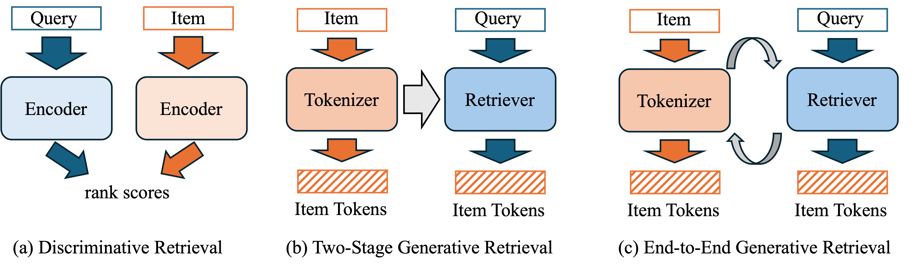
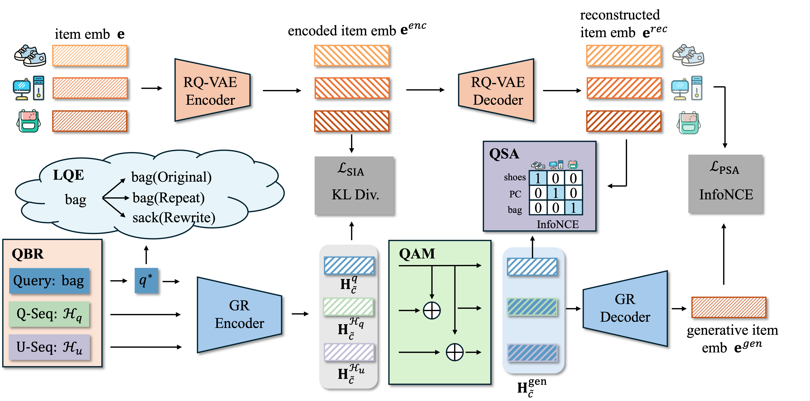

# 生成式检索别把query只当输入🔍

各位算法同学们，端到端生成检索有个大家都清楚、却很少有人正面写出来的问题：query在模型里基本只算一个输入特征，既不参与SID的学习，也不参与解码引导，于是生成的语义ID容易漂向高频token模式，跟你这次搜的意图对不上。这篇就在四个阶段把query重新当成主角来强调。

📄 IntentGR: Enhancing Intent for End-to-End Personalized Generative Retrieval in Search

🔧 QBR：把同一query下更早的历史行为单独拼成一条query级行为序列，作为新的输入信号，跟用户长期偏好一起放进同一个encoder，让模型自己去找和当前query相关的历史兴趣。

🧩 QSA：在tokenizer和生成器联合优化时加一个共享的query-item语义目标，让生成端的query表示去对齐tokenizer重建出的目标item表示，而不是各自只围着item重建和SID预测转。

⚙️ LQE 和 QAM：前者对长尾query做增广，提高出现次数和语义多样性，缓解头部query主导训练分布；后者在解码阶段用query语义调制attention上下文，让解码器生成SID时更受query引导。

📊 在公开基准AOL4PS上，Recall@10相对最强baseline提升8.11%；在阿里国际的工业级电商数据集AE上提升11.96%。

📈 长尾query上的增益比整体更明显，说明LQE这部分确实在起作用。

✅ 四个机制是互补的，从输入表示、联合优化、训练分布到解码上下文各管一段，少一段效果都会下降。

总结感想：做搜索侧生成式检索、手上有query级行为日志的团队，这套结构可以借鉴。要盯的指标很明确：整体Recall@10和长尾query分桶后的Recall@10一起看，同时监控生成SID的频次分布有没有继续向头部集中。容易出问题的地方在数据侧：QBR依赖同一query下的历史行为，长尾和冷启动query本来就稀疏，LQE的增广质量直接决定上限；另外对比基线是ETEGRec这类推荐向端到端方法和ASI++这类只把query当对齐信号的检索方法，跟它们比才有意义。

原文：[AlphaXiv](https://alphaxiv.org/abs/2611.22788v1)
