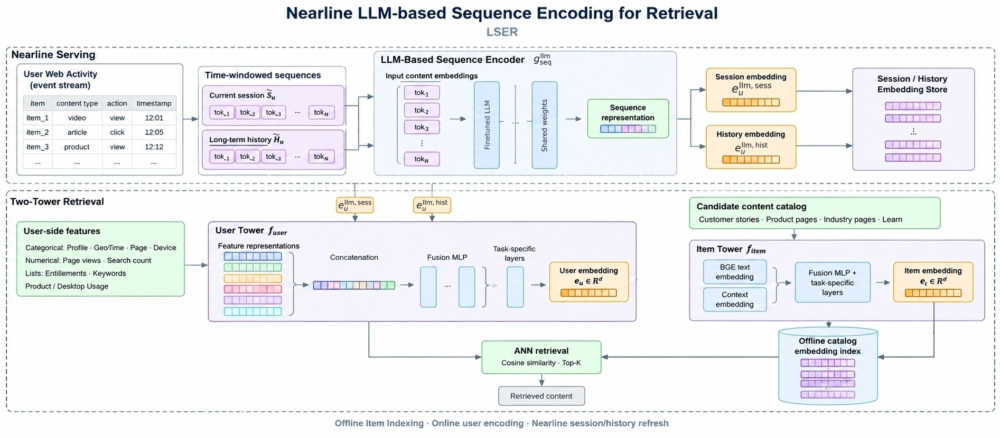
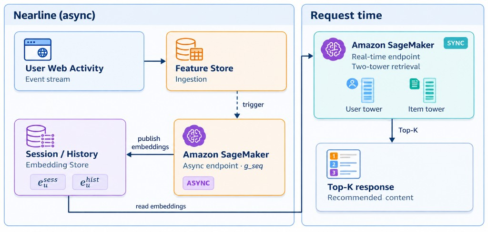

# 召回塞LLM向量，坑不在模型

各位算法同学们，召回用户塔里加入一路 LLM 向量，真正麻烦的地方不在模型，而在这路向量上线后怎么保持新鲜。这篇 Autodesk 的工业论文把后半段讲得比较细，涨点反而没有多讲。

📄 From Sessions to Serving: Integrating LLM-Based Embeddings into Retrieval for Production Content Recommendation

🔧 它没有替换原有序列编码器，而是在召回用户塔里拼接一路 LLM 产出的 session 级和历史级向量，作为辅助特征做增量，原链路不动，工程风险可控。

🧩 用户行为被切成两段：当前 session 的短期意图，加上更早多天窗口的历史行为；点击和 learn 两个通道还各自物化成平行序列字段，实现上是四条 item-id 列表，分别过滤后再在塔内融合。

⚙️ 真正的工程量在近线：异步刷新序列向量和 LLM 向量并写进 embedding store，主推荐服务请求时直接读取，不阻塞在线路径。

📊 消融实验在它们全量多内容类型目录上做，覆盖 customer stories、product pages、industry pages、learning content，验证的是 LLM 特征在原有序列编码器之上的增量。

📈 线上在多个投放面跑了 A/B，engagement 和下游转化都有改善。

✅ 但摘要只给了“有改善”的定性说法，具体涨幅没披露，看的时候重点盯它消融的对照组是怎么设的。

总结感想：做多内容类型 marketplace、召回侧序列特征已经调到瓶颈、想试语义向量的团队，看这篇比看纯模型论文有用。要盯两件事：LLM 向量相对序列编码器的增量是否稳定，以及近线刷新的延迟和向量过期率。别指望它替换双塔，它是加法，不是替换。

原文：[AlphaXiv](https://alphaxiv.org/abs/2611.26096v1)
