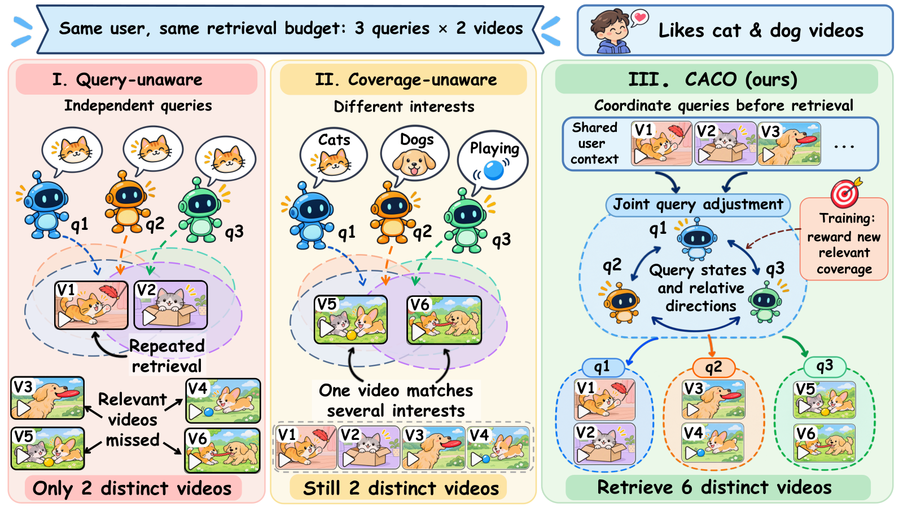
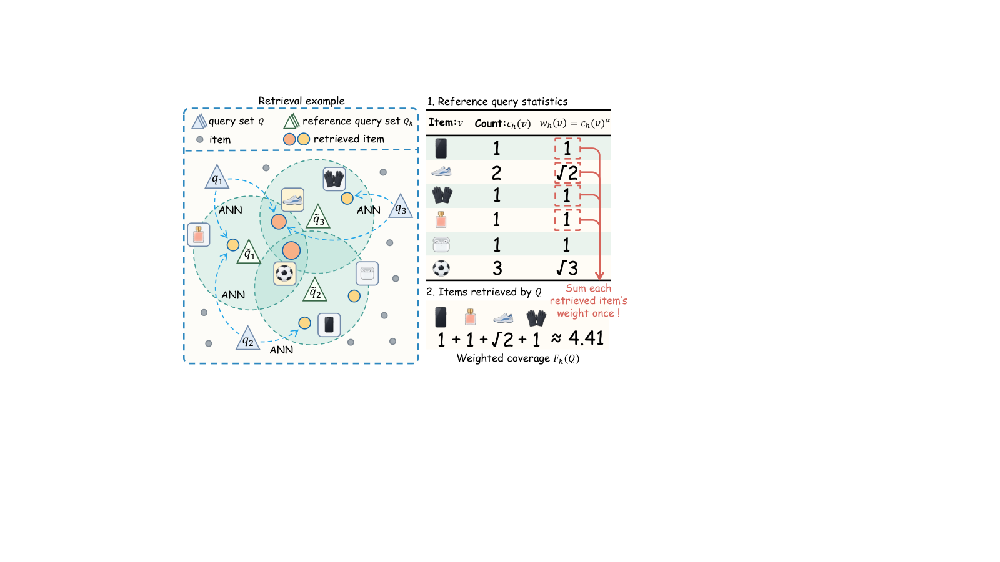

# 召回预算不变，重复率砍掉一半🎯

各位算法同学们，同一个用户、3 条 query、每条取 2 个视频，6 个坑位最后只回来 2 个不重复的视频——问题不在模型不 genergy，而在几条 query 互相不知道对方捞走了什么。这篇就盯着这个被忽略的「集合级检索几何」做文章。

📄 CACO: Coverage-Aware Coordinated Optimization for Continuous Generative Retrieval

🔧 把从冻结底座采样出的参考 query 的经验召回频次当作相关性代理，构造无标签的集合覆盖目标：同一个 item 只计一次权重，召回重复项增益直接为零，不用 ground truth 也能选 query。

🧩 为了不在推理时生成大 query 池，用一个协调调整网络，把 inter-query 双向注意力和门控相对方向拼起来，最后在切空间做有界投影加球面 retraction 更新 query，数量、深度、底座全不动。

⚙️ 训练靠切向对偶扰动加反事实单 query 替换来量每条 query 的边际增益，绕过 top-K 不可导，拿到平滑集合覆盖的无偏梯度估计。

📊 8 个公开 benchmark 加一个自建 24 分区流式工业数据集，跨 6 个冻结的 flow matching 与扩散 backbone。

📈 相对最强 baseline，Recall@100 最高 +23.7%，Recall@400 最高 +23.9%。

✅ query 间重叠下降 53.3%–64.9%，额外推理延迟只有 0.5%–3.0%。

📈 离线贪心选择实验里，30 个 backbone–dataset 组合的召回全部提升。

总结感想：这套后训练只适合已经在用 flow matching 或扩散做生成式召回、并且确实是多 query 并行取数的团队，单 query 场景没什么收益。上线前要盯的是固定 L×K 下的重叠率和 Recall@100，而非 query 分布多样性指标。坑有两个：覆盖目标的权重来自参考 query 的召回频次，参考池采样分布和线上分布一偏，权重就跟着偏；另外它只动 query 不动底座，底座本身召不回来的 item 它救不了。

原文：[AlphaXiv](https://alphaxiv.org/abs/2611.25738v1)
